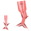
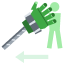

---
tags:
  - techniques
  - abilities
  - compare
---

# All techniques

Every technique of the 10 races in one table: **click a column** to sort it, **type in the box** to keep only the rows that match. Values are those of each race's page: damage is what the target really loses, for a body of size 1, except the Tontatta and the Lunarians, at their own size. A suit's techniques, listed in short on the Modified Humans page, have the values of their tooltip in game. A technique with an Alt mode shows each mode's value, separated by `/`.

<input class="table-filter" type="search" placeholder="Filter by technique, race or type" aria-label="Filter the techniques">

| Technique | Race | Type | Cost | Cooldown | Charge | Hold | Damage | Range |
|---|---|---|---|---|---|---|---|---|
| { .ability-mini }[Skypiean Body](sky-people.md#skypiean-body) | [Sky People](sky-people.md) | Passive | given with the race |  |  |  |  |  |
| { .ability-mini }[Birkan Body](sky-people.md#birkan-body) | [Sky People](sky-people.md) | Passive | given with the race |  |  |  |  |  |
| { .ability-mini }[Shandia Body](sky-people.md#shandia-body) | [Sky People](sky-people.md) | Passive | given with the race |  |  |  |  |  |
| { .ability-mini }[Wingless Body](sky-people.md#wingless-body) | [Sky People](sky-people.md) | Passive | given with the race |  |  |  |  |  |
| { .ability-mini }[Axe Slash](sky-people.md#axe-slash) | [Sky People](sky-people.md) | Active | 500 Doriki, 2 technology points | 8 s |  |  | 8 | 24 blocks (line) |
| { .ability-mini }[Impact](sky-people.md#impact) | [Sky People](sky-people.md) | Active | 800 Doriki, 3 martial arts points | 8 s |  |  | 8, plus half of each blow caught (up to 24 more; 48 for a giant-sized body) | 4 blocks around |
| { .ability-mini }[Sky Leap](sky-people.md#sky-leap) | [Sky People](sky-people.md) | Active | 1,250 Doriki, 5 martial arts points | 1 / 6 s |  |  |  |  |
| { .ability-mini }[Breath Gale](sky-people.md#breath-gale) | [Sky People](sky-people.md) | Active | 3,000 Doriki, 5 technology points | 7 s |  |  | 4 | 8 blocks, a cone 70 degrees wide |
| { .ability-mini }[Dial Blend](sky-people.md#dial-blend) | [Sky People](sky-people.md) | Active | 5,000 Doriki, 10 technology points | 10 s / 10 s |  |  | 8 to every enemy around / 12 to the first enemy in sight | 4 blocks around / 20 blocks |
| { .ability-mini }[Mantra Mark](sky-people.md#mantra-mark) | [Sky People](sky-people.md) | Active | 3,000 Doriki, 5 martial arts points | 20 s |  |  |  | 30 blocks |
| { .ability-mini }[Divine Stride](sky-people.md#divine-stride) | [Sky People](sky-people.md) | Active | 5,000 Doriki, 10 martial arts points | 10 s |  |  | 12 | 12 blocks (line) |
| { .ability-mini }[War Cry](sky-people.md#war-cry) | [Sky People](sky-people.md) | Active | 3,000 Doriki, 5 martial arts points | 30 s |  |  |  | 10 blocks around |
| { .ability-mini }[Berserker](sky-people.md#berserker) | [Sky People](sky-people.md) | Active | 5,000 Doriki, 10 martial arts points | 30 s, once it ends |  | 8 s | +4 |  |
| { .ability-mini }[Fishman Body](fishmen.md#fishman-body) | [Fishmen](fishmen.md) | Passive | given with the race |  |  |  |  |  |
| { .ability-mini }[Saw-shark Body](fishmen.md#saw-shark-body) | [Fishmen](fishmen.md) | Passive | given with the race |  |  |  | +3 |  |
| { .ability-mini }[Ray Body](fishmen.md#ray-body) | [Fishmen](fishmen.md) | Passive | given with the race |  |  |  | +2, with an empty main hand |  |
| { .ability-mini }[Garfish Body](fishmen.md#garfish-body) | [Fishmen](fishmen.md) | Passive | given with the race |  |  |  |  |  |
| { .ability-mini }[Human Will](humans.md#human-will) | [Humans](humans.md) | Passive | given with the race |  |  |  |  |  |
| { .ability-mini }[Pride of Elbaf](giants.md#elbaf-pride) | [Giants](giants.md) | Passive | given with the race |  |  |  | +25 % |  |
| { .ability-mini }[Shoulder Carry](giants.md#shoulder-carry) | [Giants](giants.md) | Passive | given with the race |  |  |  |  |  |
| { .ability-mini }[Wotan Body](giants.md#wotan-body) | [Giants](giants.md) | Passive | given with the race |  |  |  |  |  |
| { .ability-mini }[Ancient Blood](giants.md#ancient-blood) | [Giants](giants.md) | Passive | given with the race |  |  |  |  |  |
| { .ability-mini }[Stomp](giants.md#stomp) | [Giants](giants.md) | Active | 500 Doriki, 2 martial arts points | 10 s |  |  | 4 | 4 blocks around |
| { .ability-mini }[Giant's Grip](giants.md#giants-grip) | [Giants](giants.md) | Active | 1,500 Doriki, 3 martial arts points | 15 s |  | up to 5 s | 10, when the thrown body slams into something |  |
| { .ability-mini }[Boulder Throw](giants.md#boulder-throw) | [Giants](giants.md) | Active | 2,500 Doriki, 4 martial arts points | 12 s |  | up to 5 s | 14, to enemies around where it bursts | 3 blocks around the burst |
| { .ability-mini }[Hakoku](giants.md#hakoku) | [Giants](giants.md) | Active | 4,000 Doriki, 6 martial arts points | 15 s |  |  | 20 | 32 blocks (line) |
| { .ability-mini }[Elbaf Charge](giants.md#elbaf-charge) | [Giants](giants.md) | Active | 1,000 Doriki, 2 martial arts points | 12 s, at size 4 |  |  | 8 | 16 blocks in 0.8 s at size 4 (a man's body would run 8) |
| { .ability-mini }[Roar of Elbaf](giants.md#elbaf-roar) | [Giants](giants.md) | Active | 5,000 Doriki, 8 martial arts points | 30 s, at size 4 |  |  |  | 6 blocks around for a man, 12 at size 4 |
| { .ability-mini }[Continent Puller](giants.md#continent-puller) | [Giants](giants.md) | Active | 4,000 Doriki, 6 martial arts points | 14 s |  |  | 24, the strongest giant technique | 12 blocks (a wide line) |
| { .ability-mini }[Oni Blood](oni.md#oni-blood) | [Oni](oni.md) | Passive | given with the race |  |  |  | +20 % |  |
| { .ability-mini }[Guard Breaker](oni.md#guard-breaker) | [Oni](oni.md) | Active | 500 Doriki, 2 martial arts points | 12 s |  |  | 10 |  |
| { .ability-mini }[Horn Toss](oni.md#horn-toss) | [Oni](oni.md) | Active | 1,000 Doriki, 2 martial arts points | 10 s |  |  | 8 | 2 blocks (line) |
| { .ability-mini }[Shock Fist](oni.md#shock-fist) | [Oni](oni.md) | Active | 1,500 Doriki, 3 martial arts points | 9 s |  |  | 7 | 10 blocks (line) |
| { .ability-mini }[Demon Skin](oni.md#demon-skin) | [Oni](oni.md) | Active | 2,000 Doriki, 3 martial arts points | 30 s, from the end |  | 6 s | -30 % |  |
| { .ability-mini }[Demon Leap](oni.md#demon-leap) | [Oni](oni.md) | Active | 3,000 Doriki, 5 martial arts points | 16 s, from the landing |  |  | 12 to the one landed on, 6 to the others in the wave | 20 blocks (line to the target), wave 5 blocks around |
| { .ability-mini }[Demon Sweep](oni.md#demon-sweep) | [Oni](oni.md) | Active | 2,000 Doriki, 3 martial arts points | 12 s |  |  | 9, x1.2 with a blunt weapon | 3 blocks around |
| { .ability-mini }[Demon Quake](oni.md#demon-quake) | [Oni](oni.md) | Active | 4,000 Doriki, 6 martial arts points | 16 s |  |  | 8 | 4 blocks around |
| { .ability-mini }[Tontatta Strength](tontatta.md#tontatta-strength) | [Tontatta](tontatta.md) | Passive | given with the race |  |  |  |  |  |
| { .ability-mini }[Tonta Uppercut](tontatta.md#tonta-uppercut) | [Tontatta](tontatta.md) | Active | 500 Doriki, 2 martial arts points | 8 s |  |  | 10 | about 1.5 blocks (line) |
| { .ability-mini }[Underfoot Dash](tontatta.md#underfoot-dash) | [Tontatta](tontatta.md) | Active | 1,000 Doriki, 2 martial arts points | 5 s |  |  | 5, to each body passed |  |
| { .ability-mini }[Tail Hammer](tontatta.md#tail-hammer) | [Tontatta](tontatta.md) | Active | 3,000 Doriki, 5 martial arts points | 14 s |  |  | 14 | about 8 blocks (line to the target) |
| { .ability-mini }[Tonta Barrage](tontatta.md#tonta-barrage) | [Tontatta](tontatta.md) | Active | 2,000 Doriki, 3 martial arts points | 12 s |  |  | 1.25 a blow, 15 in all | about 1.5 blocks (line) |
| { .ability-mini }[Head Climb](tontatta.md#head-climb) | [Tontatta](tontatta.md) | Active | 5,000 Doriki, 8 martial arts points | 18 s |  |  | 18 | about 1.5 blocks (line) |
| { .ability-mini }[Tonta Whirl](tontatta.md#tonta-whirl) | [Tontatta](tontatta.md) | Active | 2,000 Doriki, 3 martial arts points | 20 s |  |  | 4 blows of 1 |  |
| { .ability-mini }[Ant Burden](tontatta.md#ant-burden) | [Tontatta](tontatta.md) | Active | 3,000 Doriki, 5 martial arts points | 16 s |  |  | 8, on landing |  |
| { .ability-mini }[Lunarian Blood](lunarians.md#lunarian-blood) | [Lunarians](lunarians.md) | Passive | given with the race |  |  |  | -50 % |  |
| { .ability-mini }[Black Wings](lunarians.md#black-wings) | [Lunarians](lunarians.md) | Active | given with the race | 15 s, from the end of the flight |  |  |  |  |
| { .ability-mini }[Flame Switch](lunarians.md#flame-switch) | [Lunarians](lunarians.md) | Active | given with the race | 10 s |  |  |  |  |
| { .ability-mini }[Flame Blast](lunarians.md#flame-blast) | [Lunarians](lunarians.md) | Active | 500 Doriki, 2 martial arts points | 10 s |  |  | 12, and 3 s of burning | 8 blocks (line) |
| { .ability-mini }[Flaming Blow](lunarians.md#flaming-blow) | [Lunarians](lunarians.md) | Active | 1,000 Doriki, 2 martial arts points | 8 s |  |  | 14, and 3 s of burning | 3 blocks (line) |
| { .ability-mini }[Flame Shroud](lunarians.md#flame-shroud) | [Lunarians](lunarians.md) | Active | 3,000 Doriki, 5 martial arts points | 25 s, from the end |  | 5 s | 3 a second | 4 blocks around |
| { .ability-mini }[Wing Gust](lunarians.md#wing-gust) | [Lunarians](lunarians.md) | Active | 1,500 Doriki, 3 martial arts points | 11 s |  |  | 4 | 6 blocks ahead |
| { .ability-mini }[Flameless Rush](lunarians.md#flameless-rush) | [Lunarians](lunarians.md) | Active | 2,000 Doriki, 3 martial arts points | 7 s |  |  | 10 | 8 blocks (line) |
| { .ability-mini }[Buccaneer Blood](buccaneers.md#buccaneer-blood) | [Buccaneers](buccaneers.md) | Passive | given with the race | 300 s |  |  |  |  |
| { .ability-mini }[Living Wall](buccaneers.md#living-wall) | [Buccaneers](buccaneers.md) | Active | 1,500 Doriki, 3 martial arts points | 20 s |  | 5 s | -50 % |  |
| { .ability-mini }[Crushing Hold](buccaneers.md#crushing-hold) | [Buccaneers](buccaneers.md) | Active | 3,000 Doriki, 5 martial arts points | 18 s |  | 4 s | 3 at once, then 3 each second |  |
| { .ability-mini }[Buccaneer Charge](buccaneers.md#buccaneer-charge) | [Buccaneers](buccaneers.md) | Active | 500 Doriki, 2 martial arts points | 10 s / 8 s |  |  | 7 / 10 | 6 blocks (line) / in front |
| { .ability-mini }[Ground Breaker](buccaneers.md#ground-breaker) | [Buccaneers](buccaneers.md) | Active | 2,000 Doriki, 3 martial arts points | 18 s | 1 s |  | 12 | 5 blocks around |
| { .ability-mini }[Rock Hurl](buccaneers.md#rock-hurl) | [Buccaneers](buccaneers.md) | Active | 3,500 Doriki, 5 martial arts points | 12 s |  |  | 9 | 2.5 blocks around |
| { .ability-mini }[Answering Fist](buccaneers.md#answering-fist) | [Buccaneers](buccaneers.md) | Active | 5,000 Doriki, 8 martial arts points | 15 s |  |  | 10, up to 20 |  |
| { .ability-mini }[Merfolk Body](merfolk.md#merfolk-body) | [Merfolk](merfolk.md) | Passive | given with the race |  |  |  |  |  |
| { .ability-mini }[Swift Tail](merfolk.md#swift-tail) | [Merfolk](merfolk.md) | Passive | given with the race |  |  |  |  |  |
| { .ability-mini }[Great Body](merfolk.md#great-body) | [Merfolk](merfolk.md) | Passive | given with the race |  |  |  |  |  |
| { .ability-mini }[Undertow](merfolk.md#undertow) | [Merfolk](merfolk.md) | Active | 500 Doriki, 2 martial arts points | 8 s |  |  | 6 | 8 blocks, 12 in the water |
| { .ability-mini }[Tail Sweep](merfolk.md#tail-sweep) | [Merfolk](merfolk.md) | Active | 1,000 Doriki, 2 martial arts points | 12 s / 10 s |  |  | 10 on land, 18 in the water / 10 on landing | 3.5 blocks around / a bound of 8 blocks, 12 leaping from the water |
| { .ability-mini }[Siren Song](merfolk.md#siren-song) | [Merfolk](merfolk.md) | Active | 3,000 Doriki, 5 martial arts points | 30 s |  | 5 s |  | 8 blocks around |
| { .ability-mini }[Sea Escort](merfolk.md#sea-escort) | [Merfolk](merfolk.md) | Active | 1,500 Doriki, 3 martial arts points | 25 s |  | 30 s |  | 6 blocks around |
| { .ability-mini }[Princely Fist](merfolk.md#princely-fist) | [Merfolk](merfolk.md) | Active | 2,000 Doriki, 3 martial arts points | 11 s |  |  | 12 |  |
| { .ability-mini }[Trident Assault](merfolk.md#trident-assault) | [Merfolk](merfolk.md) | Active | 3,500 Doriki, 5 martial arts points | 12 s / 12 s |  |  | 10, 15 with a trident in hand / 14, 21 with a trident in hand | up to 30 blocks / 6 blocks (line) |
| { .ability-mini }[Modified Body](modified-humans.md#modified-body) | [Modified Humans](modified-humans.md) | Passive | given with the race |  |  |  |  |  |
| { .ability-mini }[Raid Suit](modified-humans.md#raid-suit) | [Modified Humans](modified-humans.md) | Passive | given with the race |  |  |  |  |  |
| { .ability-mini }[Unsociable](modified-humans.md#unsociable) | [Modified Humans](modified-humans.md) | Passive | given with the race |  |  |  |  |  |
| { .ability-mini }[Germa Boots](modified-humans.md#germa-boots) | [Modified Humans: every suit](modified-humans.md) | Active | with the suit | 6 s |  | up to 8 s |  |  |
| { .ability-mini }[Cape Shield](modified-humans.md#cape-shield) | [Modified Humans: every suit](modified-humans.md) | Active | with the suit | 12 s |  | 3 s |  |  |
| { .ability-mini }[Pink Hornet](modified-humans.md#poison-pink) | [Modified Humans: Poison Pink](modified-humans.md) | Active | with the suit | 8 / 14 s | 1 s |  | 12 / 20 | 3 blocks (area) / 24 blocks (line) |
| { .ability-mini }[Poison Draw](modified-humans.md#poison-pink) | [Modified Humans: Poison Pink](modified-humans.md) | Active | with the suit | 15 s |  |  |  |  |
| { .ability-mini }[Poison Touch](modified-humans.md#poison-pink) | [Modified Humans: Poison Pink](modified-humans.md) | Passive | with the suit |  |  | 3 s |  |  |
| { .ability-mini }[Pink Rasen](modified-humans.md#poison-pink) | [Modified Humans: Poison Pink](modified-humans.md) | Active | with the suit | 18 s |  | 3 s | 24 | 4 blocks (area) |
| { .ability-mini }[Poison Mist](modified-humans.md#poison-pink) | [Modified Humans: Poison Pink](modified-humans.md) | Active | with the suit | 25 s |  | 6 s |  | 6 blocks (area) |
| { .ability-mini }[Sparking Figure](modified-humans.md#sparking-red) | [Modified Humans: Sparking Red](modified-humans.md) | Active | with the suit | 10 / 20 s | 1 s |  | 16 / 26 |  |
| { .ability-mini }[Sparking Valkyrie](modified-humans.md#sparking-red) | [Modified Humans: Sparking Red](modified-humans.md) | Active | with the suit | 12 s |  |  | 6 | 25 blocks (line) |
| { .ability-mini }[Sparking Blast](modified-humans.md#sparking-red) | [Modified Humans: Sparking Red](modified-humans.md) | Active | with the suit | 20 s | 2 s |  | 22 |  |
| { .ability-mini }[Sparking Flash](modified-humans.md#sparking-red) | [Modified Humans: Sparking Red](modified-humans.md) | Active | with the suit | 15 s |  | 4 s |  | 8 blocks (area) |
| { .ability-mini }[Black Bug](modified-humans.md#black-bug) | [Modified Humans: red, blue, green](modified-humans.md) | Active | with the suit | 15 s | 1 s |  | 18, +50 % for each other colour |  |
| { .ability-mini }[Dengeki Kick](modified-humans.md#dengeki-blue) | [Modified Humans: Dengeki Blue](modified-humans.md) | Active | with the suit | 8 s |  |  | 14 | 10 blocks (line) |
| { .ability-mini }[Henry Blazer](modified-humans.md#dengeki-blue) | [Modified Humans: Dengeki Blue](modified-humans.md) | Active | with the suit | 12 s |  |  | 12 / 18 | 16 blocks (line) |
| { .ability-mini }[Henry Needle](modified-humans.md#dengeki-blue) | [Modified Humans: Dengeki Blue](modified-humans.md) | Active | with the suit | 10 s |  |  | 14 | 30 blocks (line) |
| { .ability-mini }[Henry Cracker](modified-humans.md#dengeki-blue) | [Modified Humans: Dengeki Blue](modified-humans.md) | Active | with the suit | 25 s |  | 3 s | 36 | 5 blocks (area) |
| { .ability-mini }[Stealth](modified-humans.md#stealth-black) | [Modified Humans: Stealth Black](modified-humans.md) | Active | with the suit | 20 s |  | 30 s |  |  |
| { .ability-mini }[Silent Steps](modified-humans.md#stealth-black) | [Modified Humans: Stealth Black](modified-humans.md) | Passive | with the suit |  |  |  |  |  |
| { .ability-mini }[Stealth Rescue](modified-humans.md#stealth-black) | [Modified Humans: Stealth Black](modified-humans.md) | Active | with the suit | 20 s |  | 30 s |  |  |
| { .ability-mini }[Stealth Ambush](modified-humans.md#stealth-black) | [Modified Humans: Stealth Black](modified-humans.md) | Active | with the suit | 12 s |  |  | 18 / 36 | 12 blocks (line) |
| { .ability-mini }[Stealth Decoy](modified-humans.md#stealth-black) | [Modified Humans: Stealth Black](modified-humans.md) | Active | with the suit | 25 s |  | 6 s |  | 16 blocks (area) |
| { .ability-mini }[Winch Arm](modified-humans.md#winch-green) | [Modified Humans: Winch Green](modified-humans.md) | Active | with the suit | 6 s |  |  |  | 15 blocks (line) / 20 blocks (line) |
| { .ability-mini }[Winch Punch](modified-humans.md#winch-green) | [Modified Humans: Winch Green](modified-humans.md) | Active | with the suit | 8 s |  |  | 14 | 16 blocks (line) |
| { .ability-mini }[Winch Danton](modified-humans.md#winch-green) | [Modified Humans: Winch Green](modified-humans.md) | Active | with the suit | 18 s |  | 3 s | 12 |  |
| { .ability-mini }[Winch Bomber](modified-humans.md#winch-green) | [Modified Humans: Winch Green](modified-humans.md) | Active | with the suit | 18 s | 1 s | 2 s | 20 | 10 blocks (line) |

