---
tags:
  - buccaneer
  - buccaneers
  - bust
---

# Buccaneers

{ .mod-icon }

*Big folk, twice a man's height, with a broad chest: they stand in front of their friends and take the blows.*

| | |
|---|---|
| **Size** | 2: about 3.6 blocks high (slider 1.875 to 2.125) |
| **Busts** | Broad, Stout or Great Buccaneer, only a look |
| **Passive** | Buccaneer Blood |
| **Techniques** | 6 |
| **In the abilities menu** | { .fruit-icon } their own category |
| **Rokushiki** | Buccaneers count as humans |

A Buccaneer is the player's own skin on a bigger body, with a broad chest: reach, blows, health, strides and techniques all grow with the size, through [AkumaLib](../../akumalib/index.md)'s size system. Armour and jackets follow the chest.

## Three busts { #busts }

In the character creator a Buccaneer picks one of three busts. They change the look only: the same size, the same passive, the same techniques. Each has its own face in the creator's book.

| | Bust | Shape |
|---|---|---|
| { .fruit-icon } | **Broad Buccaneer** | broad shoulders and chest over a narrower waist |
| 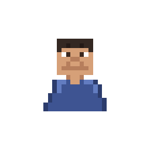{ .fruit-icon } | **Stout Buccaneer** | a belly and hips under a smaller chest |
| { .fruit-icon } | **Great Buccaneer** | broad all the way down |

## In a man's house

A Buccaneer is too tall for a door. **Hold sneak** to bend: they hunch and get through a 1 x 2 door, as the Oni do.

## Buccaneer Blood { #buccaneer-blood }

{ .ability-icon } *Passive, Buccaneers*

The user hits hard with bare hands and their body takes a lot. A blow that would kill them leaves them standing with 1 health instead; then their will needs time to come back.

| Stat | Value |
|---|---|
| Bare hand damage | +2 |
| Toughness | +2 |
| Left at 1 health | once every 5 minutes |

## Techniques

In the abilities tree, a branch only Buccaneers see: Buccaneer Charge first, then Living Wall and Crushing Hold, then Ground Breaker and Rock Hurl, then Answering Fist.

!!! note "About the values"
    Damage is what the target really loses, in health points (2 = one heart), and ranges are in blocks, for a body of size 1: a Buccaneer's grow with their size. Cooldowns and times are in seconds. Sizes and slider: [Your size](index.md#your-size).

| Technique | Cost | Comes after |
|---|---|---|
| { .fruit-icon } [Buccaneer Charge](#buccaneer-charge) | 500 Doriki, 2 martial arts points | |
| { .fruit-icon } [Living Wall](#living-wall) | 1,500 Doriki, 3 martial arts points | Buccaneer Charge |
| { .fruit-icon } [Crushing Hold](#crushing-hold) | 3,000 Doriki, 5 martial arts points | Buccaneer Charge |
| 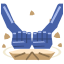{ .fruit-icon } [Ground Breaker](#ground-breaker) | 2,000 Doriki, 3 martial arts points | Living Wall |
| 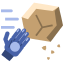{ .fruit-icon } [Rock Hurl](#rock-hurl) | 3,500 Doriki, 5 martial arts points | Crushing Hold |
| { .fruit-icon } [Answering Fist](#answering-fist) | 5,000 Doriki, 8 martial arts points | Ground Breaker and Rock Hurl |

### Buccaneer Charge { #buccaneer-charge }

{ .ability-icon } *Active, Buccaneers*

The user rushes a few blocks ahead shoulder first: every enemy on the way is hit and thrown off the path. Blocks are not broken, and a wall stops the rush. Only standing up.

With the **Alt key** it is { .fruit-icon } the **Buccaneer Palm**: a huge open palm thrust ahead on the spot, no run needed. The enemy before it is hit and thrown far back.

| Stat | Charge | Palm |
|---|---|---|
| Cooldown | 10 s | 8 s |
| Damage | 7 | 10 |
| Range | 6 blocks (line) | in front |

### Living Wall { #living-wall }

{ .ability-icon } *Active, Buccaneers*

For a few seconds the user stands as a wall of flesh. A blow from the front at an ally behind them lands on the user instead; blows from the front hurt the user half as much and do not push them back. Allies are players who are not their enemies, the creatures on their side and their own tamed animals.

Press again to stop it early: the cooldown is then the share of the time used, never under a quarter.

| Stat | Value |
|---|---|
| Cooldown | 20 s |
| Duration | 5 s |
| Damage taken from the front | -50 % |

### Crushing Hold { #crushing-hold }

{ .ability-icon } *Active, Buccaneers*

The user seizes a body up to 0.6 of their own height against their chest and crushes it: hurt at once, then each second, and dropped at their feet at the end. 8 damage on the user sets it free. Press again to let go early, for a shorter cooldown.

| Stat | Value |
|---|---|
| Cooldown | 18 s |
| Hold | 4 s |
| Damage | 3 at once, then 3 each second |

### Ground Breaker { #ground-breaker }

{ .ability-icon } *Active, Buccaneers*

After a short cast, the user brings both fists down on the ground: the shock hurts every enemy around them and throws them up.

| Stat | Value |
|---|---|
| Cooldown | 18 s |
| Cast | 1 s |
| Damage | 12 |
| Range | 5 blocks around |

### Rock Hurl { #rock-hurl }

{ .ability-icon } *Active, Buccaneers*

The user tears a rock out of the ground in front of them and throws it where they look. It bursts on what it hits and knocks enemies over. The hole closes after 20 s.

| Stat | Value |
|---|---|
| Cooldown | 12 s |
| Damage | 9 |
| Burst | 2.5 blocks around |

### Answering Fist { #answering-fist }

{ .ability-icon } *Active, Buccaneers*

The user punches the nearest enemy in front of them and throws it far. The more health they lost in the last 5 seconds, the harder it hits: up to twice as hard, at half their health lost.

| Stat | Value |
|---|---|
| Cooldown | 15 s |
| Damage | 10, up to 20 |

<!-- animations -->
??? example "Animations"

    Taken in game.

    

    <figure markdown="span">
      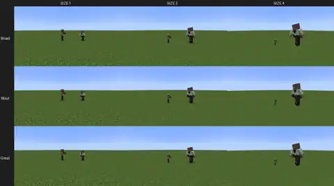{ loading=lazy }
      <figcaption>Buccaneer Charge</figcaption>
    </figure>
    <figure markdown="span">
      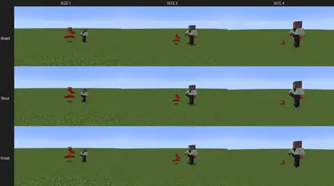{ loading=lazy }
      <figcaption>Buccaneer Palm</figcaption>
    </figure>
    <figure markdown="span">
      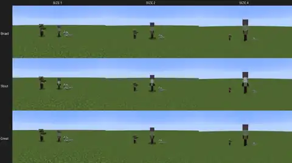{ loading=lazy }
      <figcaption>Living Wall</figcaption>
    </figure>
    <figure markdown="span">
      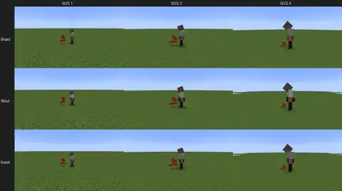{ loading=lazy }
      <figcaption>Crushing Hold</figcaption>
    </figure>
    <figure markdown="span">
      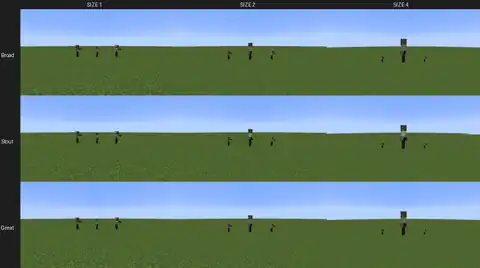{ loading=lazy }
      <figcaption>Ground Breaker</figcaption>
    </figure>
    <figure markdown="span">
      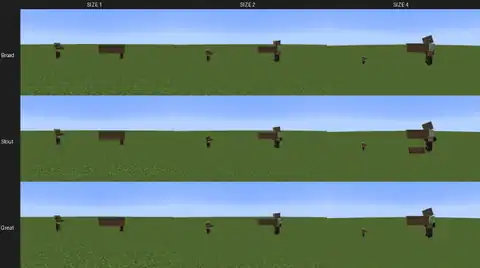{ loading=lazy }
      <figcaption>Rock Hurl</figcaption>
    </figure>
    <figure markdown="span">
      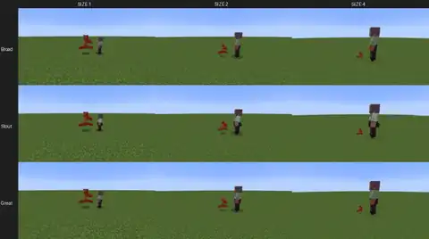{ loading=lazy }
      <figcaption>Answering Fist</figcaption>
    </figure>
    <figure markdown="span">
      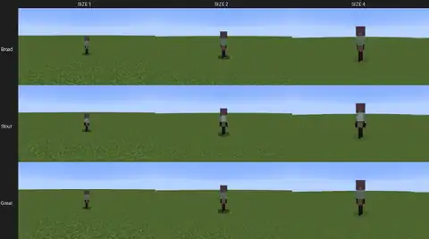{ loading=lazy }
      <figcaption>Buccaneer Blood</figcaption>
    </figure>
    

<!-- /animations -->

## What follows the size

- **Damage and reach** of every technique grow with the Buccaneer's size, and shrink back to a man's when they hunch.
- **Cooldowns** are a little longer for a bigger body. See [Race size and slider](../../akumalib/size/race-size.md) and [Abilities that follow the size](../../akumalib/size/abilities.md).
