---
tags:
  - cyborg
  - franky
  - cola
  - parts
---

# Cyborgs

{ .mod-icon }

*Franky's way: a bare body built part by part. Crafted parts give their techniques, from iron to netherite, all running on cola.*

| | |
|---|---|
| **Size** | 1, a man's |
| **Body** | nothing bare; each part gives its zone's stats and its techniques |
| **Parts** | 14 (2 of them from plans), 3 tiers each |
| **Accessories** | 8, and 3 modules (workbench, storage, furnace); no tier |
| **Techniques** | 29 from the parts, 5 from the accessories and modules; none bought in the tree |
| **Since** | 0.5.0: the Cyborg is the base mod's race, rebuilt by this mod |

The Cyborg is the base mod's race (its NPCs, its cola and its weakness to magnets stay). Since 0.5.0 a cyborg starts **bare**: the base mod's Cyborg Passive Bonuses and its cyborg techniques are gone, and everything comes from the parts the player crafts and fits.

!!! note "About the values"
    Damage is what the target really loses, in health points (2 = one heart): a technique's tooltip shows the base mod's own number, 2.5 times the iron figure. Ranges are in blocks, for a body of size 1. Times are in seconds. "Iron / diamond / netherite" gives a part's three tiers.

<!-- models:0 -->
<div class="mob-gallery" markdown>

<figure markdown>
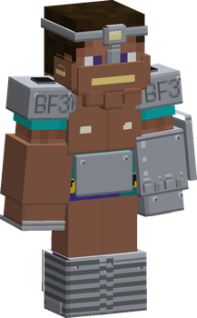
<figcaption>Iron parts</figcaption>
</figure>

<figure markdown>
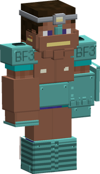
<figcaption>Diamond parts</figcaption>
</figure>

<figure markdown>
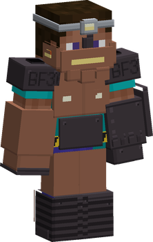
<figcaption>Netherite parts</figcaption>
</figure>

</div>

In 3D: drag to turn, scroll or pinch to zoom. A full set at each tier (Fire Jaw, Striking Arms and Armed Arm, Armored Chest, Cannon Shoulders, Tank Legs, five accessories), Franky Tank, and the bare body.

<div class="model-viewer" data-models="../models/" data-ids="cyborgs"></div>

<!-- /models:0 -->

## The body { #body }

{ .ability-icon } *Body, every cyborg*

Every cyborg has the **Body** technique: it opens the body screen, where parts are fitted and taken off. It cannot be opened within **5 s** of being hit ("You can't open your body right after being hit"). Cooldown 1 s.

| Slot | Opens at (Doriki) |
|---|---|
| Head | from the start |
| Right arm | from the start |
| Chest | from the start |
| Shoulders | from the start |
| Legs | from the start |
| Accessory 1 | from the start |
| Accessory 2 | 2,000 |
| Accessory 3 | 4,000 |
| **Left arm** | 5,000 |
| Accessory 4 | 6,000 |
| Accessory 5 | 8,000 |

The Doriki needed is a share of the server's Doriki limit (10,000 by default): a fifth for each accessory past the first, half for the left arm. A closed slot is greyed with "Opens at N Doriki"; nothing goes in. A part already in a slot whose Doriki falls back stays there but does nothing (no stats, no techniques, not drawn).

- Each slot takes only a part of its zone, and **never the same part twice**: no two identical accessories, no same part on both arms. Shift-click sends a part to the first free slot that takes it.
- **Kept over death**: the parts stay in the body. The hotbar slot of each part's technique is remembered.
- A player who **stops being a cyborg** gets every part back in the inventory (at the feet if it is full).
- The parts are drawn on the body, tinted by tier (steel grey, diamond blue, netherite black); the jaws, forearms and legs that imitate the body are in the skin's own colour, as Franky's. In first person the arm shows the part fitted on that side, and the Black Leg leg its leg part.

### Tiers { #tiers }

| Tier | Damage | Cola | Cooldown | Reach and radius | Durations |
|---|---|---|---|---|---|
| Iron | x1.8 | x0.8 | x0.8 | x1.15 | x1 |
| Diamond | x2.4 | x0.55 | x0.65 | x1.3 | x1.35 |
| Netherite | x3.0 | x0.35 | x0.5 | x1.45 | x1.7 |

The tables below already apply them. A part goes up a tier at a crafting table: **iron part + 4 diamonds = diamond part**, **diamond part + 1 netherite ingot = netherite part**. Cast times, pushes and speeds stay the same at every tier. Accessories have no tier.

### Zone stats { #zone-stats }

| Part | Stat | Iron | Diamond | Netherite |
|---|---|---|---|---|
| Fire Jaw | armour | 4 | 6 | 8 |
| Nail Jaw | armour | 5 | 7.5 | 10 |
| Steel Hair | armour | 6 | 9 | 12 |
| Striking Arms, Vegapunk Arms | bare-hand damage, each arm | +1.5 | +2.5 | +3.5 |
| Armed Arm | bare-hand damage, each arm | +1.875 | +3.125 | +4.375 |
| Connector Arms | bare-hand damage, each arm | +2.25 | +3.75 | +5.25 |
| Super Fridge | armour, toughness | 10, 3.75 | 12.5, 6.25 | 15, 8.75 |
| Armored Chest | armour, toughness | 16, 6 | 20, 10 | 24, 14 |
| Cannon Shoulders, Rocket Shoulders | armour, toughness | 8, 3 | 10, 5 | 12, 7 |
| Every legs part | speed | +10 % | +15 % | +20 % |
| Coup de Boo Thruster | jump height | +1 | +1.5 | +2 |
| Tank Legs | jump height | +0.5 | +1 | +1.5 |

The two arms add up. **The Armored Chest leaves the back weak**: a blow from behind deals +25 %, unless [Back Plating](#accessories) is worn.

## Parts and their techniques { #parts }

| Part | Zone | Techniques |
|---|---|---|
| { .fruit-icon } [Fire Jaw](#fire-jaw) | head | Fresh Fire (ALT Franky Fireball) |
| { .fruit-icon } [Nail Jaw](#nail-jaw) | head | Master Nail |
| 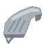{ .fruit-icon } [Steel Hair](#steel-hair) | head | Franky Triangle Jacker |
| 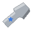{ .fruit-icon } [Striking Arms](#striking-arms) | arm | Strong Right, Strong Hammer, Franky Boxing, Franky Southland Suplex (ALT Franosuke Iron Suplex), Franky Butterfly |
| 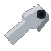{ .fruit-icon } [Armed Arm](#armed-arm) | arm | Weapons Left, Ouch Finger (ALT Beans Left), Hoshi Shield |
| 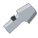{ .fruit-icon } [Connector Arms](#connector-arms) | arm | Coup de Vent, Hakugeki Ho |
| 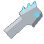{ .fruit-icon } [Vegapunk Arms](#vegapunk-arms) (plan) | arm | Franky Radical Beam, Strong Impact Right, Super Strong Dexter |
| 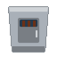{ .fruit-icon } [Super Fridge](#super-fridge) | chest | Cola Overdrive |
| { .fruit-icon } [Armored Chest](#armored-chest) | chest | Franky Nipple Light |
| { .fruit-icon } [Cannon Shoulders](#cannon-shoulders) | shoulders | Franky Destroy Ho, Tsuiseki Hodan |
| 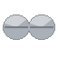{ .fruit-icon } [Rocket Shoulders](#rocket-shoulders) (plan) | shoulders | Franky Rocket Launcher, Franky Cannon |
| 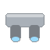{ .fruit-icon } [Coup de Boo Thruster](#coup-de-boo-thruster) | legs | Coup de Boo |
| 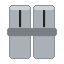{ .fruit-icon } [Kentauros Legs](#kentauros-legs) | legs | Franky Kentauros, Ultimate Hammer |
| { .fruit-icon } [Tank Legs](#tank-legs) | legs | Franky Tank |

<!-- models:1 -->
In 3D: drag to turn, scroll or pinch to zoom. Every part alone, iron, on the body.

<div class="model-viewer" data-models="../models/" data-ids="cyborg-parts"></div>

<!-- /models:1 -->

A part's techniques come with it and go when it is taken off; they are not bought in the tree. Each needs its part fitted ("Needs the ... part").

### Fire Jaw { #fire-jaw }

{ .fruit-icon } { .fruit-icon } { .fruit-icon }

<!-- models:2 -->
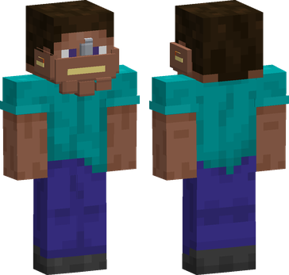{ .form-picture }

<!-- /models:2 -->

**Fresh Fire** 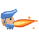{ .fruit-icon }: a flamethrower from the jaw, 10 bursts (one every 0.15 s). Press again to stop it.

| Stat | Iron | Diamond | Netherite |
|---|---|---|---|
| Damage a burst | 5.4 | 7.2 | 9 |
| Cola, whole use | 8 | 5.5 | 3.5 |
| Cooldown | 4 s | 3.25 s | 2.5 s |

**ALT: Franky Fireball** { .fruit-icon }: one ball of fire that bursts where it hits, setting fire, breaking no block.

| Stat | Iron | Diamond | Netherite |
|---|---|---|---|
| Damage, hit and burst | 28.8 | 38.4 | 48 |
| Burst radius | 2.3 | 2.6 | 2.9 |
| Target on fire | 5 s | 5 s | 5 s |
| Cola | 12 | 8 | 5 |
| Cooldown | 6.4 s | 5.2 s | 4 s |

### Nail Jaw { #nail-jaw }

{ .fruit-icon } { .fruit-icon } { .fruit-icon }

<!-- models:3 -->
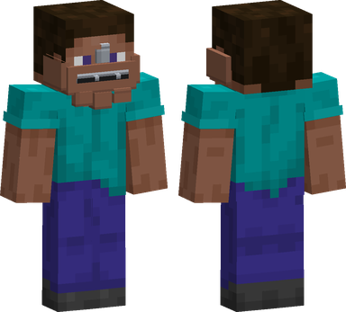{ .form-picture }

<!-- /models:3 -->

**Master Nail** 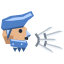{ .fruit-icon }: 7 nails spat in a 60° fan; each pins its target (Slowness V).

| Stat | Iron | Diamond | Netherite |
|---|---|---|---|
| Damage a nail | 7.2 | 9.6 | 12 |
| Pinned | 1.5 s | 2 s | 2.55 s |
| Cola | 8 | 6 | 4 |
| Cooldown | 5.6 s | 4.55 s | 3.5 s |

### Steel Hair { #steel-hair }

{ .fruit-icon } { .fruit-icon } 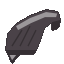{ .fruit-icon }

<!-- models:4 -->
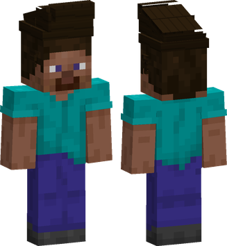{ .form-picture }

<!-- /models:4 -->

**Franky Triangle Jacker** { .fruit-icon }: two sideburn blades thrown, one from each side. They go through every enemy and cut through blocks as soft as stone (griefing rules permitting); a harder block stops them.

| Stat | Iron | Diamond | Netherite |
|---|---|---|---|
| Damage | 16.2 | 21.6 | 27 |
| Cola | 4 | 3 | 2 |
| Cooldown | 4 s | 3.25 s | 2.5 s |

### Striking Arms { #striking-arms }

{ .fruit-icon } { .fruit-icon } 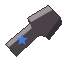{ .fruit-icon }

<!-- models:5 -->
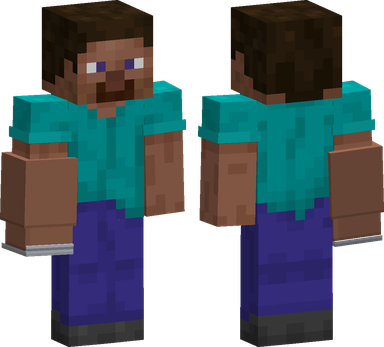{ .form-picture }

<!-- /models:5 -->

<!-- models:16 -->
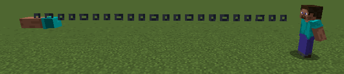

<!-- /models:16 -->

**Strong Right** 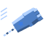{ .fruit-icon }: the fist flies off on a chain, from the arm that wears the Striking Arms (the right one if both do), and is reeled back after its hit. Needs empty hands; the hand is gone until the fist is back. No cola.

| Stat | Iron | Diamond | Netherite |
|---|---|---|---|
| Damage | 21.6 | 28.8 | 36 |
| Cooldown | 4 s | 3.25 s | 2.5 s |

**Strong Hammer** { .fruit-icon }: after a 0.75 s wind-up, a hammer blow on the first enemy in sight, stunned (Slowness VI and Weakness) and pushed.

| Stat | Iron | Diamond | Netherite |
|---|---|---|---|
| Damage | 36 | 48 | 60 |
| Reach | 4.0 | 4.55 | 5.1 |
| Stun | 2 s | 2.7 s | 3.4 s |
| Cola | 8 | 6 | 4 |
| Cooldown | 8 s | 6.5 s | 5 s |

**Franky Boxing** 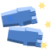{ .fruit-icon }: 2 s of jabs, 8 of them, on every enemy just ahead; the last one pushes. No cola.

| Stat | Iron | Diamond | Netherite |
|---|---|---|---|
| Damage a jab | 7.2 | 9.6 | 12 |
| Reach | 3.45 | 3.9 | 4.35 |
| Cooldown | 6.4 s | 5.2 s | 4 s |

**Franky Southland Suplex** { .fruit-icon }, **ALT Franosuke Iron Suplex** { .fruit-icon }: with an empty hand, the cyborg seizes the enemy in reach (no taller than 1.25 times them) and slams it behind; the Iron Suplex slams harder and bounces it up.

| Stat | Iron | Diamond | Netherite |
|---|---|---|---|
| Reach | 2.9 | 3.25 | 3.6 |
| Damage, Southland | 28.8 | 38.4 | 48 |
| Damage, Iron Suplex | 39.6 | 52.8 | 66 |
| Cola, Southland | none | none | none |
| Cola, Iron Suplex | 8 | 6 | 4 |
| Cooldown, Southland | 8 s | 6.5 s | 5 s |
| Cooldown, Iron Suplex | 10.4 s | 8.45 s | 6.5 s |

**Franky Butterfly** { .fruit-icon } *Passive*: +100 % swim speed while the part is fitted.

### Armed Arm { #armed-arm }

{ .fruit-icon } { .fruit-icon } 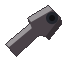{ .fruit-icon }

<!-- models:6 -->
{ .form-picture }

<!-- /models:6 -->

**Weapons Left** { .fruit-icon }: a cannonball from the arm, falling a little in flight. It bursts where it lands for half its damage, the struck enemy included; no block breaks.

| Stat | Iron | Diamond | Netherite |
|---|---|---|---|
| Damage, hit | 28.8 | 38.4 | 48 |
| Damage, burst | 14.4 | 19.2 | 24 |
| Burst radius | 2.3 | 2.6 | 2.9 |
| Cola | 12 | 8 | 5 |
| Cooldown | 6.4 s | 5.2 s | 4 s |

**Ouch Finger** 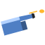{ .fruit-icon }: one fast bullet from the finger. **ALT: Beans Left** { .fruit-icon }: 8 pellets in a burst (one every 0.1 s).

| Stat | Iron | Diamond | Netherite |
|---|---|---|---|
| Damage, Ouch Finger | 18 | 24 | 30 |
| Damage, Beans Left (each pellet) | 4.5 | 6 | 7.5 |
| Cola, Ouch Finger | 2 | 2 | 1 |
| Cola, Beans Left | 6 | 4 | 3 |
| Cooldown, Ouch Finger | 2.4 s | 1.95 s | 1.5 s |
| Cooldown, Beans Left | 5.6 s | 4.55 s | 3.5 s |

**Hoshi Shield** { .fruit-icon }: a toggle. While the shield is up, every attack from the front is stopped, and the cyborg walks 30 % slower. It closes when the time or the cola runs out.

| Stat | Iron | Diamond | Netherite |
|---|---|---|---|
| Duration | 5 s | 6.75 s | 8.5 s |
| Cola a second | 1.6 | 1.1 | 0.7 |
| Cooldown | 2.4 s, plus the time held | 1.95 s, plus the time held | 1.5 s, plus the time held |

### Connector Arms { #connector-arms }

{ .fruit-icon } { .fruit-icon } 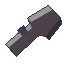{ .fruit-icon }

<!-- models:7 -->
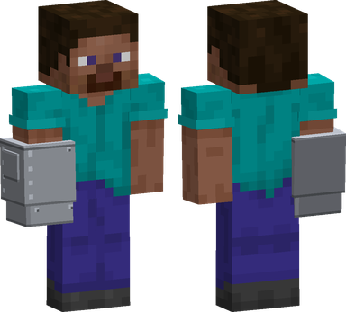{ .form-picture }

<!-- /models:7 -->

**Coup de Vent** 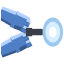{ .fruit-icon }: a blast of air charged up to 3 s; press again (or run out of cola) to fire early. The longer the charge, the stronger, faster and more costly, and the harder the recoil.

| Stat | Iron | Diamond | Netherite |
|---|---|---|---|
| Damage, no charge to full | 18 to 72 | 24 to 96 | 30 to 120 |
| Cola, no charge to full | 5 to 36 | 3 to 25 | 2 to 16 |
| Cooldown | 9.6 s | 7.8 s | 6 s |

**Hakugeki Ho** 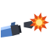{ .fruit-icon }: a shell fired at close range (about 8 blocks), made for big bodies: a direct hit on one (size 2 or more, or 3.6 blocks high) deals double. It bursts around the target, breaking no block.

| Stat | Iron | Diamond | Netherite |
|---|---|---|---|
| Damage, hit and burst | 32.4 | 43.2 | 54 |
| Damage, direct hit on a big body | 64.8 | 86.4 | 108 |
| Burst radius | 2.3 | 2.6 | 2.9 |
| Cola | 20 | 14 | 9 |
| Cooldown | 9.6 s | 7.8 s | 6 s |

### Vegapunk Arms { #vegapunk-arms }

{ .fruit-icon } 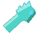{ .fruit-icon } 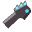{ .fruit-icon } *Learnt from a [plan](#plans).*

<!-- models:8 -->
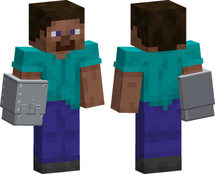{ .form-picture }

<!-- /models:8 -->

**Franky Radical Beam** 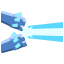{ .fruit-icon }: after a 3 s charge, the base mod's beam, with its explosion and griefing rules.

| Stat | Iron | Diamond | Netherite |
|---|---|---|---|
| Damage | 90 | 120 | 150 |
| Cola | 24 | 17 | 11 |
| Cooldown | 10.4 s | 8.45 s | 6.5 s |

**Strong Impact Right** 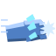{ .fruit-icon }: a rocket fist that throws its target far.

| Stat | Iron | Diamond | Netherite |
|---|---|---|---|
| Damage | 46.8 | 62.4 | 78 |
| Cola | 12 | 8 | 5 |
| Cooldown | 8 s | 6.5 s | 5 s |

**Super Strong Dexter** { .fruit-icon }: only under [Super Vega Cola](#super-vega-cola). A huge blow on the first enemy in sight, thrown very far. The cola is paid even on a miss.

| Stat | Iron | Diamond | Netherite |
|---|---|---|---|
| Damage | 81 | 108 | 135 |
| Reach | 4.6 | 5.2 | 5.8 |
| Cola | 16 | 11 | 7 |
| Cooldown | 12 s | 9.75 s | 7.5 s |

### Super Fridge { #super-fridge }

{ .fruit-icon } 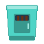{ .fruit-icon } 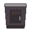{ .fruit-icon }

<!-- models:9 -->
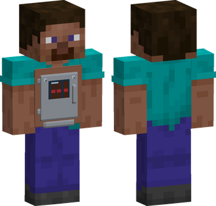{ .form-picture }

<!-- /models:9 -->

Raises the max cola: +150 / +250 / +400.

**Cola Overdrive** 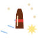{ .fruit-icon }: the cyborg burns cola for speed and strength until it ends, the cola runs out, or it is pressed again.

| Stat | Iron | Diamond | Netherite |
|---|---|---|---|
| Speed | +25 % | +45 % | +70 % |
| Swim | +1 | +1.5 | +2 |
| Jump height | +2.55 | +3.5 | +4.5 |
| Fall resistance | +5.75 | +9 | +14 |
| Step height | +1 | +1 | +1.5 |
| Resistance | I | II | II |
| Cola a second | 40 | 20 | 10 |
| Longest run | 15 s | 20 s | 25 s |
| Cooldown | (5 s + the time run) x0.8 | x0.65 | x0.5 |

### Armored Chest { #armored-chest }

{ .fruit-icon } { .fruit-icon } { .fruit-icon }

<!-- models:10 -->
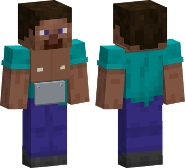{ .form-picture }

<!-- /models:10 -->

Twice a chest part's armour and toughness, but the back stays weak: +25 % damage from behind, unless Back Plating is worn.

**Franky Nipple Light** { .fruit-icon }: the cyborg's lamps light up: they see in the dark, and every enemy around who looks at them is blinded.

| Stat | Iron | Diamond | Netherite |
|---|---|---|---|
| Night vision | 30 s | 40.5 s | 51 s |
| Radius | 6.9 | 7.8 | 8.7 |
| Blindness | 3 s | 4.05 s | 5.1 s |
| Cola | 4 | 3 | 2 |
| Cooldown | 12 s | 9.75 s | 7.5 s |

An enemy is blinded if it looks within 45° of the cyborg.

### Cannon Shoulders { #cannon-shoulders }

{ .fruit-icon } { .fruit-icon } 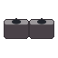{ .fruit-icon }

<!-- models:11 -->
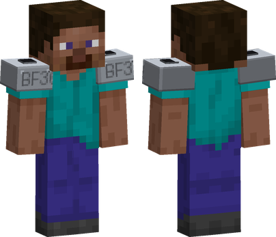{ .form-picture }

<!-- /models:11 -->

**Franky Destroy Ho** { .fruit-icon }: after a 0.5 s wind-up, one shell from each shoulder; each bursts, breaking no block. The recoil costs the cyborg 2 health.

| Stat | Iron | Diamond | Netherite |
|---|---|---|---|
| Damage a shell, hit and burst | 25.2 | 33.6 | 42 |
| Burst radius | 1.7 | 1.95 | 2.2 |
| Cola | 16 | 11 | 7 |
| Cooldown | 8 s | 6.5 s | 5 s |

**Tsuiseki Hodan** 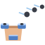{ .fruit-icon }: for 5 s, a shell every 0.5 s from alternate shoulders (10 in all) while the cyborg moves freely. Press again to stop. Direct hits only, no burst.

| Stat | Iron | Diamond | Netherite |
|---|---|---|---|
| Damage a shell | 10.8 | 14.4 | 18 |
| Cola a shell | 1.6 | 1.1 | 0.7 |
| Cooldown | 6.4 s | 5.2 s | 4 s |

### Rocket Shoulders { #rocket-shoulders }

{ .fruit-icon } { .fruit-icon } 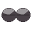{ .fruit-icon } *Learnt from a [plan](#plans).*

<!-- models:12 -->
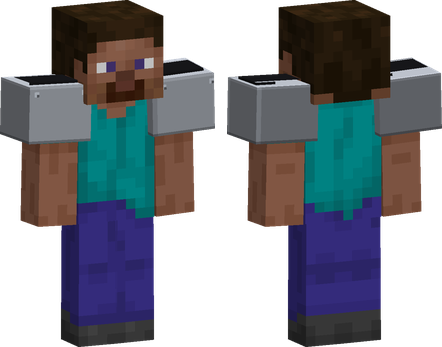{ .form-picture }

<!-- /models:12 -->

**Franky Rocket Launcher** { .fruit-icon }: 3 rockets, one every 0.2 s, each homing on the nearest enemy in a 30° cone; each bursts, breaking no block.

| Stat | Iron | Diamond | Netherite |
|---|---|---|---|
| Damage a rocket, hit and burst | 32.4 | 43.2 | 54 |
| Burst radius | 2.9 | 3.25 | 3.6 |
| Seeks within | 27.6 | 31.2 | 34.8 |
| Cola | 24 | 17 | 11 |
| Cooldown | 12 s | 9.75 s | 7.5 s |

**Franky Cannon** { .fruit-icon }: after a 1 s wind-up, one heavy shell, with a recoil.

| Stat | Iron | Diamond | Netherite |
|---|---|---|---|
| Damage, hit and burst | 54 | 72 | 90 |
| Burst radius | 3.45 | 3.9 | 4.35 |
| Cola | 16 | 11 | 7 |
| Cooldown | 9.6 s | 7.8 s | 6 s |

### Coup de Boo Thruster { #coup-de-boo-thruster }

{ .fruit-icon } 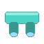{ .fruit-icon } 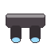{ .fruit-icon }

<!-- models:13 -->
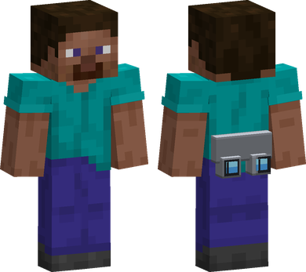{ .form-picture }

<!-- /models:13 -->

**Coup de Boo** { .fruit-icon }: a charge up to 1.5 s, then the cyborg is blown up and forward, and the enemies behind are pushed away (no damage). Charged 0.75 s or more, the launch is half as strong again (if the cola is there). Falls are spared for 10 s.

| Stat | Iron | Diamond | Netherite |
|---|---|---|---|
| Push radius behind | 4.6 | 5.2 | 5.8 |
| Cola, plain | 16 | 11 | 7 |
| Cola, strong | 24 | 17 | 11 |
| Cooldown | 8 s | 6.5 s | 5 s |

### Kentauros Legs { #kentauros-legs }

{ .fruit-icon } 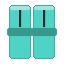{ .fruit-icon } 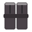{ .fruit-icon }

<!-- models:14 -->
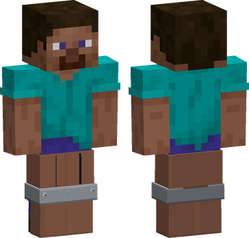{ .form-picture }

<!-- /models:14 -->

**Franky Kentauros** { .fruit-icon }: the cyborg pins the enemy in reach to the ground: it cannot move, jump nor break free. The cyborg is slowed (Slowness II) while holding. Press again to let go.

| Stat | Iron | Diamond | Netherite |
|---|---|---|---|
| Hold | 5 s | 6.75 s | 8.5 s |
| Reach | 2.9 | 3.25 | 3.6 |
| Cola, at the catch | 8 | 6 | 4 |
| Cooldown | 8 s | 6.5 s | 5 s |

**Ultimate Hammer** { .fruit-icon }: only on the enemy held by Kentauros: a blow through all armour that frees it and throws it.

| Stat | Iron | Diamond | Netherite |
|---|---|---|---|
| Damage, through all armour | 54 | 72 | 90 |
| Cola | 12 | 8 | 5 |
| Cooldown | 9.6 s | 7.8 s | 6 s |

### Tank Legs { #tank-legs }

{ .fruit-icon } { .fruit-icon } { .fruit-icon }

<!-- models:15 -->
{ .form-picture }

<!-- /models:15 -->

<!-- models:17 -->
{ .form-picture }

<!-- /models:17 -->

**Franky Tank** { .fruit-icon }: a toggle with no time limit. Treads come down under the legs and roll: +60 % speed, +1 step height, and enemies just ahead are rammed and pushed (each at most once a second). Ends when pressed again or out of cola.

| Stat | Iron | Diamond | Netherite |
|---|---|---|---|
| Ram damage | 10.8 | 14.4 | 18 |
| Cola a second | 0.8 | 0.55 | 0.35 |
| Cooldown | 4 s | 3.25 s | 2.5 s |

## Accessories and modules { #accessories }

One item each, no tier, one accessory slot each.

| Accessory | What it does |
|---|---|
| { .fruit-icon } Cola Tank | +150 max cola |
| { .fruit-icon } Back Plating | +4 armour, and no weak back under the Armored Chest |
| { .fruit-icon } Magnet Insulator | -40 % lightning damage; Jiki Jiki's Repel no longer throws the cyborg (unless iron armour covers half the body or more) |
| { .fruit-icon } Shock Absorbers | -75 % fall damage |
| { .fruit-icon } Head Lamp | night vision, always |
| { .fruit-icon } Skywalk Kit | Franky Skywalk |
| { .fruit-icon } Airbag | Franky Airbag |
| { .fruit-icon } Heel Boosters | Heel Boost |
| { .fruit-icon } Workbench Module | Workbench |
| { .fruit-icon } Storage Module | Storage |
| { .fruit-icon } Furnace Module | Furnace |

<!-- models:18 -->
<div class="mob-gallery" markdown>

<figure markdown>

<figcaption>Cola Tank</figcaption>
</figure>

<figure markdown>

<figcaption>Back Plating</figcaption>
</figure>

<figure markdown>

<figcaption>Magnet Insulator</figcaption>
</figure>

<figure markdown>

<figcaption>Shock Absorbers</figcaption>
</figure>

<figure markdown>

<figcaption>Head Lamp</figcaption>
</figure>

<figure markdown>

<figcaption>Skywalk Kit</figcaption>
</figure>

<figure markdown>

<figcaption>Airbag</figcaption>
</figure>

<figure markdown>

<figcaption>Heel Boosters</figcaption>
</figure>

<figure markdown>

<figcaption>Workbench Module</figcaption>
</figure>

<figure markdown>

<figcaption>Storage Module</figcaption>
</figure>

<figure markdown>

<figcaption>Furnace Module</figcaption>
</figure>

</div>

<!-- /models:18 -->

**Franky Skywalk** { .fruit-icon }: for 12 s, oak planks lay themselves under the cyborg's feet wherever they step over the void (only into air, nothing replaced or dropped); jump to climb, look steeply down to drop. Every plank goes at the end. Cola 6. Cooldown 8 s.

**Franky Airbag** { .fruit-icon }: for 6 s, no fall damage and no knockback. Cola 3. Cooldown 15 s.

**Heel Boost** { .fruit-icon } *Passive*: a second jump in the air, 1 block high (it grows with the body), once until the feet touch the ground, water, a ladder or a mount. A new press of jump in the air; not while gliding or in lava. The fall after it is spared. No cola. The same double jump as the Seiryu hybrid's of Missing Missing no Mi.

**Workbench** { .fruit-icon }: the game's 3x3 crafting grid, anywhere. What is left in the grid comes back to the inventory on closing. Cooldown 1 s.

**Storage** { .fruit-icon }: nine slots carried in the body, kept over a logout. They fall at the cyborg's feet at death (kept under `keepInventory`), when the module is taken off, or when its slot locks. Cooldown 1 s.

**Furnace** { .fruit-icon }: the game's furnace screen, cooking any smelting recipe at its own speed, with its screen open or closed. It burns **1 cola for each item cooked** and waits when there is none; the flame shows the cola left. Its contents fall at the feet if the module comes off, its slot locks, or at death (kept under `keepInventory`). Cooldown 1 s.

## Cola { #cola }

- The base mod's cola gauge and drinks stay. **Cola Fuel** (the base mod's) is given to every cyborg.
- **Max cola**: the base mod's, plus the Super Fridge (+150 / +250 / +400) and the Cola Tank (+150), never past the base mod's cap of 1,000.

### Super Vega Cola { #super-vega-cola }

{ .fruit-icon } Drunk by a cyborg, it fills the cola and gives **Super Vega** for 60 s: bare-hand blows deal +4 more, growing with the body's size. Under it, the Vegapunk Arms' Super Strong Dexter can be used. A non-cyborg gets nothing. The empty bottle comes back. Stacks to 16.

## Crafting { #crafting }

Every part, accessory and module is made at a plain crafting table. Parts are made in iron, then [upgraded](#tiers).

**Iron parts and accessories**: iron ingots (I), copper ingots (C), redstone (R) and the part's own item (S) in the middle.

```
I C I
R S R
I C I
```

| Item | S |
|---|---|
| Fire Jaw | blaze powder |
| Nail Jaw | iron nugget |
| Steel Hair | shears |
| Striking Arms | piston |
| Armed Arm | dispenser |
| Connector Arms | lightning rod |
| Vegapunk Arms (needs its plan) | amethyst shard |
| Super Fridge | packed ice |
| Armored Chest | block of iron |
| Cannon Shoulders | TNT |
| Rocket Shoulders (needs its plan) | firework rocket |
| Coup de Boo Thruster | fire charge |
| Kentauros Legs | sticky piston |
| Tank Legs | rail |
| Cola Tank | bucket |
| Back Plating | shield |
| Magnet Insulator | slimeball |
| Shock Absorbers | slime block |
| Head Lamp | lantern |
| Skywalk Kit | scaffolding |
| Airbag | white wool |

**Heel Boosters**: fire charge (F), piston (P), copper (C).

```
I F I
R P R
I C I
```

**Modules**: seven iron ingots, the block (B) in the middle and a redstone below: a crafting table (Workbench Module), a chest (Storage Module) or a furnace (Furnace Module).

```
I I I
I B I
I R I
```

### Plans { #plans }

{ .fruit-icon } { .fruit-icon } The **Vegapunk Arms Plan** and the **Rocket Shoulders Plan** teach their part's recipe for good: right-click to learn it (the plan is used up, the knowledge is kept, even over death). Only a player who learnt it can craft the iron part; the diamond and netherite upgrades need no plan.

| Where | Plans | Super Vega Cola |
|---|---|---|
| Labs (bandit cave labs, large Marine base lab) | 10 % each (20 % for one of the two) | 1 in 6, 1 or 2 bottles (cave lab and Marine lab) |
| Captains' and treasure chests (bandit fort stash, ghost ship captain, Marine battleship treasure, Marine base captains, large pirate ship treasure) | 2.5 % each | |
| Supplies (hard caravan, ghost ship supplies, Marine battleship supplies, pirate ship captains) | | 1 in 6, 1 or 2 bottles |
| Marine and pirate traders | 1 in 8 each, 1 to 3, 20,000 to 30,000 | 1 in 3, 1 to 3, 2,500 to 4,000 |

## Cyborg NPCs { #npcs }

The base mod's cyborg NPCs wear parts by their strength, drawn once when they appear: a grunt 1 or 2 iron parts, a captain 3 (a third of them diamond), a notorious pirate 4 (10 % netherite, 50 % diamond). Their parts follow the same Doriki slots, never a plan part, a module or the same part twice. They use the parts' techniques that NPCs can use, and pay no cola.

## Cyborgs from before 0.5.0 { #takeover }

- The base mod's cyborg techniques (Strong Right, Fresh Fire, Coup de Vent, Coup de Boo, Radical Beam, Cola Overdrive, Southland Suplex) leave the tree: whoever bought them gets the points back, and the same techniques now come from the parts. One given by a command is kept.
- The base mod's Cyborg Passive Bonuses is taken away; a bare body gives nothing. Craft your first parts and fit them with Body.

## In the character creator { #creator }

The Cyborg page shows Strong Right, Fresh Fire, Coup de Vent, Coup de Boo, Radical Beam, Cola Overdrive and Weapons Left, then Body.
