---
tags:
  - fishman
  - saw-shark
  - ray
  - garfish
  - octopus
  - whale-shark
  - pufferfish
  - hammerhead
  - swim
---

# Fishmen

{ .mod-icon }

The base mod's fishmen and their three sub-races, **Saw-shark**, **Ray** and **Garfish**, made whole, and four more since 0.4.0: **Octopus**, **Whale Shark**, **Pufferfish** and **Hammerhead**. Each has a body of its own on the player, its skin colour, and a passive for every fishman plus one per sub-race. They replace the base mod's Fishman Passive Bonuses. The [Wotan](wotan.md), half giant, comes in the same seven species.

| | |
|---|---|
| **Size** | 1.25, about 2.25 blocks high (slider about 0.94 to 1.56); the Whale Shark 1.5, about 2.7 blocks |
| **Passives** | Fishman Body, and one per sub-race |
| **Techniques** | none added by this mod |

<figure markdown>
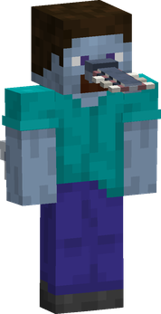
<figcaption>Saw-shark</figcaption>
</figure>

<figure markdown>
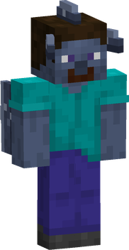
<figcaption>Ray</figcaption>
</figure>

<figure markdown>
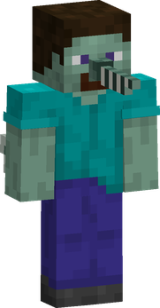
<figcaption>Garfish</figcaption>
</figure>

<figure markdown>
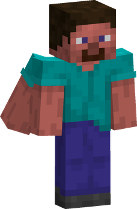
<figcaption>Octopus</figcaption>
</figure>

<figure markdown>
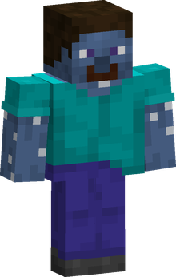
<figcaption>Whale Shark</figcaption>
</figure>

<figure markdown>
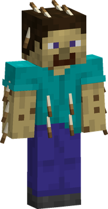
<figcaption>Pufferfish</figcaption>
</figure>

<figure markdown>
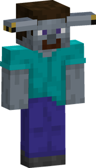
<figcaption>Hammerhead</figcaption>
</figure>

In 3D: drag to turn, scroll or pinch to zoom. The buttons switch between the seven sub-races.

Each sub-race has its own face in the character creator's book (the base mod's three too, since 0.4.0); they are shown in the table below.

## Their look

A fishman player wears their sub-race's features over their own skin, and the skin-coloured parts of that skin (not the hair, eyes, mouth or clothes) take the sub-race's colour, in first person too:

| Sub-race | Skin | Features |
|---|---|---|
| 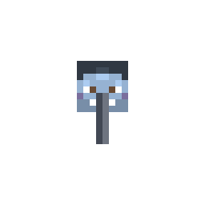{ .fruit-icon } Saw-shark (Arlong's) | pale steel blue | a muzzle with a long drooping rostrum and its saw of teeth on both sides, gills, a dorsal fin in two parts curving back, small fins on the forearms |
| 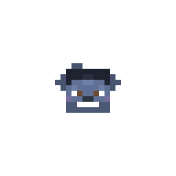{ .fruit-icon } Ray (Kuroobi's) | slate | broad fins along the arms that ripple as he runs, lobes at the temples, a crest, a ray's tail with its barb, swaying |
| 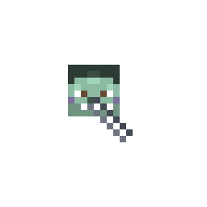{ .fruit-icon } Garfish | sea green | two long thin jaws, gills, a dorsal fin in two parts, small fins on the forearms |
| 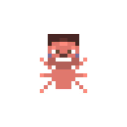{ .fruit-icon } Octopus | its own colour | two more arms: the wearer's own arms drawn again behind the real ones, sleeves and the chest piece's armour too, swinging with them |
| 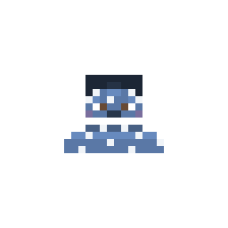{ .fruit-icon } Whale Shark | its own colour, white spots | a broad chest (12 by 6 where a man's is 8 by 4), a wide dorsal fin, three gill slits a side |
| 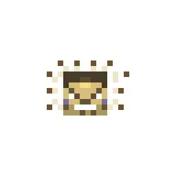{ .fruit-icon } Pufferfish | its own colour, brown spots | spines on the head, chest, back and arms, lying along the skin; they stand up for 2 s when the wearer is struck |
| 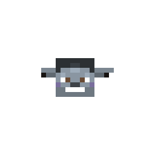{ .fruit-icon } Hammerhead | its own colour | the hammer: two lobes out of the head's sides with an eye at each end, gills, a tall dorsal fin |

The four new sub-races are painted in their own colours, not tinted by the skin colour picked in the creator, and their spots land on the bare skin only, never on a shirt or the hair. Fins, lobes, crest and tail are slabs with some thickness, and the gills small ridges on the neck. In another mod's form that has its own skin, such as Missing Missing no Mi's King Cobra hybrid, a fishman wears the form's skin, then their fishman colour again on leaving it.

The features take the skin colour picked in the character creator, if any. A slim (Alex) skin gets its arm fins moved onto its narrower arms. The pictures above are drawn on Steve's skin.

## Passives

| Passive | Who | Bonus |
|---|---|---|
| { .fruit-icon } [Fishman Body](#fishman-body) | every fishman | swim speed +200 % (x3); under water: endless air, Night Vision, Haste |
| { .fruit-icon } [Saw-shark Body](#saw-shark-body) | Saw-shark | +3 damage; bare-fisted blows may make the target bleed |
| { .fruit-icon } [Ray Body](#ray-body) | Ray | +1 toughness; bare-handed: +2 damage, +25 % attack speed |
| { .fruit-icon } [Garfish Body](#garfish-body) | Garfish | swim speed +100 % more (x4 in all) |
| { .fruit-icon } [Octopus Body](#octopus-body) | Octopus | +30 % attack speed, armed or not |
| { .fruit-icon } [Whale Shark Body](#whale-shark-body) | Whale Shark | +2 toughness, +4 health; size 1.5 |
| { .fruit-icon } [Pufferfish Body](#pufferfish-body) | Pufferfish | a close attacker takes 2 damage, poisoned one time in four |
| { .fruit-icon } [Hammerhead Body](#hammerhead-body) | Hammerhead | +2 damage, blows push 50 % further |

Each sub-race's page in the character creator shows Fishman Body first, then its own passive. A fishman with no sub-race holds Fishman Body alone. The base mod's fishman NPCs (Arlong, Kuroobi, Chew...) carry their sub-race's passive too.

### Fishman Body { #fishman-body }

{ .ability-icon } *Passive, every fishman*

The user swims fast and breathes and sees under water.

| Stat | Value |
|---|---|
| Swim speed | +200 % |
| Eyes under water | air always full, Night Vision, Haste I |

As with the base mod's passive, a Devil Fruit user loses it in the water, unless a Bubbly Coral keeps them dry.

### Saw-shark Body { #saw-shark-body }

{ .ability-icon } *Passive, Saw-shark*

The user hits harder, and a bare-fisted blow now and then leaves a bleeding wound.

| Stat | Value |
|---|---|
| Damage | +3 |
| Bleeding | 5 % of bare-fisted blows, for 3 s (the base mod's Bleeding) |

### Ray Body { #ray-body }

{ .ability-icon } *Passive, Ray*

A master of Fishman Karate: sturdier than other fishmen, and their bare-handed blows hit harder and faster.

| Stat | Value |
|---|---|
| Toughness | +1, always |
| Damage | +2, with an empty main hand |
| Attack speed | +25 %, with an empty main hand |

### Garfish Body { #garfish-body }

{ .ability-icon } *Passive, Garfish*

The swiftest of the fishmen in the water.

| Stat | Value |
|---|---|
| Swim speed | +100 %, on top of Fishman Body's: x4 against the other fishmen's x3 |

### Octopus Body { #octopus-body }

{ .ability-icon } *Passive, Octopus*

The user's six arms strike faster, armed or not.

| Stat | Value |
|---|---|
| Attack speed | +30 % |

### Whale Shark Body { #whale-shark-body }

{ .ability-icon } *Passive, Whale Shark*

The user is the biggest of the fishmen, sturdier and harder to bring down. They swim as fast as the other fishmen.

| Stat | Value |
|---|---|
| Size | 1.5, about 2.7 blocks high (set with the sub-race) |
| Toughness | +2 |
| Health | +4 |

### Pufferfish Body { #pufferfish-body }

{ .ability-icon } *Passive, Pufferfish*

The user's spines prick whoever strikes them up close, and now and then poison them.

| Stat | Value |
|---|---|
| Damage to a close attacker | 2, for each blow struck by hand or with a held weapon (not arrows nor bursts) |
| Poison | one time in four, 3 s |

### Hammerhead Body { #hammerhead-body }

{ .ability-icon } *Passive, Hammerhead*

The user's blows hit harder and throw the target further back.

| Stat | Value |
|---|---|
| Damage | +2 |
| Knockback | +50 %, for blows struck by hand or with a held weapon |
