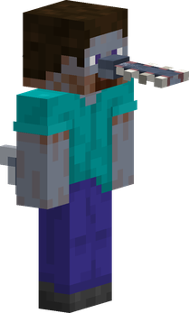
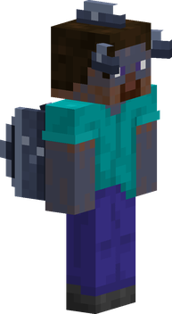
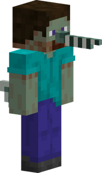

---
tags:
  - fishman
  - saw-shark
  - ray
  - garfish
  - swim
---

# Fishmen

{ .mod-icon }

The base mod's fishmen and their three sub-races, **Saw-shark**, **Ray** and **Garfish**, made whole: a body of their own on the player, the sub-race's skin colour, and a passive for every fishman plus one per sub-race. They replace the base mod's Fishman Passive Bonuses.

| | |
|---|---|
| **Size** | 1.25, about 2.25 blocks high (slider about 0.94 to 1.56) |
| **Passives** | Fishman Body, and one per sub-race |
| **Techniques** | none added by this mod |

<figure markdown>

<figcaption>Saw-shark</figcaption>
</figure>

<figure markdown>

<figcaption>Ray</figcaption>
</figure>

<figure markdown>

<figcaption>Garfish</figcaption>
</figure>

In 3D: drag to turn, scroll or pinch to zoom. The buttons switch between the three sub-races.

## Their look

A fishman player wears their sub-race's features over their own skin, and the skin-coloured parts of that skin (not the hair, eyes, mouth or clothes) take the sub-race's colour, in first person too:

| Sub-race | Skin | Features |
|---|---|---|
| Saw-shark (Arlong's) | pale steel blue | a muzzle with a long drooping rostrum and its saw of teeth on both sides, gills, a dorsal fin in two parts curving back, small fins on the forearms |
| Ray (Kuroobi's) | slate | broad fins along the arms that ripple as he runs, lobes at the temples, a crest, a ray's tail with its barb, swaying |
| Garfish | sea green | two long thin jaws, gills, a dorsal fin in two parts, small fins on the forearms |

Fins, lobes, crest and tail are slabs with some thickness, and the gills small ridges on the neck. In another mod's form that has its own skin, such as Missing Missing no Mi's King Cobra hybrid, a fishman wears the form's skin, then their fishman colour again on leaving it.

The features take the skin colour picked in the character creator, if any. A slim (Alex) skin gets its arm fins moved onto its narrower arms. The pictures above are drawn on Steve's skin.

## Passives

| Passive | Who | Bonus |
|---|---|---|
| { .fruit-icon } [Fishman Body](#fishman-body) | every fishman | swim speed +200 % (x3); under water: endless air, Night Vision, Haste |
| { .fruit-icon } [Saw-shark Body](#saw-shark-body) | Saw-shark | +3 damage; bare-fisted blows may make the target bleed |
| { .fruit-icon } [Ray Body](#ray-body) | Ray | +1 toughness; bare-handed: +2 damage, +25 % attack speed |
| { .fruit-icon } [Garfish Body](#garfish-body) | Garfish | swim speed +100 % more (x4 in all) |

A fishman with no sub-race holds Fishman Body alone. The base mod's fishman NPCs (Arlong, Kuroobi, Chew...) carry their sub-race's passive too.

### Fishman Body { #fishman-body }

{ .ability-icon } *Passive, every fishman*

The user swims fast and breathes and sees under water.

| Stat | Value |
|---|---|
| Swim speed | +200 % |
| Eyes under water | air always full, Night Vision, Haste I |

As with the base mod's passive, a Devil Fruit user loses it in the water, unless a Bubbly Coral keeps them dry.

### Saw-shark Body { #saw-shark-body }

{ .ability-icon } *Passive, Saw-shark*

The user hits harder, and a bare-fisted blow now and then leaves a bleeding wound.

| Stat | Value |
|---|---|
| Damage | +3 |
| Bleeding | 5 % of bare-fisted blows, for 3 s (the base mod's Bleeding) |

### Ray Body { #ray-body }

{ .ability-icon } *Passive, Ray*

A master of Fishman Karate: sturdier than other fishmen, and their bare-handed blows hit harder and faster.

| Stat | Value |
|---|---|
| Toughness | +1, always |
| Damage | +2, with an empty main hand |
| Attack speed | +25 %, with an empty main hand |

### Garfish Body { #garfish-body }

{ .ability-icon } *Passive, Garfish*

The swiftest of the fishmen in the water.

| Stat | Value |
|---|---|
| Swim speed | +100 %, on top of Fishman Body's: x4 against the other fishmen's x3 |
