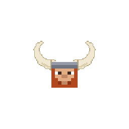
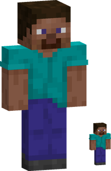

---
tags:
  - giant
  - elbaf
  - wotan
  - ancient-giant
  - hakoku
---

# Giants

{ .mod-icon }

*The people of Elbaf, many times a man's height: their reach, their blows and their strides are a giant's.*

| | |
|---|---|
| **Size** | 4 for an Elbaf giant: about 7.2 blocks high and 2.4 wide (slider 3.75 to 4.25). Wotan 2.5, Ancient giants 6: see [the three peoples](#sub-races) |
| **Passive** | Pride of Elbaf, and one more for the Wotan and the Ancient giants |
| **Techniques** | 6, and a 7th for the Ancient giants; Shoulder Carry for all |
| **In the abilities menu** | { .fruit-icon } their own category |
| **Rokushiki** | giants do not count as humans |

{ .form-picture }

In 3D: drag to turn, scroll or pinch to zoom.

A giant is the player's own body at four times the size: reach, blows, health, strides and techniques all grow with it, through [AkumaLib](../../akumalib/index.md)'s size system. He steps over relief up to about a quarter of his height. Server owners can take the giants out of the character creator ([configuration](configuration.md)).

## The three peoples { #sub-races }

The character creator offers the giants in three peoples. All three are giants: they keep the postures, the terrain rules, the hands and the techniques below. A player who was a giant before the peoples existed has none, and stays a giant of size 4.

| | Elbaf Giant | Wotan | Ancient Giant |
|---|---|---|---|
| Size | 4 | 2.5 | 6 |
| Height and width | 7.2 x 2.4 blocks | 4.5 x 1.5 blocks | 10.8 x 3.6 blocks |
| Slider | 3.75 to 4.25 | 2.34 to 2.66 | 5.63 to 6.38 |
| Passives | Pride of Elbaf | Pride of Elbaf, [Wotan Body](#wotan-body) | Pride of Elbaf, [Ancient Blood](#ancient-blood) |
| Techniques | the 6 below | the 6 below | the 6 below and [Continent Puller](#continent-puller) |

- **Elbaf Giant**: the giant as he was, proud warriors who never give way.
- **Wotan**: half giant and half fishman, smaller than a true giant, at home under water, with a fishman's dorsal fin.
- **Ancient Giant**: Oars's bloodline, horned, far bigger than any other giant. His skin is red, green or the player's own, a third each (since 0.3.0, some players changed colour once). The horns' shape and colour are picked from the player's identity, so they never change; there are five shapes since 0.3.0, and some players who already had horns got another one, once.

The slider is the same for all three: 6.25 % either way, by steps of 3.125 %. The figures below are for an Elbaf giant at size 4 unless they say otherwise: reach, damage and cooldowns follow each body's size.

## A giant in a human world

### Low roofs: hunched and on all fours

- Under a roof too low for him, he **hunches**: half his height (3.6 blocks), walking at 0.6 of his speed, and his techniques reach and hit only as much as a man's (half as much, for a giant of size 4). **Shift** hunches him too.
- Lower still, he goes **on all fours**: a third of his height (2.4 blocks), at 0.3 of his speed, and he uses **no technique** (his passive goes on).
- In a hybrid form of a Devil Fruit, the form bends with his hunched body, and tails lie as they do when he stands.

### Blocks: zones and precision (G)

- By default he **breaks a 3x3x3** (an Ancient giant a **5x5x5**, so he fits the hole he digs): the 3x3 of the face he aims at and the two layers behind it. The zone breaks in the time of its hardest block, the tool wears once per block, and every block drops what it would.
- He **places a 3x3x3** the same way (an Ancient giant a 5x5x5), growing out of the face toward him, **one item per block placed**, as long as he holds some.
- Blocks with something inside (chests, furnaces...) are never taken in a zone, only the one he aims at.
- The **G** key (Controls: "Giant: zones / precision") switches to **precision mode**: one block at a time, with his long reach (about 12.7 blocks at size 4). The mode is shown on screen.
- Zones follow the base mod's ability griefing setting and its protected areas: where they forbid it, he works block by block. A server can turn zones off for everyone (`giantAreaBlocks`).

### Plants

He walks through **leaves** and **bamboo** without breaking them. **Vines** (all kinds) do not hold him up. **Cobwebs** and **sweet berry bushes** do not slow him, and the bushes do not hurt him. Each list is a block tag (`racenomi:giant_passes_through`, `giant_does_not_climb`, `giant_not_stuck_in`), for packs and other mods.

### Water and portals

- In water that leaves his eyes above it, he **wades**: he walks on the bottom at his land speed. With his eyes under, he swims as anyone.
- A nether portal takes him as soon as he **touches** it (within half a block of his body), even one made for a man; the game's usual wait follows. On arrival he is given room for his body.

### Sleep: the couch

A man's bed is too small for him. A giant sleeps on a **couch**: a 3x3 of **hay bales** or **wool** (tag `racenomi:giant_bedding`), clicked with an empty hand. The bed's rules stay: at night, no monster near, and room to lie down (9 blocks long, 3 wide, 2 high above the couch). The couch becomes his respawn point. A server can turn the couch off (`giantCouch`): he then sleeps in a normal bed.

### Chests and other blocks

His long arm reaches chests and other blocks from where he stands, so a man's house stays usable from outside.

## Pride of Elbaf { #elbaf-pride }

{ .ability-icon } *Passive, giants*

The user never gives way: weakness and despair do not take hold of them, and they hit harder when near defeat.

| Stat | Value |
|---|---|
| Refuses | Weakness, and the base mod's Negative |
| Damage under 30 % health | +25 % |

## Wotan Body { #wotan-body }

{ .ability-icon } *Passive, Wotan*

Half a fishman: the user swims fast, breathes and sees under water, and their slippery skin takes less from fists and blunt blows.

| Stat | Value |
|---|---|
| Swim speed | +200 % |
| Eyes under water | air always full, Night Vision, Haste I |
| Blunt damage taken | -30 % |

Blunt means a fist or an empty hand, a blunt weapon or a blunt technique. As with [Fishman Body](fishmen.md#fishman-body), a Devil Fruit user loses the swimming in water, unless a Bubbly Coral keeps them dry.

## Ancient Blood { #ancient-blood }

{ .ability-icon } *Passive, Ancient giants*

The blood of the first conquerors of the New World: the user keeps going, and blows do not push them back.

| Stat | Value |
|---|---|
| Toughness | +3 |
| Knockback | none: blows do not push them |

Nothing is added to the damage: the size gives it.

## Shoulder Carry { #shoulder-carry }

{ .ability-icon } *Passive, giants*

Right-click with an empty hand on a crouching player at least twice smaller than the giant to take them on his shoulder, one at a time. They can hit and use their techniques from there, but not on him, and he does not hurt them. They get down by crouching again, their fall spared; a crouching giant sets them down with an empty right-click.

## Higher steps and water { #steps }

A giant steps a third of his height: the Wotan 1.5 blocks, the Elbaf giant 2.4, the Ancient giant 3.6. A giant wading in water can jump, and climbs out onto a bank no higher than his step.

## Techniques

In the abilities tree, a branch only giants see: Stomp first, then Giant's Grip, Boulder Throw and Elbaf Charge, then Hakoku, then Roar of Elbaf. Continent Puller sits after Boulder Throw and only the Ancient giants see it.

!!! note "About the values"
    Damage is what the target really loses, in health points (2 = one heart), and ranges are in blocks, for a body of size 1: a giant's grow with his size. Cooldowns and times are in seconds.

| Technique | Cost | Comes after |
|---|---|---|
| { .fruit-icon } [Stomp](#stomp) | 500 Doriki, 2 martial arts points | |
| { .fruit-icon } [Giant's Grip](#giants-grip) | 1,500 Doriki, 3 martial arts points | Stomp |
| { .fruit-icon } [Boulder Throw](#boulder-throw) | 2,500 Doriki, 4 martial arts points | Stomp |
| { .fruit-icon } [Hakoku](#hakoku) | 4,000 Doriki, 6 martial arts points | Giant's Grip |
| { .fruit-icon } [Elbaf Charge](#elbaf-charge) | 1,000 Doriki, 2 martial arts points | Stomp |
| { .fruit-icon } [Roar of Elbaf](#elbaf-roar) | 5,000 Doriki, 8 martial arts points | Hakoku |
| { .fruit-icon } [Continent Puller](#continent-puller), Ancient giants only | 4,000 Doriki, 6 martial arts points | Boulder Throw |

### Stomp { #stomp }

{ .ability-icon } *Active, giants*

The user brings their foot down: the ground shakes around them, and those at their feet are hurt and thrown up and back. The area grows with his size.

| Stat | Value |
|---|---|
| Cooldown | 10 s |
| Damage | 4 |
| Range | 4 blocks around |

### Giant's Grip { #giants-grip }

{ .ability-icon } *Active, giants*

The user takes a body in their fist and holds it before their chest. Used again, it is thrown where they look and is hurt when it slams into a wall, the ground or another body. A body more than half his height is too big to hold, and one that blocks, guards or dodges cannot be taken.

| Stat | Value |
|---|---|
| Cooldown | 15 s |
| Hold | up to 5 s |
| Reach | 3 blocks |
| Damage | 10, when the thrown body slams into something |
| Lets go | once he takes 8 damage |

### Boulder Throw { #boulder-throw }

{ .ability-icon } *Active, giants*

The user tears a boulder of real ground out in front of them and lifts it over their head. Used again (or when the time runs out), it is thrown where they look and bursts on the first block or body it hits.

| Stat | Value |
|---|---|
| Cooldown | 12 s |
| Hold | up to 5 s |
| Damage | 14, to enemies around where it bursts |
| Range | 3 blocks around the burst |
| Boulder | 3 x 3 x 2 blocks for a man, 5 x 5 x 4 for a giant at size 4 |

The world is not damaged: the hole closes 20 seconds after the throw. Very hard blocks (obsidian and the like) and blocks with something inside stay in the ground, and the ability griefing setting and protected areas are followed.

### Hakoku { #hakoku }

{ .ability-icon } *Active, giants*

The strike of Elbaf's warriors: with a weapon in hand, the user swings a cut that flies on and goes through every body on its way.

| Stat | Value |
|---|---|
| Cooldown | 15 s |
| Damage | 20 |
| Range | 32 blocks (line) |
| Needs | a weapon in the main hand |

### Elbaf Charge { #elbaf-charge }

{ .ability-icon } *Active, giants*

The user charges straight ahead, along the way they faced when they started, whatever they look at after, and stops at a wall. Every enemy met is hit once, and those half his size or less are thrown aside; a body as big as his takes the blow without moving. Blocks are not broken. It works only standing up, not hunched.

| Stat | Value |
|---|---|
| Cooldown | 12 s, at size 4 |
| Damage | 8 |
| Range | 16 blocks in 0.8 s at size 4 (a man's body would run 8) |

### Roar of Elbaf { #elbaf-roar }

{ .ability-icon } *Active, giants*

The user roars. Enemies half his size or less around them are slowed and weakened, and the user and their allies (players of their team, or of their faction and not enemies) hit harder for a while.

| Stat | Value |
|---|---|
| Cooldown | 30 s, at size 4 |
| Range | 6 blocks around for a man, 12 at size 4 |
| Enemies | Slowness II and Weakness for 4 s |
| User and allies | Strength I for 10 s |

### Continent Puller { #continent-puller }

{ .ability-icon } *Active, Ancient giants*

After Oars's epithet. The user sinks their hands into the ground and hauls it toward them: every enemy on a wide line ahead is hit and dragged to their feet. It breaks no block.

| Stat | Value |
|---|---|
| Cooldown | 14 s |
| Damage | 24, the strongest giant technique |
| Range | 12 blocks (a wide line) |
