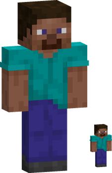

---
tags:
  - giant
  - elbaf
  - hakoku
---

# Giants

{ .mod-icon }

*The people of Elbaf, many times a man's height: their reach, their blows and their strides are a giant's.*

| | |
|---|---|
| **Size** | 4: about 7.2 blocks high and 2.4 wide (slider 3.75 to 4.25) |
| **Passive** | Pride of Elbaf |
| **Techniques** | 4 |
| **In the abilities menu** | { .fruit-icon } their own category |
| **Rokushiki** | giants do not count as humans |

{ .form-picture }

In 3D: drag to turn, scroll or pinch to zoom.

A giant is the player's own body at four times the size: reach, blows, health, strides and techniques all grow with it, through [AkumaLib](../../akumalib/index.md)'s size system. He steps over relief up to about a quarter of his height. Server owners can take the giants out of the character creator ([configuration](configuration.md)).

## A giant in a human world

### Low roofs: hunched and on all fours

- Under a roof too low for him, he **hunches**: half his height (3.6 blocks), walking at 0.6 of his speed, and his techniques reach and hit only half as much (a man's again). **Shift** hunches him too.
- Lower still, he goes **on all fours**: a third of his height (2.4 blocks), at 0.3 of his speed, and he uses **no technique** (his passive goes on).
- In a hybrid form of a Devil Fruit, the form bends with his hunched body, and tails lie as they do when he stands.

### Blocks: zones and precision (G)

- By default he **breaks a 3x3x3**: the 3x3 of the face he aims at and the two layers behind it. The zone breaks in the time of its hardest block, the tool wears once per block, and every block drops what it would.
- He **places a 3x3x3** the same way, growing out of the face toward him, **one item per block placed**, as long as he holds some.
- Blocks with something inside (chests, furnaces...) are never taken in a zone, only the one he aims at.
- The **G** key (Controls: "Giant: zones / precision") switches to **precision mode**: one block at a time, with his long reach (about 12.7 blocks at size 4). The mode is shown on screen.
- Zones follow the base mod's ability griefing setting and its protected areas: where they forbid it, he works block by block. A server can turn zones off for everyone (`giantAreaBlocks`).

### Plants

He walks through **leaves** and **bamboo** without breaking them. **Vines** (all kinds) do not hold him up. **Cobwebs** and **sweet berry bushes** do not slow him, and the bushes do not hurt him. Each list is a block tag (`racenomi:giant_passes_through`, `giant_does_not_climb`, `giant_not_stuck_in`), for packs and other mods.

### Water and portals

- In water that leaves his eyes above it, he **wades**: he walks on the bottom at his land speed. With his eyes under, he swims as anyone.
- A nether portal takes him as soon as he **touches** it (within half a block of his body), even one made for a man; the game's usual wait follows. On arrival he is given room for his body.

### Sleep: the couch

A man's bed is too small for him. A giant sleeps on a **couch**: a 3x3 of **hay bales** or **wool** (tag `racenomi:giant_bedding`), clicked with an empty hand. The bed's rules stay: at night, no monster near, and room to lie down (9 blocks long, 3 wide, 2 high above the couch). The couch becomes his respawn point. A server can turn the couch off (`giantCouch`): he then sleeps in a normal bed.

### Chests and other blocks

His long arm reaches chests and other blocks from where he stands, so a man's house stays usable from outside.

## Pride of Elbaf { #elbaf-pride }

{ .ability-icon } *Passive, giants*

The user never gives way: weakness and despair do not take hold of them, and they hit harder when near defeat.

| Stat | Value |
|---|---|
| Refuses | Weakness, and the base mod's Negative |
| Damage under 30 % health | +25 % |

## Techniques

In the abilities tree, a branch only giants see: Stomp first, then Giant's Grip and Boulder Throw, then Hakoku.

!!! note "About the values"
    Damage is what the target really loses, in health points (2 = one heart), and ranges are in blocks, for a body of size 1: a giant's grow with his size. Cooldowns and times are in seconds.

| Technique | Cost | Comes after |
|---|---|---|
| { .fruit-icon } [Stomp](#stomp) | 500 Doriki, 2 martial arts points | |
| { .fruit-icon } [Giant's Grip](#giants-grip) | 1,500 Doriki, 3 martial arts points | Stomp |
| { .fruit-icon } [Boulder Throw](#boulder-throw) | 2,500 Doriki, 4 martial arts points | Stomp |
| { .fruit-icon } [Hakoku](#hakoku) | 4,000 Doriki, 6 martial arts points | Giant's Grip |

### Stomp { #stomp }

{ .ability-icon } *Active, giants*

The user brings their foot down: the ground shakes around them, and those at their feet are hurt and thrown up and back. The area grows with his size.

| Stat | Value |
|---|---|
| Cooldown | 10 s |
| Damage | 4 |
| Range | 4 blocks around |

### Giant's Grip { #giants-grip }

{ .ability-icon } *Active, giants*

The user takes a body in their fist and holds it before their chest. Used again, it is thrown where they look and is hurt when it slams into a wall, the ground or another body. A body more than half his height is too big to hold, and one that blocks, guards or dodges cannot be taken.

| Stat | Value |
|---|---|
| Cooldown | 15 s |
| Hold | up to 5 s |
| Reach | 3 blocks |
| Damage | 10, when the thrown body slams into something |
| Lets go | once he takes 8 damage |

### Boulder Throw { #boulder-throw }

{ .ability-icon } *Active, giants*

The user tears a boulder of real ground out in front of them and lifts it over their head. Used again (or when the time runs out), it is thrown where they look and bursts on the first block or body it hits.

| Stat | Value |
|---|---|
| Cooldown | 12 s |
| Hold | up to 5 s |
| Damage | 14, to enemies around where it bursts |
| Range | 3 blocks around the burst |
| Boulder | 3 x 3 x 2 blocks for a man, 5 x 5 x 4 for a giant at size 4 |

The world is not damaged: the hole closes 20 seconds after the throw. Very hard blocks (obsidian and the like) and blocks with something inside stay in the ground, and the ability griefing setting and protected areas are followed.

### Hakoku { #hakoku }

{ .ability-icon } *Active, giants*

The strike of Elbaf's warriors: with a weapon in hand, the user swings a cut that flies on and goes through every body on its way.

| Stat | Value |
|---|---|
| Cooldown | 15 s |
| Damage | 20 |
| Range | 32 blocks (line) |
| Needs | a weapon in the main hand |
