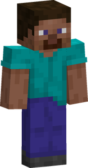

---
tags:
  - human
---

# Humans

{ .mod-icon }

The base mod's humans, with a passive of their own. Humans have no body bonus as the other races have, but they grow faster than anyone.

| | |
|---|---|
| **Size** | 1, 1.8 blocks high (slider 0.75 to 1.25) |
| **Passive** | Human Will |
| **Techniques** | none added by this mod |

<!-- models -->

<figure markdown>

<figcaption>Human, size 1</figcaption>
</figure>

In 3D: drag to turn, scroll or pinch to zoom.

<!-- /models -->

## Human Will { #human-will }

{ .ability-icon } *Passive, humans*

The user has no body bonus as the other races have, but grows faster: more Doriki and more Haki experience from all they do.

| Stat | Value |
|---|---|
| Doriki gained | +25 % |
| Haki experience gained | +25 %, for all three Haki |

Training points are not raised. Only the base mod's own humans hold it: the sky people count as humans for Rokushiki, but have passives of their own instead. So do the [Buccaneers](buccaneers.md) and the [modified humans](modified-humans.md), who have no Human Will.
