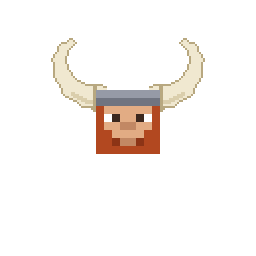

# Race Race no Mi

{ .mod-icon }

**Race Race no Mi** brings the races of One Piece to [Mine Mine no Mi](https://www.curseforge.com/minecraft/mc-mods/mine-mine-no-mi-mod). You pick your race and sub-race in the character creator: each one has its own body, its own passive and, for the sky people and the giants, techniques of their own in the abilities tree.

| | |
|---|---|
| Version documented | **0.1.1** (beta) |
| Mod id | `racenomi` |
| Configuration | [Server settings](configuration.md) |
| Changelog | [Every release](changelog.md) |

## The races

| Race | Size | What makes it |
|---|---|---|
| { .fruit-icon } [Sky People](sky-people.md): Skypiean, Birkan, Shandia | 1 | wings, the dials, the Mantra, stronger the higher they stand; 9 techniques |
| { .fruit-icon } [Fishmen](fishmen.md): Saw-shark, Ray, Garfish | 1.25 | fins and a snout, fast swimmers who breathe under water |
| { .fruit-icon } [Humans](humans.md) | 1 | no body bonus, but more Doriki and Haki experience |
| { .fruit-icon } [Giants](giants.md) | 4 | about 7 blocks high, blocks by 3x3x3, a couch of hay; 4 techniques |

The base mod's other races (Mink, Cyborg...) are left as they are.

## Your size

Every race has a size, set in the character creator with a slider: a man is 1, a fishman 1.25, a giant 4. Reach, blows, health, strides and techniques all follow the body, through [AkumaLib](../../akumalib/index.md)'s size system: a giant's Stomp covers more ground than a man's would. The figures on these pages are for a body of size 1 unless they say otherwise.

| Race | Size | Slider |
|---|---|---|
| Humans, sky people | 1 | 0.75 to 1.25, by steps of 0.125 |
| Fishmen | 1.25 | about 0.94 to 1.56 (the same slider, times 1.25) |
| Giants | 4 | 3.75 to 4.25, by steps of 0.125 |

## The techniques

The sky people's and the giants' techniques sit in a branch of their own in the abilities tree, right of the base mod's races. Each one costs Doriki and training points, like the base mod's race techniques. A player only sees the techniques of their own race in the tree, and loses them on leaving the race (by the book or by command).

## Requirements

| Mod | Version |
|---|---|
| Minecraft | 1.20.1 |
| Forge | 47.4.18 or later |
| Mine Mine no Mi | 0.11.6 |
| [AkumaLib](../../akumalib/index.md) | 6.1.0 or later |
| [Sky Island](../sky-island/index.md) | optional: the sky people are at their strongest in Skypiea |

Needed on both the client and the server.
