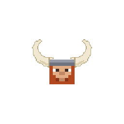
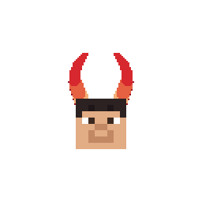
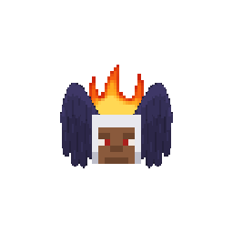
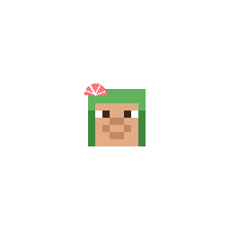

# Race Race no Mi

{ .mod-icon }

**Race Race no Mi** brings the races of One Piece to [Mine Mine no Mi](https://www.curseforge.com/minecraft/mc-mods/mine-mine-no-mi-mod). You pick your race and sub-race in the character creator: each one has its own body, its own passive and, for every race but the humans and the fishmen, techniques of their own in the abilities tree.

| | |
|---|---|
| Version documented | **0.3.0** (beta) |
| Mod id | `racenomi` |
| Configuration | [Server settings](configuration.md) |
| Changelog | [Every release](changelog.md) |

## The races

| Race | Size | What makes it |
|---|---|---|
| { .fruit-icon } [Sky People](sky-people.md): Skypiean, Birkan, Shandia | 1 | wings, the dials, the Mantra, stronger the higher they stand; 9 techniques |
| { .fruit-icon } [Fishmen](fishmen.md): Saw-shark, Ray, Garfish | 1.25 | fins and a snout, fast swimmers who breathe under water |
| { .fruit-icon } [Humans](humans.md) | 1 | no body bonus, but more Doriki and Haki experience |
| { .fruit-icon } [Giants](giants.md): Elbaf Giant, Wotan, Ancient Giant | 4, 2.5, 6 | about 7 blocks high for an Elbaf giant, blocks by 3x3x3, a couch of hay; 6 techniques, 7 for the Ancient giants |
| { .fruit-icon } [Oni](oni.md) | 1.75 | horns, hard bare hands, harder with a blunt weapon, stronger when drunk; 7 techniques |
| { .fruit-icon } [Tontatta](tontatta.md) | 0.25 | a hand high, a tail, blows as hard as a man's; 7 techniques |
| { .fruit-icon } [Lunarians](lunarians.md) | 1.5 | black wings and a flame on the back, lit or out; 7 techniques |
| { .fruit-icon } [Buccaneers](buccaneers.md): three busts | 2 | twice a man's height, a broad chest, they take the blows for their friends; 6 techniques |
| { .fruit-icon } [Merfolk](merfolk.md): Mermaid, Great Merfolk | 1, 1.25 | a fish tail in the water, legs on land, the fastest swimmers; 6 techniques |
| { .fruit-icon } [Modified Humans](modified-humans.md) | 1 | the Vinsmoke's bodies and the five Raid Suits of Germa 66, 7 techniques a suit |

The base mod's other races (Mink, Cyborg...) are left as they are.

## Compare the races { #compare }

What each body gives, side by side, from the race pages (size 1 figures, a race at its own size). Every technique with its cost and figures: [All techniques](all-techniques.md).

| Race | Size | Body | In the water | Own techniques |
|---|---|---|---|---|
| [Humans](humans.md) | 1 | +25 % Doriki and Haki experience | a man's | none |
| [Sky People](sky-people.md) | 1 | wings; by sub-race +20 % speed, or +1 to +3 damage and +1 to +2 toughness; stronger the higher they stand | a man's | 3, and 2 per sub-race |
| [Fishmen](fishmen.md) | 1.25 | by sub-race +3 damage and bleeding, +2 bare-handed damage and +1 toughness, or faster swimming | swim x3 (Garfish x4), breathe and see under water | none |
| [Giants](giants.md) | 4 (Wotan 2.5, Ancient 6) | never give way, +25 % damage under 30 % health; Wotan -30 % blunt damage; Ancient +3 toughness, not pushed back | Wotan: swim x3, breathe and see under water | 6, 7 for the Ancient |
| [Oni](oni.md) | 1.75 | +2 bare-handed damage, +1 toughness, +20 % with a blunt weapon, stronger when drunk | a man's | 7 |
| [Tontatta](tontatta.md) | 0.25 | +15 % speed, a 4.25-block jump, 6-block falls unhurt, blows that push as a man's | a man's | 7 |
| [Lunarians](lunarians.md) | 1.5 | +1 bare-handed damage; flame lit: -50 % damage taken; flame out: +40 % speed, +25 % attack speed, +2 bare-handed damage | a man's | 7, 2 of them given |
| [Buccaneers](buccaneers.md) | 2 | +2 bare-handed damage, +2 toughness, left at 1 health once every 5 minutes | a man's | 6 |
| [Merfolk](merfolk.md) | 1 (Great Merfolk 1.25) | Great Merfolk: +2 toughness | a fish tail: swim x4.5 (Mermaid faster still), breathe and see under water; lost with a Devil Fruit | 6 |
| [Modified Humans](modified-humans.md) | 1 | -25 % projectile and cutting damage, 1 health every 2 s, +2 bare-handed damage, +10 % speed; in a suit -50 % fire damage, no fall damage, +4 bare-handed damage; nobody trades with them | a man's | 7 a suit |

## Your size

Every race has a size, set in the character creator with a slider: a man is 1, a fishman 1.25, a Lunarian 1.5, an Oni 1.75, a Buccaneer 2, a giant 4, a Tontatta 0.25. Reach, blows, health, strides and techniques all follow the body, through [AkumaLib](../../akumalib/index.md)'s size system: a giant's Stomp covers more ground than a man's would. The figures on these pages are for a body of size 1 unless they say otherwise (the Tontatta and Lunarian pages give them at the race's own size).

| Race | Size | Slider |
|---|---|---|
| Humans, sky people, modified humans, Mermaids | 1 | 0.75 to 1.25, by steps of 0.125 |
| Fishmen, Great Merfolk | 1.25 | about 0.94 to 1.56 (the same slider, times 1.25) |
| Lunarians | 1.5 | 1.41 to 1.59, by steps of about 0.047 |
| Oni | 1.75 | 1.64 to 1.86, by steps of about 0.055 |
| Buccaneers | 2 | 1.875 to 2.125, by steps of 0.0625 |
| Giants: Wotan | 2.5 | 2.34 to 2.66, by steps of about 0.078 |
| Giants: Elbaf Giant | 4 | 3.75 to 4.25, by steps of 0.125 |
| Giants: Ancient Giant | 6 | 5.63 to 6.38, by steps of about 0.19 |
| Tontatta | 0.25 | none |

## The techniques

The techniques of the sky people, the giants, the Oni, the Tontatta, the Lunarians, the Buccaneers and the merfolk sit in a branch of their own in the abilities tree, right of the base mod's races. Each one costs Doriki and training points, like the base mod's race techniques. A player only sees the techniques of their own race in the tree, and loses them on leaving the race (by the book or by command). The modified humans' techniques come with the Raid Suit they wear, not from the tree.

**By command**, `/ability unlock_group` has a group for each race and sub-race (`racenomi:giant`, `racenomi:wotan`...): a race gives its whole kit, a sub-race only its own. A technique given by a command is not taken back by the race check.

## Requirements

| Mod | Version |
|---|---|
| Minecraft | 1.20.1 |
| Forge | 47.4.2 or later (an older Forge crashes when a chest is opened) |
| Mine Mine no Mi | 0.11.6 |
| [AkumaLib](../../akumalib/index.md) | 6.4.0 or later |
| [Sky Island](../sky-island/index.md) | optional: the sky people are at their strongest in Skypiea |

Needed on both the client and the server.
