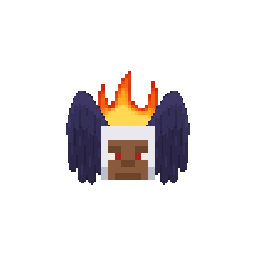
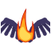
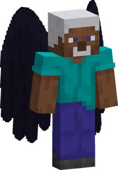
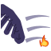
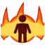
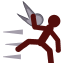

---
tags:
  - lunarian
  - flame
  - wings
---

# Lunarians

{ .mod-icon }

*Tall folk with brown skin, white hair and big black wings. They light the flame on their back to use their techniques; while it burns they are very tough, and when it is out they are quick fighters.*

| | |
|---|---|
| **Size** | 1.5: about 2.7 blocks high and 0.9 wide (slider 1.41 to 1.59) |
| **Passive** | Lunarian Blood |
| **Techniques** | 7, two of them given with the race |
| **In the abilities menu** | { .fruit-icon } their own category |
| **Rokushiki** | Lunarians do not count as humans |

A Lunarian is the player's own body at one and a half times the size: reach, blows, health, strides and techniques all grow with it, through [AkumaLib](../../akumalib/index.md)'s size system. Their brown skin and white hair are laid over any skin, with black wings and a flame on the back.

**Hold sneak** and they hunch to a man's height (1.8 blocks), which takes them through a door: at 0.9 wide they need no narrowing of the shoulders. Hunched, a Lunarian walks at half their speed, and their techniques reach and hit only as much as a man's.

<!-- models -->

<figure markdown>

<figcaption>Lunarian, size 1.5</figcaption>
</figure>

In 3D: drag to turn, scroll or pinch to zoom.

<!-- /models -->

## The flame

The flame on a Lunarian's back is **lit** or **out**. It starts **out** at every login and in every new life, and goes out in water. Lunarian Blood holds the figures:

| | Lit | Out |
|---|---|---|
| Damage taken | -50 % | |
| Techniques | all of them | only [Flame Switch](#flame-switch) |
| Speed | | +40 % |
| Attack speed | | +25 % |
| Bare hand damage | | +2 |
| Jump height | | +0.5 block |

A technique that needs the flame is greyed out in the slots while it is out. [Flame Switch](#flame-switch) lights it and puts it out. Under water the flame goes out by itself, and cannot be lit again until the Lunarian is out of the water.

## Lunarian Blood { #lunarian-blood }

{ .ability-icon } *Passive, Lunarians*

Fire does not burn the user: fire and lava do them no harm. With the flame lit they take much less damage and can use their techniques; with it out they run, hit and jump faster and harder.

| Stat | Value |
|---|---|
| Bare hand damage | +1, always |
| Damage taken, flame lit | -50 % |
| Speed, flame out | +40 % |
| Attack speed, flame out | +25 % |
| Bare hand damage, flame out | +2, on top of the +1 |
| Jump height, flame out | +0.5 block |

Damage that goes through everything (the void, `/kill`) is not halved.

## Techniques

Two techniques come with the race and need no points: **Black Wings** and **Flame Switch**. The other three sit in a branch only Lunarians see in the abilities tree: Flame Blast first, then Flaming Blow, then Flame Shroud.

!!! note "About the values"
    Damage is what the target really loses, in health points (2 = one heart), for a Lunarian of their own size 1.5: the figures are what the race does, ranges included. Cooldowns and times are in seconds. Sizes and slider: [Your size](index.md#your-size).

| Technique | Cost | Comes after | Flame |
|---|---|---|---|
| { .fruit-icon } [Black Wings](#black-wings) | given with the race | | lit |
| { .fruit-icon } [Flame Switch](#flame-switch) | given with the race | | either |
| { .fruit-icon } [Flame Blast](#flame-blast) | 500 Doriki, 2 martial arts points | | lit |
| { .fruit-icon } [Flaming Blow](#flaming-blow) | 1,000 Doriki, 2 martial arts points | Flame Blast | lit |
| { .fruit-icon } [Wing Gust](#wing-gust) | 1,500 Doriki, 3 martial arts points | Flame Blast | either, burns when lit |
| { .fruit-icon } [Flame Shroud](#flame-shroud) | 3,000 Doriki, 5 martial arts points | Flaming Blow and Flame Blast | lit |
| { .fruit-icon } [Flameless Rush](#flameless-rush) | 2,000 Doriki, 3 martial arts points | Flaming Blow | out |

### Black Wings { #black-wings }

{ .ability-icon } *Active, Lunarians*

The user takes off at once and flies for a few seconds, leaning forward. Then the wings stop and the body falls as any body does, so the landing is theirs to choose. Putting the flame out ends the flight.

| Stat | Value |
|---|---|
| Cooldown | 15 s, from the end of the flight |
| Flight | 8 s |
| Ceiling | 20 blocks over the ground |

They fly at the base mod's Pteranodon's top speed, and reach it in about 3 seconds. Sprinting flies faster than cruising. The wings give way to another flight the body can use (a Devil Fruit's) and in a whole form, which hides them: the technique is then refused. The double jump does nothing here. Black Wings does not grow with the size.

### Flame Switch { #flame-switch }

{ .ability-icon } *Active, Lunarians*

The user lights the flame on their back or puts it out. It cannot be lit under water.

| Stat | Value |
|---|---|
| Cooldown | 10 s |

Flame Switch does not grow with the size.

### Flame Blast { #flame-blast }

{ .ability-icon } *Active, Lunarians*

A jet of flame straight ahead that goes through everything it meets and sets it on fire. With nobody in the way the jet still goes. No block catches fire.

| Stat | Value |
|---|---|
| Cooldown | 10 s |
| Damage | 12, and 3 s of burning |
| Range | 8 blocks (line) |

### Flaming Blow { #flaming-blow }

{ .ability-icon } *Active, Lunarians*

A burning blow on the nearest enemy ahead. With nobody in reach it does not go.

| Stat | Value |
|---|---|
| Cooldown | 8 s |
| Damage | 14, and 3 s of burning |
| Range | 3 blocks (line) |

### Flame Shroud { #flame-shroud }

{ .ability-icon } *Active, Lunarians*

A shape of flame wraps round the user and burns everyone close, once a second. Putting the flame out ends it.

| Stat | Value |
|---|---|
| Cooldown | 25 s, from the end |
| Duration | 5 s |
| Damage | 3 a second |
| Range | 4 blocks around |

### Wing Gust { #wing-gust }

{ .ability-icon } *Active, Lunarians*

The user beats their wings once: the wind throws back everything ahead, and burns it 2 s if the flame is lit. Not with the wings hidden.

| Stat | Value |
|---|---|
| Cooldown | 11 s |
| Damage | 4 |
| Range | 6 blocks ahead |

### Flameless Rush { #flameless-rush }

{ .ability-icon } *Active, Lunarians, flame out*

The flame out, the user rushes straight ahead very fast: the first enemy met is hit and stops the rush.

| Stat | Value |
|---|---|
| Cooldown | 7 s |
| Damage | 10 |
| Range | 8 blocks (line) |

## What follows the size

- **Flame Blast, Flaming Blow and Flame Shroud** are written so that the figures above are what a Lunarian of size 1.5 does: damage and reach by the size's curves (about x1.22), cooldowns about x1.09 longer than at size 1. In a bigger form (a Devil Fruit's), they grow on from there.
- **Black Wings and Flame Switch** do not grow (`akumalib:size_exempt`): a Lunarian of any size flies and lights the flame the same.
- **Hunched**, the techniques reach and hit only as much as a man's.

See [Race size and slider](../../akumalib/size/race-size.md) and [Abilities that follow the size](../../akumalib/size/abilities.md).
