---
tags:
  - merfolk
  - mermaid
  - merman
  - tail
---

# Merfolk

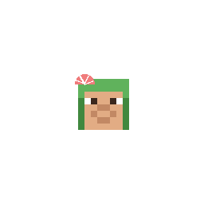{ .mod-icon }

*A fish tail in the water, legs on land: the fastest swimmers of the sea, who lose it all to a Devil Fruit.*

| | |
|---|---|
| **Size** | Mermaid 1, Great Merfolk 1.25 |
| **Sub-races** | Mermaid, Great Merfolk |
| **Passive** | Merfolk Body, and one more for each sub-race |
| **Techniques** | 6 |
| **In the abilities menu** | 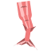{ .fruit-icon } their own category |

## The tail { #tail }

The tail comes out when a merfolk swims off the bottom of the water, or under it. Their legs shrink up into the hips as it grows, with a burst of bubbles, and it waves faster as they swim. Standing in a shallow, the legs stay. Back on land the tail goes the same way, drops falling from the hips. Leggings and boots are hidden while the tail is out.

## Two sub-races { #sub-races }

| | Sub-race | Size | Tail | Passive |
|---|---|---|---|---|
| { .fruit-icon } | **Mermaid** | 1, a man's | coral | [Swift Tail](#swift-tail) |
| 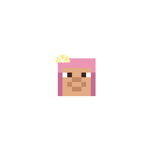{ .fruit-icon } | **Great Merfolk** | 1.25, a fishman's | grey-blue | [Great Body](#great-body) |

## Merfolk Body { #merfolk-body }

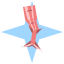{ .ability-icon } *Passive, merfolk*

The user has a fish tail in the water: they swim faster than anyone in the sea, and breathe and see in the dark under water.

| Stat | Value |
|---|---|
| Swim speed | +350 %: 4.5 times a man's (a fishman 3 times) |

**With a Devil Fruit** the user loses all of it, unless a Bubbly Coral keeps them dry.

**Fishman Karate**: the five techniques of the base mod's Fishman Karate open to every race cost a merfolk a fishman's price. Two Fish Engine and Yarinami stay the fishmen's.

## Swift Tail { #swift-tail }

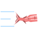{ .ability-icon } *Passive, Mermaid*

The user swims faster still than other merfolk. Not with a Devil Fruit.

| Stat | Value |
|---|---|
| Swim speed | +50 % |

## Great Body { #great-body }

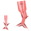{ .ability-icon } *Passive, Great Merfolk*

The user is bigger than other merfolk, as big as a fishman, and sturdier.

| Stat | Value |
|---|---|
| Toughness | +2 |

## Techniques

In the abilities tree, a branch only merfolk see: Undertow first, then Tail Sweep and Sea Escort, then Siren Song and Princely Fist, then Trident Assault. Each one has its own pose and water effects; the trident is drawn as one.

!!! note "About the values"
    Damage is what the target really loses, in health points (2 = one heart), and ranges are in blocks, for a body of size 1. Cooldowns and times are in seconds. Sizes: [Your size](index.md#your-size).

| Technique | Cost | Comes after |
|---|---|---|
| 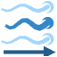{ .fruit-icon } [Undertow](#undertow) | 500 Doriki, 2 martial arts points | |
| { .fruit-icon } [Tail Sweep](#tail-sweep) | 1,000 Doriki, 2 martial arts points | Undertow |
| { .fruit-icon } [Sea Escort](#sea-escort) | 1,500 Doriki, 3 martial arts points | Undertow |
| { .fruit-icon } [Siren Song](#siren-song) | 3,000 Doriki, 5 martial arts points | Tail Sweep |
| { .fruit-icon } [Princely Fist](#princely-fist) | 2,000 Doriki, 3 martial arts points | Tail Sweep |
| 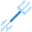{ .fruit-icon } [Trident Assault](#trident-assault) | 3,500 Doriki, 5 martial arts points | Princely Fist |

### Undertow { #undertow }

{ .ability-icon } *Active, merfolk*

The user sends a cone of water in front of them that carries enemies away and slows them. Stronger in the water.

| Stat | Value |
|---|---|
| Cooldown | 8 s |
| Damage | 6 |
| Range | 8 blocks, 12 in the water |
| Slowness | 3 s |

### Tail Sweep { #tail-sweep }

{ .ability-icon } *Active, merfolk*

The user sweeps everything around them with their tail and throws enemies away. Much stronger in the water.

With the **Alt key** it is 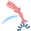{ .fruit-icon } **Tail Leap**: the user bounds ahead on their tail, and landing, the tail strikes every enemy around them. Higher and further out of the water.

| Stat | Tail Sweep | Tail Leap |
|---|---|---|
| Cooldown | 12 s | 10 s |
| Damage | 10 on land, 18 in the water | 10 on landing |
| Range | 3.5 blocks around | a bound of 8 blocks, 12 leaping from the water |

### Siren Song { #siren-song }

{ .ability-icon } *Active, merfolk*

The user sings: enemies around them are slowed and weakened as long as they hear it, and creatures forget their target. The user strikes no blow while singing, and a hit does not stop the song. Press again to stop singing, for a shorter cooldown.

| Stat | Value |
|---|---|
| Cooldown | 30 s |
| Song | 5 s |
| Range | 8 blocks around |

### Sea Escort { #sea-escort }

{ .ability-icon } *Active, merfolk*

The user guides their allies around them through the sea: players who are not their enemies and their pets swim like dolphins and breathe under water.

| Stat | Value |
|---|---|
| Cooldown | 25 s |
| Range | 6 blocks around |
| Duration | 30 s |

### Princely Fist { #princely-fist }

{ .ability-icon } *Active, merfolk*

The user lands a heavy punch on the enemy in front of them, who cannot move nor strike for a moment.

| Stat | Value |
|---|---|
| Cooldown | 11 s |
| Damage | 12 |
| Stunned | 1 s |

### Trident Assault { #trident-assault }

{ .ability-icon } *Active, merfolk*

**Trident Throw**: the user throws a trident of water far ahead. Stronger with a trident in hand.

With the **Alt key** it is **Trident Thrust**: the user thrusts straight ahead and runs through every enemy on the line.

| Stat | Trident Throw | Trident Thrust |
|---|---|---|
| Cooldown | 12 s | 12 s |
| Damage | 10, 15 with a trident in hand | 14, 21 with a trident in hand |
| Range | up to 30 blocks | 6 blocks (line) |

<!-- animations -->
??? example "Animations"

    Taken in game.

    

    <figure markdown="span">
      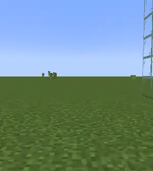{ loading=lazy }
      <figcaption>The tail</figcaption>
    </figure>
    <figure markdown="span">
      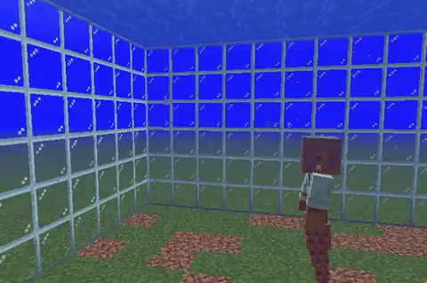{ loading=lazy }
      <figcaption>Undertow, in the water</figcaption>
    </figure>
    <figure markdown="span">
      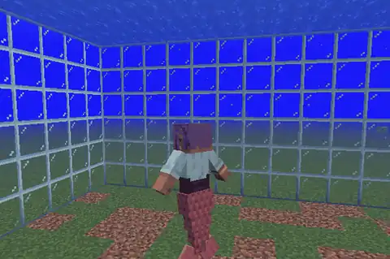{ loading=lazy }
      <figcaption>Tail Sweep, in the water</figcaption>
    </figure>
    <figure markdown="span">
      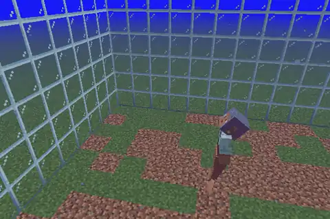{ loading=lazy }
      <figcaption>Tail Leap, from the water</figcaption>
    </figure>
    <figure markdown="span">
      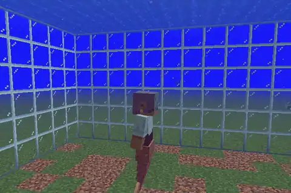{ loading=lazy }
      <figcaption>Siren Song</figcaption>
    </figure>
    <figure markdown="span">
      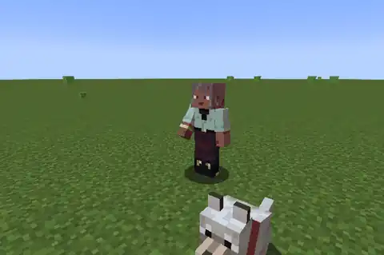{ loading=lazy }
      <figcaption>Sea Escort</figcaption>
    </figure>
    <figure markdown="span">
      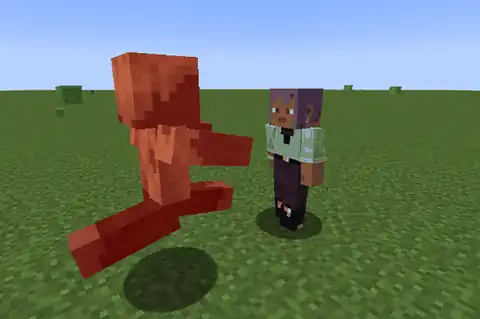{ loading=lazy }
      <figcaption>Princely Fist</figcaption>
    </figure>
    <figure markdown="span">
      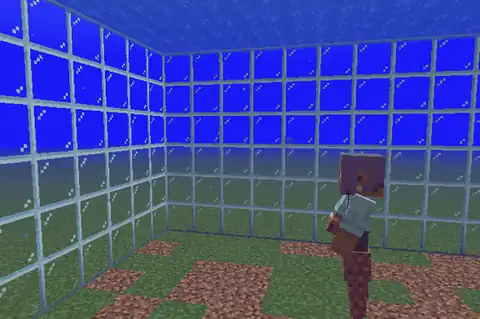{ loading=lazy }
      <figcaption>Trident Throw</figcaption>
    </figure>
    <figure markdown="span">
      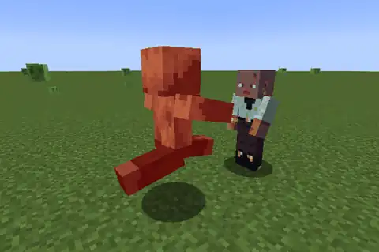{ loading=lazy }
      <figcaption>Trident Thrust</figcaption>
    </figure>
    

<!-- /animations -->
