---
tags:
  - mink
  - electro
  - sulong
  - zou
---

# Minks

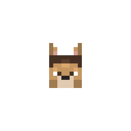{ .mod-icon }

*The fur folk of Zou: Electro in their fists, the Sulong under the full moon, and seven kinds, each with its own body and techniques.*

| | |
|---|---|
| **Sub-races** | Dog, Lion, Bunny (the base mod's), Cat, Jaguar, Polar Bear, Bull (since 0.5.0) |
| **Size** | 1, a man's; Polar Bear 1.5 (2.7 blocks), Bull 1.25 (2.25 blocks) |
| **Passives** | the base mod's Mink Passive Bonuses, and one passive for each kind |
| **Techniques** | 8 for every mink, and 1 or 2 for each kind |
| **Since** | 0.5.0: the minks are the base mod's race, taken over by this mod |

The Mink is the base mod's race, with its three kinds (Dog, Lion, Bunny). Since 0.5.0 this mod draws them anew, adds four kinds, gives each kind a passive, and replaces the minks' techniques with a full kit of its own. Every mink keeps the base mod's **Mink Passive Bonuses** (+50 % speed, a higher jump, softer falls).

## The seven kinds { #kinds }

| Kind | Size | Passive | Own techniques |
|---|---|---|---|
| { .fruit-icon } [Dog](#dog) | 1 | [Dog Mink Pack](#dog-mink-pack): stronger beside crew allies | [Inu Odoshi](#inu-odoshi) |
| { .fruit-icon } [Lion](#lion) | 1 | [Lion Mink Body](#lion-mink-body): +3 damage | [Electro Roar](#electro-roar) |
| 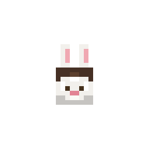{ .fruit-icon } [Bunny](#bunny) | 1 | [Bunny Mink Legs](#bunny-mink-legs): a higher jump, faster, falls of 12 blocks unhurt | [Moon Rabbit](#moon-rabbit), [Comet Rabbit](#comet-rabbit) |
| { .fruit-icon } [Cat](#cat) | 1 | [Cat Mink Eyes](#cat-mink-eyes): sees in the dark | [Aka Byobu](#aka-byobu) |
| 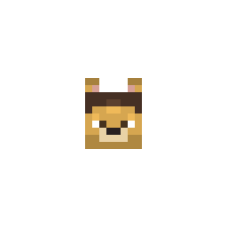{ .fruit-icon } [Jaguar](#jaguar) | 1 | [Jaguar Mink Claws](#jaguar-mink-claws): +2 damage, bare-handed blows may bleed | [Juken Karajishi](#juken-karajishi) |
| 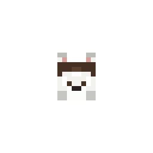{ .fruit-icon } [Polar Bear](#polar-bear) | 1.5 | [Polar Bear Mink Fur](#polar-bear-mink-fur): never freezes, swims faster, more health and toughness | [Bear Hug](#bear-hug) |
| 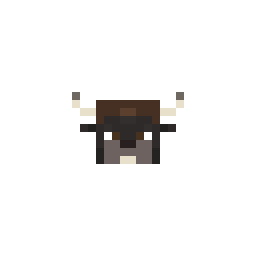{ .fruit-icon } [Bull](#bull) | 1.25 | [Bull Mink Charge](#bull-mink-charge): a sprinting blow knocks back twice as far | [Mo Golova](#mo-golova) |

## Looks { #looks }

Every mink wears ears, a muzzle in relief and a tail, drawn over the player's own skin: the Dog's pointed ears and curled tail that wags, the Lion's mane all round the head and its tufted tail, the Bunny's long ears that flop as it runs, the Cat's tail held up, the Jaguar's rosettes and spotted tail, the Polar Bear's round ears and broad muzzle, the Bull's horns with upturned tips. A helmet does not hide the ears or the horns. The Polar Bear and the Bull also have a broad chest.

**The fur colour** is, in this order: white in [Sulong](#sulong); otherwise the skin tint chosen in the character creator; otherwise one of the kind's canon colourings, picked from the player's identity, so it never changes and every player sees the same. The skin-coloured pixels of the player's own skin take the fur's colour too (hair, eyes, mouth and clothes keep theirs), in first person as well. The Lion's mane and tail tuft take the colour of the skin's hair.

| Kind | Canon fur colours |
|---|---|
| Dog | ■ tan, ■ cream, ■ grey, ■ brown |
| Lion | ■ gold, ■ sand, ■ tawny |
| Bunny | ■ white, ■ cream, ■ grey, ■ brown |
| Cat | ■ ginger, ■ grey, ■ black, ■ cream |
| Jaguar | ■ gold, ■ pale gold, ■ black |
| Polar Bear | ■ white, ■ ivory, ■ silver |
| Bull | ■ black, ■ brown, ■ white, ■ red |

The base mod's own NPC minks keep the base mod's drawing; players of all seven kinds and NPCs of the four new kinds wear these.

## The kinds { #the-kinds }

All passives below are on top of the base mod's Mink Passive Bonuses. Each kind's [Lineage Factor](index.md#lineage-factor) carries the same numbers (never the size), so a body grafted with it by the Nomi Nomi no Mi of Missing Missing no Mi gets them too.

### Dog { #dog }

{ .mod-icon }

#### Dog Mink Pack { #dog-mink-pack }

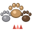{ .ability-icon } *Passive, Dog minks*

The user fights better beside their crew: each crew ally near them adds to their blows.

| Stat | Value |
|---|---|
| Attack speed | +10 % |
| Damage for each crew ally within 8 blocks | +10 %, up to 3 allies (+30 %) |

Allies are the members of the player's crew, alive, counted every half second; the 8 blocks grow with the body's size. With no crew, no bonus.

### Lion { #lion }

{ .mod-icon }

#### Lion Mink Body { #lion-mink-body }

{ .ability-icon } *Passive, Lion minks*

The hardest hits of the minks.

| Stat | Value |
|---|---|
| Damage | +3 |

### Bunny { #bunny }

{ .mod-icon }

#### Bunny Mink Legs { #bunny-mink-legs }

{ .ability-icon } *Passive, Bunny minks*

Light feet: the user jumps higher, runs faster and lands unhurt from up to 12 blocks.

| Stat | Value |
|---|---|
| Jump height | +1 |
| Speed | +20 % |
| Fall resistance | +6.75: with a man's 3 and the minks' 2.25, no fall damage up to 12 blocks |

### Cat { #cat }

{ .mod-icon }

#### Cat Mink Eyes { #cat-mink-eyes }

{ .ability-icon } *Passive, Cat minks*

The user sees in the dark, and strikes quickly.

| Stat | Value |
|---|---|
| Attack speed | +10 % |
| Night vision | while the light at their eyes is 7 or less, checked every half second |

The night vision is hidden (no icon) and goes in the light. A Night Vision potion is left alone.

### Jaguar { #jaguar }

{ .mod-icon }

#### Jaguar Mink Claws { #jaguar-mink-claws }

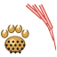{ .ability-icon } *Passive, Jaguar minks*

The user's claws tear: a bare-handed blow may make the target bleed.

| Stat | Value |
|---|---|
| Damage | +2 |
| Bleeding | 10 % chance on a bare-handed blow, 3 s |

Only a direct blow with an empty main hand: arrows and techniques do not bleed.

### Polar Bear { #polar-bear }

{ .mod-icon }

1.5 times a man, about 2.7 blocks high, with a broad chest: Bepo's build. Reach, blows, health and strides grow with the body.

#### Polar Bear Mink Fur { #polar-bear-mink-fur }

{ .ability-icon } *Passive, Polar Bear minks*

Thick fur: the user never freezes, swims well and takes blows.

| Stat | Value |
|---|---|
| Health | +4 |
| Toughness | +2 |
| Swim speed | +30 % |
| Freezing | never, even in powder snow |

### Bull { #bull }

{ .mod-icon }

1.25 times a man, about 2.25 blocks high, with a broad chest and horns.

#### Bull Mink Charge { #bull-mink-charge }

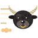{ .ability-icon } *Passive, Bull minks*

The user is hard to push, and a blow struck at a run throws far.

| Stat | Value |
|---|---|
| Damage | +2 |
| Knockback resistance | +30 % |
| Knockback of a blow struck while sprinting | x2 |

By hand or with a held weapon; arrows and techniques do not count.

## Techniques { #techniques }

Every mink has the eight common techniques; each kind adds its own. In the abilities tree they sit in the minks' branch, each one shown only to the minks it belongs to. **Doriki** is a level to reach, not spent; the **martial arts points** are spent.

!!! note "About the values"
    Damage is what the target really loses, in health points (2 = one heart), and ranges are in blocks, for a body of size 1: a Polar Bear's or a Bull's grow with their size, and so does everyone's in Sulong (x1.15). Cooldowns and times are in seconds.

**Electro charges.** Most techniques need [Electro](#electro) switched on and spend some of its 9 charges ("Electro must be on for that", "Not enough Electro charges left"). In [Sulong](#sulong) they spend none, but Electro must still be on.

**In Sulong** every technique below deals x1.5 damage and comes back in half the time (except Bear Hug's cooldown), as written in the Sulong column.

| Technique | Who | Cost | Comes after |
|---|---|---|---|
| 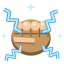{ .fruit-icon } [Electro](#electro) | every mink | 500 Doriki, 3 martial arts points | |
| { .fruit-icon } [Sulong](#sulong) | every mink | 1,200 Doriki | Electro |
| 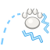{ .fruit-icon } [Eleclaw](#eleclaw) | every mink | 800 Doriki, 5 martial arts points | Electro |
| 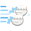{ .fruit-icon } [Mink Assault](#mink-assault) | every mink | 800 Doriki, 5 martial arts points | Electro |
| { .fruit-icon } [Electrical Tempesta](#electrical-tempesta) | every mink | 3,000 Doriki, 5 martial arts points | Mink Assault |
| { .fruit-icon } [Electrical Luna](#electrical-luna) | every mink | 3,600 Doriki, 10 martial arts points | Mink Assault |
| { .fruit-icon } [Moon Raid](#moon-raid) | every mink | 5,000 Doriki, 10 martial arts points | Sulong |
| 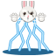{ .fruit-icon } [Electrical Shower](#electrical-shower) | every mink | 7,000 Doriki, 10 martial arts points | Electrical Tempesta |
| 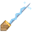{ .fruit-icon } [Inu Odoshi](#inu-odoshi) | Dog | 3,000 Doriki, 5 martial arts points | Electro |
| 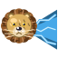{ .fruit-icon } [Electro Roar](#electro-roar) | Lion | 3,000 Doriki, 5 martial arts points | Electro |
| 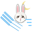{ .fruit-icon } [Moon Rabbit](#moon-rabbit) | Bunny | 3,000 Doriki, 5 martial arts points | Electro |
| { .fruit-icon } [Comet Rabbit](#comet-rabbit) | Bunny | 5,000 Doriki, 10 martial arts points | Moon Rabbit |
| { .fruit-icon } [Aka Byobu](#aka-byobu) | Cat | 3,000 Doriki, 5 martial arts points | Electro |
| { .fruit-icon } [Juken Karajishi](#juken-karajishi) | Jaguar | 3,000 Doriki, 5 martial arts points | Electro |
| { .fruit-icon } [Bear Hug](#bear-hug) | Polar Bear | 3,000 Doriki, 5 martial arts points | Electro |
| { .fruit-icon } [Mo Golova](#mo-golova) | Bull | 3,000 Doriki, 5 martial arts points | Electro |

A player who stops being a mink, or of that kind, loses these techniques within 5 seconds and gets the points back (a technique given by a command is kept).

### Electro { #electro }

{ .ability-icon } *Toggle, every mink*

The user charges their fists, and whatever they hold, with electricity. The blows hit harder, faster, and may paralyse. Electro holds the 9 charges the other techniques spend.

| Stat | Value |
|---|---|
| Charges | 9, all back when Electro ends |
| Blows | +5 damage (base mod's punch value), +0.35 attack speed |
| Paralysis | 1 blow in 10, 0.5 s |
| Ends | switched off, out of charges, or with the eyes under water |
| Cooldown | 2.5 to 9 s: 1 s for each charge spent |

It shows Electrical Full Power's pose as it starts.

### Sulong { #sulong }

{ .ability-icon } *Cast, then held, every mink*

The minks' true form, under the full moon. After a 2 s cast the user grows, their fur and hair turn white, their eyes red and lit in the dark, their mane and tail wilder, with sparks all over. Press again to end it.

| Stat | Value |
|---|---|
| Needs | the full moon, seen from under an open sky |
| Cast | 2 s |
| Size | x1.15 |
| Speed | +150 % |
| Bare-hand damage | +10 |
| Jump height | +1.05 |
| Fall resistance | +6.25 |
| Step height | +1 block |
| Techniques | x1.5 damage, half the cooldown, no Electro charge spent |
| Ends | pressed again, or the moon lost from sight |
| Cooldown | twice the time held, 5 to 60 s |
| Afterwards | Slowness II and Hunger II for a third of the time held, 5 to 30 s |

### Eleclaw { #eleclaw }

{ .ability-icon } *Leap, every mink*

Carrot's leap: the user springs at the enemy under the crosshair (or the nearest one straight ahead), strikes the first enemy met with a charged claw, and paralyses it. No fall damage from the leap. Needs the ground underfoot.

| Stat | Value | In Sulong |
|---|---|---|
| Damage | 10 | 15 |
| Leap | up to 10 blocks | |
| Paralysis | yes | |
| Electro charges | 1 | none |
| Cooldown | 8 s | 4 s |

### Mink Assault { #mink-assault }

{ .ability-icon } *Rush, every mink*

The user rushes straight ahead through everything in the way, striking and paralysing each enemy. A wall stops the rush.

| Stat | Value | In Sulong |
|---|---|---|
| Damage | 8, to every enemy on the way | 12 |
| Rush | 12 blocks | |
| Paralysis | 2 s | |
| Electro charges | 1 | none |
| Cooldown | 9 s | 4.5 s |

### Electrical Luna { #electrical-luna }

{ .ability-icon } *Cast, every mink*

As in the canon: the user gathers a ball of lightning in both hands for 2 s, unable to move, then slams it into the ground. Every enemy around is struck, paralysed and thrown.

| Stat | Value | In Sulong |
|---|---|---|
| Cast | 2 s | |
| Damage | 14 | 21 |
| Area | 6 blocks around | |
| Paralysis | 2 s | |
| Electro charges | 2 | none |
| Cooldown | 10 s | 5 s |

### Electrical Tempesta { #electrical-tempesta }

{ .ability-icon } *Cast, every mink*

After a short 0.5 s gathering, the user discharges all round the body.

| Stat | Value | In Sulong |
|---|---|---|
| Cast | 0.5 s | |
| Damage | 8 | 12 |
| Area | 5 blocks around | |
| Paralysis | 1.5 s | |
| Electro charges | 1 | none |
| Cooldown | 8 s | 4 s |

### Electrical Shower { #electrical-shower }

{ .ability-icon } *Leap, every mink*

The user leaps straight up and falls slowly, while bolts rain on the enemies below. Needs the ground underfoot; no fall damage after it.

| Stat | Value | In Sulong |
|---|---|---|
| Damage | 4 a bolt | 6 |
| Bolts | every 0.25 s from 0.5 s after the leap, up to 3 enemies each time, 4 or 5 times | |
| Area | 6 blocks around, down to 12 blocks below | |
| Paralysis | 1 s a bolt | |
| Duration | 1.5 s | |
| Electro charges | 2 | none |
| Cooldown | 12 s | 6 s |

### Moon Raid { #moon-raid }

{ .ability-icon } *Rush, every mink, in Sulong only*

The user dashes claw first at the enemy, until the first body hit. If a mink of their crew, also in Sulong, stands within 8 blocks of that enemy, the nearest one leaps at it and strikes it too, as hard.

| Stat | Value |
|---|---|
| Needs | Sulong ("This can only be used in Sulong") |
| Damage | 21 (14 x1.5 of Sulong), and as much from the partner |
| Rush | 16 blocks |
| Paralysis | 2 s |
| Cooldown | 7.5 s (15 s halved by Sulong) |

### Inu Odoshi { #inu-odoshi }

{ .ability-icon } *Rush, Dog minks*

A full-speed charge ending in a kick on the first enemy met, thrown far.

| Stat | Value | In Sulong |
|---|---|---|
| Damage | 16 | 24 |
| Rush | 16 blocks | |
| Paralysis | 2 s | |
| Electro charges | 2 | none |
| Cooldown | 13 s | 6.5 s |

### Electro Roar { #electro-roar }

{ .ability-icon } *Active, Lion minks*

The lion roars lightning in a cone ahead: every enemy in it is struck, paralysed and pushed back, and projectiles in the cone are struck down.

| Stat | Value | In Sulong |
|---|---|---|
| Damage | 8 | 12 |
| Cone | 7 blocks long, 80° wide | |
| Paralysis | 2 s | |
| Electro charges | 1 | none |
| Cooldown | 11 s | 5.5 s |

### Moon Rabbit { #moon-rabbit }

{ .ability-icon } *Rush, Bunny minks*

A long run with the claws out, striking everything on the way.

| Stat | Value | In Sulong |
|---|---|---|
| Damage | 10, to every enemy on the way | 15 |
| Rush | about 19.6 blocks | |
| Paralysis | 1.5 s | |
| Electro charges | 1 | none |
| Cooldown | 12 s | 6 s |

### Comet Rabbit { #comet-rabbit }

{ .ability-icon } *Leap, Bunny minks*

A high leap onto the enemy in sight, landing in a double kick that strikes all around.

| Stat | Value | In Sulong |
|---|---|---|
| Damage | 14, to every enemy within 3 blocks of the landing | 21 |
| Leap | up to 12 blocks | |
| Paralysis | 2 s | |
| Electro charges | 2 | none |
| Cooldown | 14 s | 7 s |

### Aka Byobu { #aka-byobu }

{ .ability-icon } *Rush, Cat minks*

A spinning charge ending in a heavy claw on the first enemy met, thrown high.

| Stat | Value | In Sulong |
|---|---|---|
| Damage | 14 | 21 |
| Rush | about 15.6 blocks | |
| Paralysis | 1.5 s | |
| Electro charges | 2 | none |
| Cooldown | 13 s | 6.5 s |

### Juken Karajishi { #juken-karajishi }

{ .ability-icon } *Active, Jaguar minks*

A great slash across everything in front, with bare claws or anything held; a sword cuts deeper.

| Stat | Value | In Sulong |
|---|---|---|
| Damage | 14; 17.5 with a sword | 21; 26.25 with a sword |
| Reach | a line 3.5 blocks long, 1.5 wide | |
| Paralysis | 1.5 s | |
| Electro charges | 2 | none |
| Cooldown | 10 s | 5 s |

### Bear Hug { #bear-hug }

{ .ability-icon } *Hold, Polar Bear minks*

The bear seizes the enemy in sight and crushes it. Press again to let go.

| Stat | Value | In Sulong |
|---|---|---|
| Reach | 2.5 blocks | |
| Damage | 3 at the catch, then 3 every 0.5 s: 18 in all | 4.5 a squeeze, 27 in all |
| Hold | 3 s | |
| Paralysis | 0.75 s at each squeeze | |
| Electro charges | 1, at the catch | none |
| Cooldown | 15 s | 15 s |

It can only take a body no taller than four fifths of the bear, and not one more than twice its size; a raised shield, a guard or a dodge refuses it. The held enemy breaks free after dealing 8 damage to the bear.

### Mo Golova { #mo-golova }

{ .ability-icon } *Rush, Bull minks*

A short lunge, head down: an electric headbutt on the first enemy met. The longest paralysis of the minks.

| Stat | Value | In Sulong |
|---|---|---|
| Damage | 12 | 18 |
| Rush | about 7.2 blocks | |
| Paralysis | 2.5 s | |
| Electro charges | 1 | none |
| Cooldown | 8 s | 4 s |

## Minks from before 0.5.0 { #takeover }

At the first login with 0.5.0, a mink who had the base mod's electro techniques gets ours instead, on the same hotbar slot, paid with the points the old ones gave back:

| The base mod's | Becomes |
|---|---|
| Eleclaw | Electro |
| Sulong | Sulong |
| Electrical Missile | Mink Assault |
| Electrical Luna | Electrical Luna |
| Electrical Tempesta | Electrical Tempesta |
| Electrical Shower | Electrical Shower |

A player who does not reach the new technique's Doriki keeps the points to spend later. The base mod's nodes are hidden from every tree. A mink keeps their kind (Dog, Lion or Bunny).

## In the character creator { #creator }

The Mink page lists the eight common techniques, then the base mod's speed and jump perks. Each kind's page lists its own techniques, then the perks and its passive.

## NPC minks { #npcs }

The base mod's generic fighters may be born a Cat, Jaguar, Polar Bear or Bull mink: 0.5 % each among pirates and others, 0.1 % among the Marines ([chances and settings](configuration.md#npcs)).
