---
tags:
  - modified human
  - germa
  - raid suit
  - vinsmoke
---

# Modified Humans

{ .mod-icon }

*The Vinsmoke's bodies: changed before birth, tough and fast, with no emotions, and the five Raid Suits of Germa 66.*

| | |
|---|---|
| **Size** | 1, a man's (slider 0.75 to 1.25) |
| **Passives** | Modified Body, Raid Suit, and a flaw: Unsociable |
| **Techniques** | 7 a suit, given while it is worn |
| **In the abilities menu** | { .fruit-icon } their own category |
| **Rokushiki** | modified humans count as humans, for Rokushiki and the styles |

A modified human has no Human Will: their growth is a man's.

## Modified Body { #modified-body }

{ .ability-icon } *Passive, modified humans*

The body of the user was changed before birth: a skin hard as a shell against bullets and blades, wounds that close fast, and more strength and speed than a man. With no emotions, nothing plays on their mind.

| Stat | Value |
|---|---|
| Projectile and cutting damage taken | -25 % |
| Health back | 1 every 2 s |
| Bare hand damage | +2 |
| Speed | +10 % |

Lovestruck and Negative never take hold, and the Conqueror's Haki knocks them out half as long.

## Unsociable { #unsociable }

{ .ability-icon } *Passive, a flaw always on*

Nobody warms to the user. Villagers, wandering traders and the base mod's traders shake their head and will not trade with them. With [Cruise Cruise no Mi](../cruise/index.md), merchants and village heads refuse them too, and they win no reputation.

## The Germa 66 ration box { #ration-box }

{ .fruit-icon } { .fruit-icon } { .fruit-icon } { .fruit-icon } { .fruit-icon }

The box is given once, the first time the player is a modified human. Only a modified human can use it.

- **Use** it to put the suit on, or take it off.
- **Sneak and use** opens a screen with the five suits: the player in each one (drag to turn them), its name and its seven techniques. Click one to wear it; the box remembers it.
- **A lost box** can be crafted by a modified human: 4 iron ingots, 4 redstone and a diamond. With Cruise Cruise no Mi it is the Inventor's, at level 30. The base mod's pirate and marine traders sell one for 5,000 to 7,500 Belly.
- The suit comes off when the player dies.

The suits are worn on the body: belt, collar, gauntlets, boots and a cape with the number on its back. Poison Pink's cape is a pair of butterfly wings that beat. Nobody sees anything of the player under Stealth.

## Raid Suit { #raid-suit }

{ .ability-icon } *Passive, while a suit is worn*

The cloth bears fire, the boots land any fall and make the blows hit harder.

| Stat | Value |
|---|---|
| Fire damage taken | -50 % |
| Fall damage | none |
| Bare hand damage | +4 |

## The suits and their techniques { #suits }

Each suit gives seven techniques while it is worn: the two of every suit, and five of its own. They go when it comes off, and a technique on the bar comes back to its slot. They are not bought in the abilities tree. Every one has its own icon, pose and effects.

!!! note "About the values"
    Damage is what the target really loses, in health points (2 = one heart), and ranges are in blocks, for a body of size 1. Cooldowns and times are in seconds.

### Every suit

| Technique | |
|---|---|
| 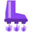{ .fruit-icon } [Germa Boots](#germa-boots) | the jets hold the user up, then throw them in a big leap |
| { .fruit-icon } [Cape Shield](#cape-shield) | the cape stops every attack from the front |

#### Germa Boots { #germa-boots }

{ .ability-icon } *Active, every suit*

The jets in the boots hold the user up in the air where they are. Used again, or when the time runs out, the jets throw them in a big leap where they look.

| Stat | Value |
|---|---|
| Cooldown | 6 s |
| Hold | up to 8 s |

#### Cape Shield { #cape-shield }

{ .ability-icon } *Active, every suit*

The cape spreads into a shield in front of the user and stops every attack from the front. Press again to fold it early, for a shorter cooldown.

| Stat | Value |
|---|---|
| Cooldown | 12 s |
| Hold | 3 s |

#### Black Bug { #black-bug }

{ .ability-icon } *Active, red, blue and green suits*

After a 1 s crouch, the user rushes 8 blocks ahead through every enemy on the way. Each is hit harder for each other colour of suit that struck it in the last 2 s.

| Stat | Value |
|---|---|
| Cooldown | 15 s |
| Cast | 1 s |
| Damage | 18, +50 % for each other colour |

### Sparking Red { #sparking-red }

| Technique | Cooldown | |
|---|---|---|
| 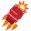{ .fruit-icon } **Sparking Figure** | 10 s (Double 20 s) | a 6-block rush that bursts on the first body: 16 damage, and 10 around. **Alt:** { .fruit-icon } **Double Sparking Figure**, a longer cast, 26 damage and 16 within 5 blocks, costs the user 4 health |
| { .fruit-icon } **Sparking Valkyrie** | 12 s | five beams of light from the eyes, one after the other, through everything: 25 blocks, 6 damage each |
| { .fruit-icon } **Sparking Blast** | 20 s | after a 1.5 s cast, a ball of light flies 30 blocks and bursts for 22 within 4 blocks |
| { .fruit-icon } **Sparking Flash** | 15 s | those within 8 blocks who look at the user are blinded and slowed for 4 s |
| { .fruit-icon } [Black Bug](#black-bug) | 15 s | |

### Dengeki Blue { #dengeki-blue }

| Technique | Cooldown | |
|---|---|---|
| 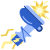{ .fruit-icon } **Dengeki Kick** | 8 s | a lightning leap onto the enemy looked at (10 blocks): 14 damage, paralysed 1.5 s and thrown |
| 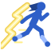{ .fruit-icon } **Henry Blazer** | 12 s | a 16-block zigzag through every enemy passed: 12 damage, 18 with a sword in hand |
| { .fruit-icon } **Henry Needle** | 10 s | an electric needle, 30 blocks: 14 damage, paralysed 2 s |
| { .fruit-icon } **Henry Cracker** | 25 s | the user rises into a storm that strikes 6 times for 6 within 5 blocks |
| { .fruit-icon } [Black Bug](#black-bug) | 15 s | |

### Winch Green { #winch-green }

| Technique | Cooldown | |
|---|---|---|
| 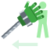{ .fruit-icon } **Winch Arm** | 6 s | the gauntlet flies out on its steel cable (15 blocks), grabs the enemy and pulls it to the user. **Alt:** 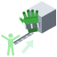{ .fruit-icon } **Winch Grapple**, the hand grabs the block or body looked at (20 blocks) and pulls the user there |
| 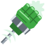{ .fruit-icon } **Winch Punch** | 8 s | the fist on its cable, 16 blocks: 14 damage to the first enemy, thrown far |
| 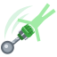{ .fruit-icon } **Winch Danton** | 18 s | grabs an enemy by the head and swings it round for 3 s: 12 damage to each body it hits, then thrown where the user looks. Hits on the user make them let go |
| 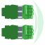{ .fruit-icon } **Winch Bomber** | 18 s | a series of jabs, then a wave along a 10-block line: 20 damage. The arms come down after it |
| { .fruit-icon } [Black Bug](#black-bug) | 15 s | |

### Stealth Black { #stealth-black }

| Technique | Cooldown | |
|---|---|---|
| { .fruit-icon } **Stealth** | 20 s | the user vanishes, with all they hold, up to 30 s; their first blow does double damage and shows them again |
| { .fruit-icon } **Silent Steps** | passive | while hidden, no step is heard and mobs lose the user |
| { .fruit-icon } **Stealth Rescue** | 20 s | the one beside the user vanishes too, for as long as they stay near, without ending the user's Stealth |
| { .fruit-icon } **Stealth Ambush** | 12 s | under Stealth, the user appears behind the enemy looked at (12 blocks) and kicks: 18 damage, doubled by Stealth to 36 |
| { .fruit-icon } **Stealth Decoy** | 25 s | an image of the user stands where they were and mobs go after it for 6 s, while their Stealth starts |

### Poison Pink { #poison-pink }

| Technique | Cooldown | |
|---|---|---|
| { .fruit-icon } **Pink Hornet** | 8 s (Kosen 14 s) | a ball of poison that bursts into a cloud (3 blocks, 5 s): 12 damage and Poison II for 8 s. **Alt:** { .fruit-icon } **Pink Kosen**, after a 1 s cast, a ray of poison from the palm, 24 blocks: 20 damage and Poison III for 14 s |
| { .fruit-icon } **Pink Rasen** | 18 s | a poison tornado around the user for 3 s draws enemies in (4 blocks), strikes 4 times for 6 with Poison II, then throws them up |
| { .fruit-icon } **Poison Mist** | 25 s | a mist of 6 blocks for 6 s: enemies in it are poisoned and slowed, the user heals 1 a second |
| { .fruit-icon } **Poison Draw** | 15 s | draws every poison and bad effect out of the one the user touches and heals them 8; looking at no one, on the user |
| { .fruit-icon } **Poison Touch** | passive | bare-handed blows give Poison II |

<!-- animations -->
??? example "Animations"

    Taken in game.

    

    <figure markdown="span">
      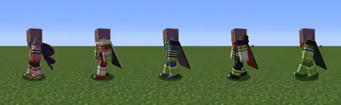{ loading=lazy }
      <figcaption>The suits</figcaption>
    </figure>
    <figure markdown="span">
      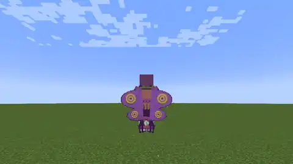{ loading=lazy }
      <figcaption>Germa Boots</figcaption>
    </figure>
    <figure markdown="span">
      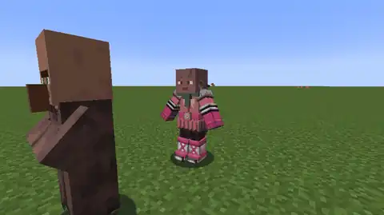{ loading=lazy }
      <figcaption>Cape Shield</figcaption>
    </figure>
    <figure markdown="span">
      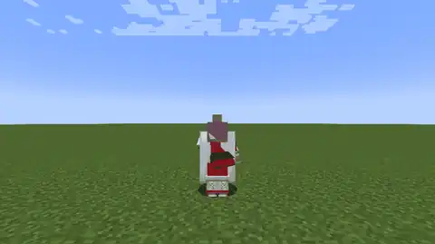{ loading=lazy }
      <figcaption>Black Bug</figcaption>
    </figure>
    <figure markdown="span">
      { loading=lazy }
      <figcaption>Sparking Figure</figcaption>
    </figure>
    <figure markdown="span">
      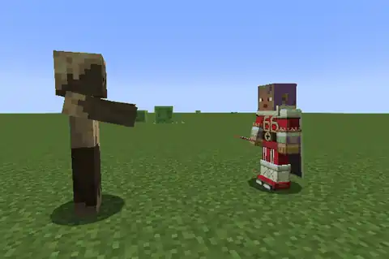{ loading=lazy }
      <figcaption>Double Sparking Figure</figcaption>
    </figure>
    <figure markdown="span">
      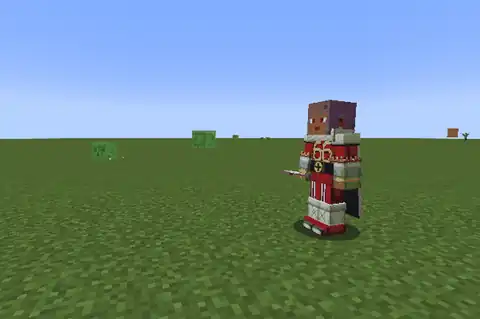{ loading=lazy }
      <figcaption>Sparking Valkyrie</figcaption>
    </figure>
    <figure markdown="span">
      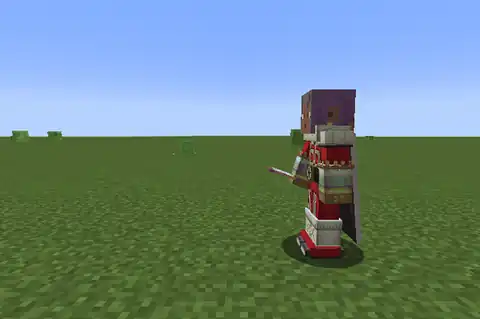{ loading=lazy }
      <figcaption>Sparking Blast</figcaption>
    </figure>
    <figure markdown="span">
      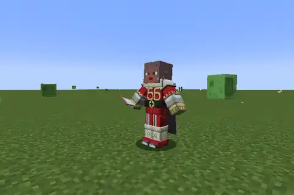{ loading=lazy }
      <figcaption>Sparking Flash</figcaption>
    </figure>
    <figure markdown="span">
      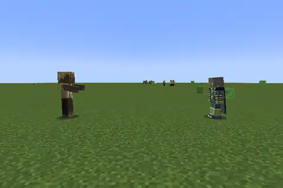{ loading=lazy }
      <figcaption>Dengeki Kick</figcaption>
    </figure>
    <figure markdown="span">
      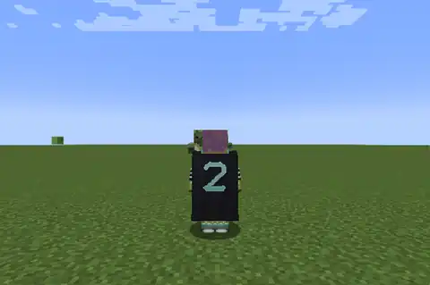{ loading=lazy }
      <figcaption>Henry Blazer</figcaption>
    </figure>
    <figure markdown="span">
      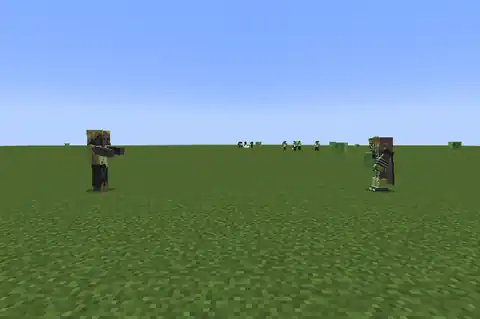{ loading=lazy }
      <figcaption>Henry Needle</figcaption>
    </figure>
    <figure markdown="span">
      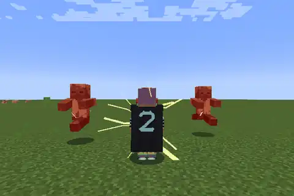{ loading=lazy }
      <figcaption>Henry Cracker</figcaption>
    </figure>
    <figure markdown="span">
      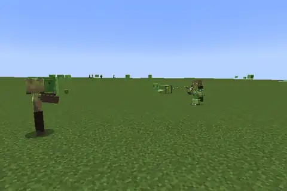{ loading=lazy }
      <figcaption>Winch Arm</figcaption>
    </figure>
    <figure markdown="span">
      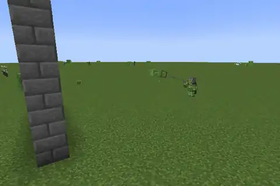{ loading=lazy }
      <figcaption>Winch Grapple</figcaption>
    </figure>
    <figure markdown="span">
      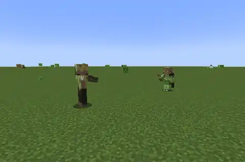{ loading=lazy }
      <figcaption>Winch Punch</figcaption>
    </figure>
    <figure markdown="span">
      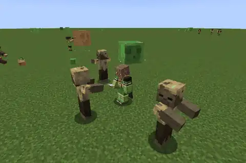{ loading=lazy }
      <figcaption>Winch Danton</figcaption>
    </figure>
    <figure markdown="span">
      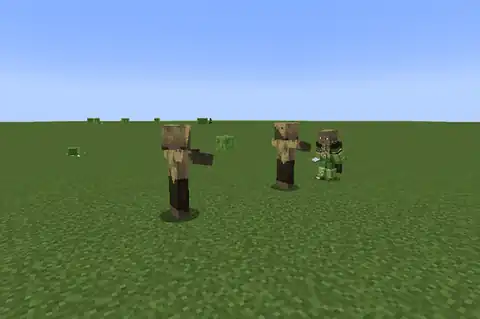{ loading=lazy }
      <figcaption>Winch Bomber</figcaption>
    </figure>
    <figure markdown="span">
      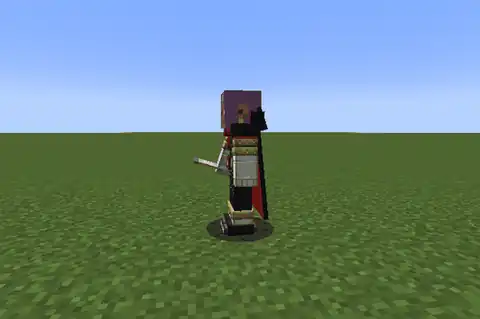{ loading=lazy }
      <figcaption>Stealth</figcaption>
    </figure>
    <figure markdown="span">
      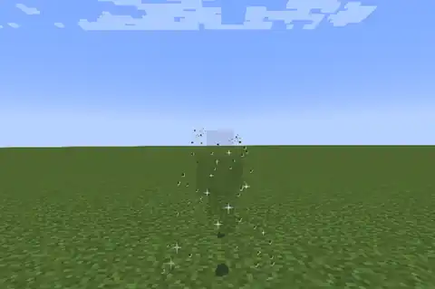{ loading=lazy }
      <figcaption>Silent Steps</figcaption>
    </figure>
    <figure markdown="span">
      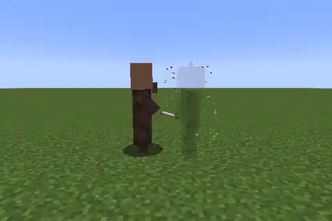{ loading=lazy }
      <figcaption>Stealth Rescue</figcaption>
    </figure>
    <figure markdown="span">
      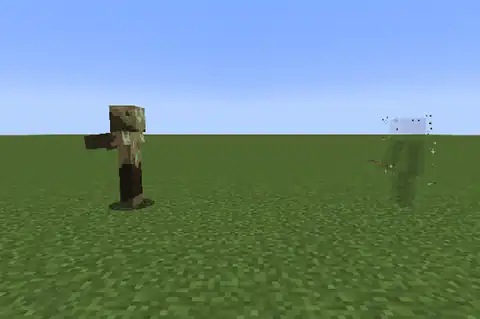{ loading=lazy }
      <figcaption>Stealth Ambush</figcaption>
    </figure>
    <figure markdown="span">
      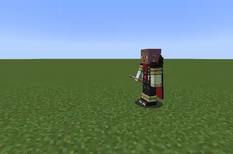{ loading=lazy }
      <figcaption>Stealth Decoy</figcaption>
    </figure>
    <figure markdown="span">
      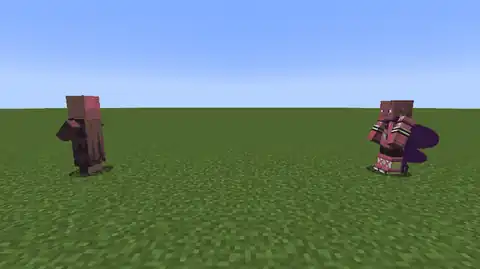{ loading=lazy }
      <figcaption>Pink Hornet</figcaption>
    </figure>
    <figure markdown="span">
      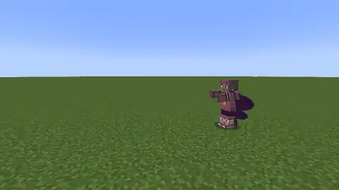{ loading=lazy }
      <figcaption>Pink Kosen</figcaption>
    </figure>
    <figure markdown="span">
      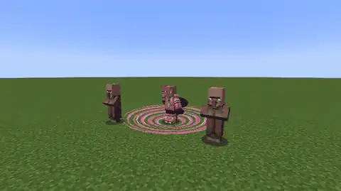{ loading=lazy }
      <figcaption>Pink Rasen</figcaption>
    </figure>
    <figure markdown="span">
      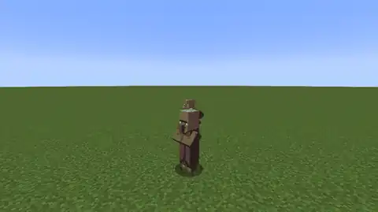{ loading=lazy }
      <figcaption>Poison Mist</figcaption>
    </figure>
    <figure markdown="span">
      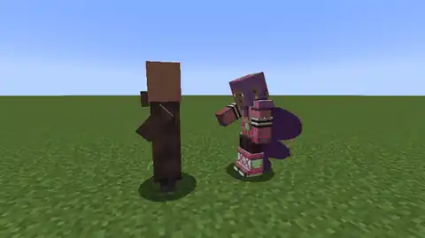{ loading=lazy }
      <figcaption>Poison Draw</figcaption>
    </figure>
    <figure markdown="span">
      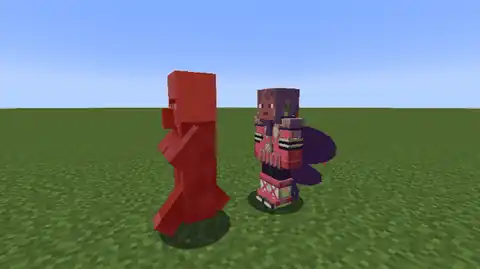{ loading=lazy }
      <figcaption>Poison Touch</figcaption>
    </figure>
    

<!-- /animations -->
