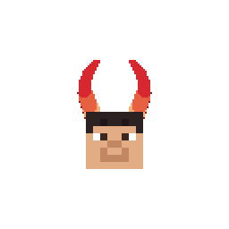
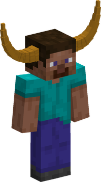
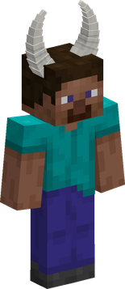
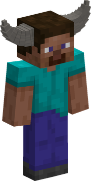
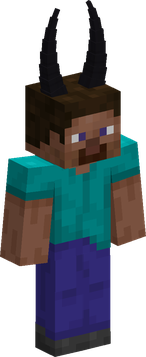
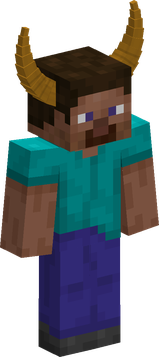

---
tags:
  - oni
  - horns
  - blunt
---

# Oni

{ .mod-icon }

*Big horned folk, nearly twice a man's height: they hit hard with bare hands, harder with a blunt weapon, and drink makes them stronger.*

| | |
|---|---|
| **Size** | 1.75: about 3.15 blocks high and 1.05 wide (slider 1.64 to 1.86) |
| **Passive** | Oni Blood |
| **Techniques** | 7 |
| **In the abilities menu** | { .fruit-icon } their own category |
| **Rokushiki** | Oni count as humans |

An Oni is the player's own body at 1.75 times the size: reach, blows, health, strides and techniques all grow with it, through [AkumaLib](../../akumalib/index.md)'s size system. The horns are drawn over the player's own skin, and their shape and colour are picked from the player's identity, so they never change and every player sees the same horns. There are five shapes since 0.3.0 (Harald's, long and almost straight, and Oars', from the temples, were added): some players who already had horns got another shape, once.

<!-- models -->

<figure markdown>

<figcaption>Kaido's horns</figcaption>
</figure>

<figure markdown>

<figcaption>Yamato's horns</figcaption>
</figure>

<figure markdown>

<figcaption>the young Kaido's horns</figcaption>
</figure>

<figure markdown>

<figcaption>Harald's horns</figcaption>
</figure>

<figure markdown>

<figcaption>Oars' horns</figcaption>
</figure>

In 3D: drag to turn, scroll or pinch to zoom. The five horn shapes; a player gets one shape and one colour from their identity.

<!-- /models -->

## In a man's house

An Oni is too wide and too tall for a door a block wide. **Hold sneak** and they hunch, with narrow shoulders: 0.98 wide and a man's height (1.8 blocks, a little more at the top of the slider), which fits a 1 x 2 door. A roof too low for them keeps the hunch on. The crawl is the game's own, with the same narrow shoulders.

Hunched, an Oni walks at half their speed, and their techniques reach and hit only as much as a man's.

## Oni Blood { #oni-blood }

{ .ability-icon } *Passive, Oni*

The user hits hard with bare hands and harder with a blunt weapon. Drink makes them stronger and tougher, and does not turn their head.

| Stat | Value |
|---|---|
| Bare hand damage | +2 |
| Toughness | +1 |
| Damage with a blunt weapon | +20 % |
| Damage for each level of Drunk | +10 %, up to level 5 |
| Resistance for each level of Drunk | 5 %, up to level 5 |

- **Blunt weapons** are the base mod's own `mineminenomi:blunts` item tag, as it stands: a weapon added to the tag counts. With one in the main hand, a blow and the techniques below that hit do 20 % more damage.
- **Drunk** stays with its slowness, but the nausea it brings is refused.

## Techniques

In the abilities tree, a branch only Oni see: Guard Breaker first, then Horn Toss and Shock Fist, then Demon Skin and Demon Sweep, then Demon Leap, then Demon Quake.

!!! note "About the values"
    Damage is what the target really loses, in health points (2 = one heart), and ranges are in blocks, for a body of size 1: an Oni's grow with their size (damage and reach about x1.3, cooldowns about x1.13 at size 1.75). Cooldowns and times are in seconds. Sizes and slider: [Your size](index.md#your-size).

| Technique | Cost | Comes after |
|---|---|---|
| { .fruit-icon } [Guard Breaker](#guard-breaker) | 500 Doriki, 2 martial arts points | |
| { .fruit-icon } [Horn Toss](#horn-toss) | 1,000 Doriki, 2 martial arts points | Guard Breaker |
| { .fruit-icon } [Shock Fist](#shock-fist) | 1,500 Doriki, 3 martial arts points | Guard Breaker |
| { .fruit-icon } [Demon Skin](#demon-skin) | 2,000 Doriki, 3 martial arts points | Horn Toss |
| { .fruit-icon } [Demon Sweep](#demon-sweep) | 2,000 Doriki, 3 martial arts points | Shock Fist |
| { .fruit-icon } [Demon Leap](#demon-leap) | 3,000 Doriki, 5 martial arts points | Demon Skin and Shock Fist |
| { .fruit-icon } [Demon Quake](#demon-quake) | 4,000 Doriki, 6 martial arts points | Demon Leap |

### Guard Breaker { #guard-breaker }

{ .ability-icon } *Active, Oni*

The next blow of the user comes down from above. It goes through part of the armour and breaks a guard: a raised shield is put out for its cooldown, and a guard ability of the target stops. With bare hands or a blunt weapon.

| Stat | Value |
|---|---|
| Cooldown | 12 s |
| Ready for the blow | up to 10 s, one blow |
| Damage | 10 |
| Through armour | +30 % |

### Horn Toss { #horn-toss }

{ .ability-icon } *Active, Oni*

At arm's length, the user gores the nearest enemy and throws it up and over, behind them. A body bigger than the Oni is hurt but not lifted. With nobody within reach it does not go.

| Stat | Value |
|---|---|
| Cooldown | 10 s |
| Damage | 8 |
| Range | 2 blocks (line) |

### Shock Fist { #shock-fist }

{ .ability-icon } *Active, Oni*

The user punches the air and a shock goes straight ahead: every enemy on the line is hit and pushed on. The Oni's one technique at range. The line runs level along the body, at the height it stands.

| Stat | Value |
|---|---|
| Cooldown | 9 s |
| Damage | 7 |
| Range | 10 blocks (line) |

### Demon Skin { #demon-skin }

{ .ability-icon } *Active, Oni*

For a few seconds the user hardens: they take less damage, and their blows push enemies further. A shove a technique does by itself is not made greater.

| Stat | Value |
|---|---|
| Cooldown | 30 s, from the end |
| Duration | 6 s |
| Damage taken | -30 % |
| Knockback of the blows | +50 % |

### Demon Sweep { #demon-sweep }

{ .ability-icon } *Active, Oni*

The user swings all the way round: every enemy close is hit and thrown away. Stronger with a blunt weapon.

| Stat | Value |
|---|---|
| Cooldown | 12 s |
| Damage | 9, x1.2 with a blunt weapon |
| Range | 3 blocks around |

### Demon Leap { #demon-leap }

{ .ability-icon } *Active, Oni*

A great jump onto the enemy in sight. Landing, the Oni hits whoever is under them, and a wave throws those around. No block breaks. It needs the ground under the user's feet, and with nobody in sight it does not go.

| Stat | Value |
|---|---|
| Cooldown | 16 s, from the landing |
| Damage | 12 to the one landed on, 6 to the others in the wave |
| Range | 20 blocks (line to the target), wave 5 blocks around |
| Flight | up to 6 s |

### Demon Quake { #demon-quake }

{ .ability-icon } *Active, Oni*

The user strikes the ground: everything around them is hit and thrown up. From the ground only.

| Stat | Value |
|---|---|
| Cooldown | 16 s |
| Damage | 8 |
| Range | 4 blocks around |

## What follows the size

- **Damage and reach** of every technique grow with the Oni's size, and shrink back to a man's when they hunch.
- **Cooldowns** are a little longer for a bigger body.
- **Guard Breaker** is on AkumaLib's list of techniques that follow the size of a blow (`akumalib:size_melee`); **Horn Toss** lifts only bodies no bigger than the Oni.
- **Shock Fist** and **Demon Leap** cover distance by the Oni's size: the leap is thrown further, the shock line is longer. See [Race size and slider](../../akumalib/size/race-size.md) and [Abilities that follow the size](../../akumalib/size/abilities.md).
