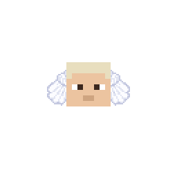

---
tags:
  - skypiean
  - birkan
  - shandia
  - wings
  - dial
  - mantra
---

# Sky People

{ .mod-icon }

*The peoples of the sky islands: wings on their backs, the dials of Skypiea in their hands, stronger the higher they stand.*

Three sub-races to pick in the character creator: **Skypiean**, **Birkan** and **Shandia**. A fourth, the **Wingless Birkan**, is never offered by the book: an operator makes it with a command. All of them count as humans for Rokushiki (the human price in the abilities tree).

| | |
|---|---|
| **Size** | 1 (slider 0.75 to 1.25) |
| **Passives** | one per sub-race |
| **Techniques** | 3 for all, 2 more per sub-race |
| **In the abilities menu** | { .fruit-icon } their own category |

<figure markdown>

<figcaption>Skypiean</figcaption>
</figure>

<figure markdown>

<figcaption>Birkan</figcaption>
</figure>

<figure markdown>

<figcaption>Shandia</figcaption>
</figure>

In 3D: drag to turn, scroll or pinch to zoom. The buttons switch between the three peoples.

## Wings and looks

Each people has its own wings, drawn on the player's own skin:

- **Skypiean**: small wings straight out at the shoulders, three tiers of round feathers, and two **antennae** of hair on the head, in the colour of the player's hair (read from the top of the skin's head).
- **Birkan**: small wings pointing down from the shoulders.
- **Shandia**: long wings swept back, five long pointed feathers.
- **Wingless Birkan**: no wings.

The wings fold back at rest, open as you walk and run, beat in the air (harder as you fall), sweep back for Divine Stride and beat once for Sky Leap. Every player sees them.

## The sub-races

| Sub-race | Passive | Bonus (on the ground) | Mantra | Dials |
|---|---|---|---|---|
| { .fruit-icon } Skypiean | { .fruit-icon } Skypiean Body | +20 % speed | x1.25 | +40 % |
| { .fruit-icon } Birkan | { .fruit-icon } Birkan Body | +1 damage, +1 toughness | x1.5 | +25 % |
| { .fruit-icon } Shandia | { .fruit-icon } Shandia Body | +3 damage, +2 toughness | x1.25 | +25 % |
| Wingless Birkan | { .fruit-icon } Wingless Body | +3 damage, +1 toughness | x2 | +25 % |

### Skypiean Body { #skypiean-body }

{ .ability-icon } *Passive, Skypiean*

Light on their feet: **+20 % movement speed** on the ground, up to +30 % high in the sky.

### Birkan Body { #birkan-body }

{ .ability-icon } *Passive, Birkan*

Strong of body: **+1 attack damage** and **+1 toughness** on the ground, up to +1.5 each high in the sky.

### Shandia Body { #shandia-body }

{ .ability-icon } *Passive, Shandia*

Born warriors: **+3 attack damage** and **+2 toughness** on the ground, up to +4.5 and +3 high in the sky.

### Wingless Body { #wingless-body }

{ .ability-icon } *Passive, Wingless Birkan*

A Birkan who gave up their wings: **+3 attack damage** and **+1 toughness**, the same at any height. The sky no longer lifts them: no altitude bonus at all, but the strongest Mantra (x2, everywhere). They keep Mantra Mark and the common techniques that need no wings; Sky Leap and Divine Stride are closed to them.

Wings come off only by an operator's command:

- `/racenomi wings remove <player>`: a Birkan becomes a Wingless Birkan.
- `/racenomi wings restore <player>`: the wings come back.

## Altitude

The sky makes its people stronger. From **Y 128** up to **Y 256**, in any dimension, the passive's bonuses, the dial bonus and the Mantra grow from x1 to **x1.5**; under Y 128 they are as on the ground. In [Sky Island](../sky-island/index.md)'s Skypiea they are always full. The Wingless Birkan's bonuses do not change with height.

## Dials

The base mod's dials work better in their hands, more so high up:

- The **Axe**, **Flame**, **Impact** and **Milky Dials** (used with a right click) and the **Reject Dial** (with a blow) hit **25 % harder** and are ready again **25 % sooner**; **40 %** for a Skypiean. Up to 37.5 % and 60 % high in the sky.
- The Reject Dial's blow is not raised (it already kills), only its cooldown is shortened.
- Breath, Flash and Eisen Dials do nothing when used, so there is nothing to raise.

Several techniques below are **stronger with a real dial carried** anywhere in the inventory: their damage (or range) is raised by the same bonus.

## Mantra

The sky people's Observation Haki grows faster and reaches farther: its experience and the view distance of its aura are multiplied by the Mantra figure in the table above (x1.25, x1.5 for a Birkan, x2 for a Wingless Birkan), grown by the altitude except for the Wingless Birkan.

## Techniques

In the abilities tree: Axe Slash and Impact first, then Sky Leap, then each sub-race's pair. Only the sky people see this branch; a sub-race's pair only that sub-race.

!!! note "About the values"
    Damage is what the target really loses, in health points (2 = one heart), for a body of size 1. Cooldowns and times are in seconds.

| Technique | For | Cost | Comes after |
|---|---|---|---|
| { .fruit-icon } [Axe Slash](#axe-slash) | all | 500 Doriki, 2 technology points | |
| { .fruit-icon } [Impact](#impact) | all | 800 Doriki, 3 martial arts points | |
| { .fruit-icon } [Sky Leap](#sky-leap) | all, with wings | 1,250 Doriki, 5 martial arts points | Axe Slash, Impact |
| { .fruit-icon } [Breath Gale](#breath-gale) | Skypiean | 3,000 Doriki, 5 technology points | Sky Leap |
| { .fruit-icon } [Dial Blend](#dial-blend) | Skypiean | 5,000 Doriki, 10 technology points | Breath Gale |
| { .fruit-icon } [Mantra Mark](#mantra-mark) | Birkan, Wingless Birkan | 3,000 Doriki, 5 martial arts points | Sky Leap |
| { .fruit-icon } [Divine Stride](#divine-stride) | Birkan, with wings | 5,000 Doriki, 10 martial arts points | Mantra Mark |
| { .fruit-icon } [War Cry](#war-cry) | Shandia | 3,000 Doriki, 5 martial arts points | Sky Leap |
| { .fruit-icon } [Berserker](#berserker) | Shandia | 5,000 Doriki, 10 martial arts points | War Cry |

### Axe Slash { #axe-slash }

{ .ability-icon } *Active, all the sky people*

The user swings the air of an Axe Dial out in one blade that flies dead straight and cuts the first body it meets.

| Stat | Value |
|---|---|
| Cooldown | 8 s |
| Damage | 8 |
| Range | 24 blocks (line) |
| With an Axe Dial | damage +25 % (+40 % for a Skypiean) |

### Impact { #impact }

{ .ability-icon } *Active, all the sky people*

For a moment the user catches blows in an Impact Dial, taking only half of each. Then it lets everything go in a shockwave around them that throws enemies back.

| Stat | Value |
|---|---|
| Catching | 1.5 s |
| Cooldown | 8 s |
| Damage | 8, plus half of each blow caught (up to 24 more; 48 for a giant-sized body) |
| Range | 4 blocks around |
| With an Impact Dial | damage +25 % (+40 % for a Skypiean) |

### Sky Leap { #sky-leap }

{ .ability-icon } *Active, all the sky people with wings*

The user beats their wings once and bounds forward and up. The landing that follows (within 5 seconds) does not hurt.

| Stat | Value |
|---|---|
| Leaps in a row | 3, 0.5 s apart |
| Recharge | 2 s per leap spent, once back on the ground (or after the last leap) |
| Needs | wings |

### Breath Gale { #breath-gale }

{ .ability-icon } *Active, Skypiean*

The user lets a Breath Dial go all at once: a gust in a cone that throws enemies back and sends their shots back.

| Stat | Value |
|---|---|
| Cooldown | 7 s |
| Damage | 4 |
| Range | 8 blocks, a cone 70 degrees wide |
| With a Breath Dial | damage, range and push +40 % |

### Dial Blend { #dial-blend }

{ .ability-icon } *Active, Skypiean*

The user lets two dials go together. The base mod's **ALT** key switches between the two blends; Flash Impact comes first.

| Stat | Flash Impact | Breath Flame |
|---|---|---|
| Cooldown | 10 s | 10 s |
| Damage | 8 to every enemy around | 12 to the first enemy in sight |
| Range | 4 blocks around | 20 blocks |
| Also | Blindness for 3 s | sets it on fire for 5 s |
| Stronger with | a Flash Dial (+40 %) | a Flame Dial (+40 %) |

### Mantra Mark { #mantra-mark }

{ .ability-icon } *Active, Birkan and Wingless Birkan*

The user reads the one they look at with their Mantra. For 20 seconds the user alone sees it outlined, even through walls, and their next blow on it (in person: not a shot or an ability) hurts more. The mark goes with that blow.

| Stat | Value |
|---|---|
| Cooldown | 20 s |
| Range | 30 blocks |
| Mark | 20 s |
| Next blow | x1.5 damage |

### Divine Stride { #divine-stride }

{ .ability-icon } *Active, Birkan with wings*

The user braces, wings swept back, then bounds forward straight through the enemies in front, hitting each of them once.

| Stat | Value |
|---|---|
| Wind-up | 1 s |
| Cooldown | 10 s |
| Damage | 12 |
| Range | 12 blocks (line) |
| Needs | wings |

### War Cry { #war-cry }

{ .ability-icon } *Active, Shandia*

The user lets out a war cry. They and the players around them who are not their enemies hit harder for a while.

| Stat | Value |
|---|---|
| Cooldown | 30 s |
| Effect | Strength I for 15 s |
| Range | 10 blocks around |

### Berserker { #berserker }

{ .ability-icon } *Active, Shandia*

The user goes wild for a few seconds: they hit harder and faster, but their guard drops.

| Stat | Value |
|---|---|
| Duration | 8 s |
| Cooldown | 30 s, once it ends |
| Damage | +4 |
| Attack speed | +25 % |
| Armour | -4 |
