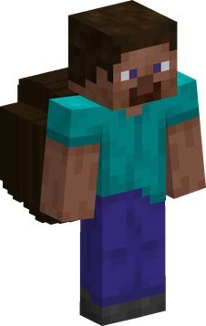
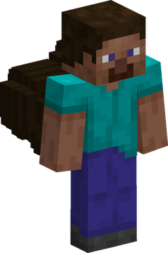
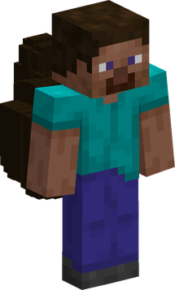
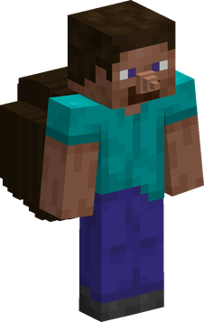

---
tags:
  - tontatta
  - dwarf
  - small
---

# Tontatta

{ .mod-icon }

*Tiny folk with a big furry tail, not much taller than a hand: they hit as hard as a man and go under everything.*

| | |
|---|---|
| **Size** | 0.25: about 0.45 blocks high and 0.15 wide, no slider |
| **Passive** | Tontatta Strength |
| **Techniques** | 7 |
| **In the abilities menu** | { .fruit-icon } their own category |
| **Rokushiki** | Tontatta do not count as humans |

A Tontatta is the player's own body at a quarter of the size, with a bushy tail and a pointed nose drawn over their skin: the tail takes the colour of the player's hair, and its shape and the nose are picked from the player's identity, so they never change. Everything else is what [AkumaLib](../../akumalib/index.md)'s size system gives a body this small: a short reach, and a body that goes where a man cannot.

<!-- models -->

<figure markdown>

<figcaption>a ball of a tail</figcaption>
</figure>

<figure markdown>

<figcaption>a cloud of three</figcaption>
</figure>

<figure markdown>

<figcaption>a ball that curls up</figcaption>
</figure>

<figure markdown>

<figcaption>the pointed nose</figcaption>
</figure>

In 3D: drag to turn, scroll or pinch to zoom. The three tails, in the colour of the skin's hair, and the pointed nose one Tontatta in two has; all from the player's identity.

<!-- /models -->

## Tontatta Strength { #tontatta-strength }

{ .ability-icon } *Passive, Tontatta*

The user is tiny, but their blows push as hard as a man's, and they reach blocks further than their size. They are a little quicker than a man, in the air too, jump up to three blocks higher the longer the jump is held, and fall from higher unhurt.

| Stat | Value |
|---|---|
| Block reach | 3 blocks |
| Speed | +15 % |
| Jump | up to 4.25 blocks with the key held, lower when let go sooner, a man's 1.25 for a tap; a sprint jump pushes forward as a man's |
| Fall without harm | 6 blocks |
| Fall damage past that | a quarter of a man's a block: about 46 blocks kill a Tontatta, not 23 |

A body this small would push almost nothing: Tontatta Strength takes the size's loss of knockback back out of the user's blows. Their damage and the speed of their swing already are a man's. They keep their short reach to hit.

Since 0.4.0 a jump no longer slows a Tontatta: they keep their extra speed in the air. And **they fly as high as a man**: Moku and the other flights of the base mod and the addons once climbed only to about 15 blocks over the ground for so small a body; they now climb to a man's ceiling, at a man's speed ([AkumaLib](../../akumalib/index.md) 6.5.0).

## Techniques

In the abilities tree, a branch only Tontatta see: Tonta Uppercut first, then Tonta Barrage and Underfoot Dash, then Ant Burden, Tail Hammer and Tonta Whirl, then Head Climb.

!!! note "About the values"
    Damage is what the target really loses, in health points (2 = one heart). The figures are those of a Tontatta at their own size 0.25, ranges and cooldowns included: their reach is half a man's, and their cooldowns shorter than a man's. Cooldowns and times are in seconds. Sizes: [Your size](index.md#your-size).

| Technique | Cost | Comes after |
|---|---|---|
| { .fruit-icon } [Tonta Uppercut](#tonta-uppercut) | 500 Doriki, 2 martial arts points | |
| { .fruit-icon } [Tonta Barrage](#tonta-barrage) | 2,000 Doriki, 3 martial arts points | Tonta Uppercut |
| { .fruit-icon } [Underfoot Dash](#underfoot-dash) | 1,000 Doriki, 2 martial arts points | Tonta Uppercut |
| { .fruit-icon } [Ant Burden](#ant-burden) | 3,000 Doriki, 5 martial arts points | Tonta Barrage |
| { .fruit-icon } [Tail Hammer](#tail-hammer) | 3,000 Doriki, 5 martial arts points | Tonta Uppercut and Underfoot Dash |
| { .fruit-icon } [Tonta Whirl](#tonta-whirl) | 2,000 Doriki, 3 martial arts points | Underfoot Dash |
| { .fruit-icon } [Head Climb](#head-climb) | 5,000 Doriki, 8 martial arts points | Tail Hammer |

### Tonta Uppercut { #tonta-uppercut }

{ .ability-icon } *Active, Tontatta*

A blow from below that throws the nearest enemy up, however much bigger. A man goes about 5 blocks up, a giant of size 4 about 2.5: the sturdier the body, the lower it flies. With nobody in reach it does not go.

| Stat | Value |
|---|---|
| Cooldown | 8 s |
| Damage | 10 |
| Range | about 1.5 blocks (line) |

### Tonta Barrage { #tonta-barrage }

{ .ability-icon } *Active, Tontatta*

A flurry of very fast blows on the nearest enemy in front: 12 blows in 1.2 s. A blow does not push, so the series stays on its target. If nobody is left in reach, the series ends.

| Stat | Value |
|---|---|
| Cooldown | 12 s |
| Blows | 12, one every 0.1 s |
| Damage | 1.25 a blow, 15 in all |
| Range | about 1.5 blocks (line) |

### Underfoot Dash { #underfoot-dash }

{ .ability-icon } *Active, Tontatta*

A lightning run straight ahead, between the legs and under the bodies on the way. Each body passed is hit once and stumbles for a second. It does not push: the run goes on under it. A wall stops the run.

| Stat | Value |
|---|---|
| Cooldown | 5 s |
| Damage | 5, to each body passed |
| Distance | 6 blocks, in 0.3 s |
| Stumble | Slowness II for 1 s |

### Tail Hammer { #tail-hammer }

{ .ability-icon } *Active, Tontatta*

The user jumps high over the enemy in sight and comes down on them tail first. Only that enemy is hit, and no block breaks. It needs the ground under the user's feet, and with nobody in sight it does not go. A body that has moved away is missed: only the wait is paid.

| Stat | Value |
|---|---|
| Cooldown | 14 s |
| Damage | 14 |
| Range | about 8 blocks (line to the target) |
| Flight | up to 4 s |

### Head Climb { #head-climb }

{ .ability-icon } *Active, Tontatta*

The small against the big: the user goes up the body of an enemy in 0.75 s, hits it at the head, slows it and jumps off. No fall hurts. It works only on a body at least 1.5 times the user's height: on anything smaller it is refused with a message, and no real wait follows.

| Stat | Value |
|---|---|
| Cooldown | 18 s |
| Damage | 18 |
| Range | about 1.5 blocks (line) |
| Climb | 0.75 s |
| Slowed | Slowness III for 1 s |

The climb ends early if the enemy dies, changes level, or is moved too far in one tick to be a walk (a teleport).

### Ant Burden { #ant-burden }

{ .ability-icon } *Active, Tontatta*

The user lifts the nearest enemy over their head, even one much bigger, and throws it ahead. It is hurt where it lands.

| Stat | Value |
|---|---|
| Cooldown | 16 s |
| Damage | 8, on landing |

### Tonta Whirl { #tonta-whirl }

{ .ability-icon } *Active, Tontatta*

The user runs twice round the nearest enemy in 1 s, so fast they hit it 4 times, and leave it dizzy and blind.

| Stat | Value |
|---|---|
| Cooldown | 20 s |
| Damage | 4 blows of 1 |
| Nausea and blindness | 3 s |

## What follows the size

- **Reach and moves** of every technique are half a man's at size 0.25 (the dash covers 6 blocks, the hammer reaches 8).
- **Cooldowns** are about three quarters of a man's (x0.74).
- **Damage** is a man's: a body under size 1 loses none.
- **Tonta Uppercut** lifts a body by what it holds firm: the heavier it stands, the lower it flies.
- **Head Climb** works only on a body at least 1.5 times the user's height.
- In a bigger form (a Devil Fruit's), the techniques grow with the form.

See [Race size and slider](../../akumalib/size/race-size.md) and [Abilities that follow the size](../../akumalib/size/abilities.md).
