---
tags:
  - wotan
  - giant
  - fishman
  - fishman-karate
---

# Wotan

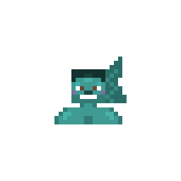{ .mod-icon }

*Half giant and half fishman: a giant's body, strength and techniques, a fishman's breath and karate, and the gift of their fish.*

| | |
|---|---|
| **Size** | 3.5, about 6.3 blocks high (slider 3.28 to 3.72) |
| **Sub-races** | seven fish species: Saw-shark, Ray, Garfish, Octopus, Whale Shark, Pufferfish, Hammerhead |
| **Passives** | Pride of Elbaf and Shoulder Carry (the giants'), Fishman Body, and their fish's own |
| **Techniques** | the giants' 6, and the base mod's whole Fishman Karate tree |
| **In the abilities menu** | 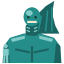{ .fruit-icon } their own category |

<!-- models -->

<figure markdown>
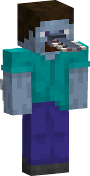
<figcaption>Saw-shark Wotan, size 3.5</figcaption>
</figure>

<figure markdown>
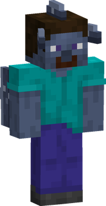
<figcaption>Ray Wotan, size 3.5</figcaption>
</figure>

<figure markdown>
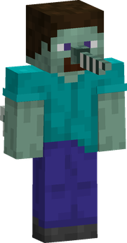
<figcaption>Garfish Wotan, size 3.5</figcaption>
</figure>

<figure markdown>
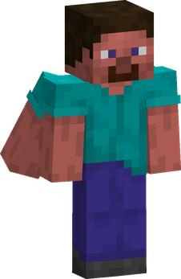
<figcaption>Octopus Wotan, size 3.5</figcaption>
</figure>

<figure markdown>
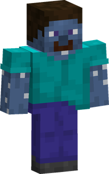
<figcaption>Whale Shark Wotan, size 3.5</figcaption>
</figure>

<figure markdown>
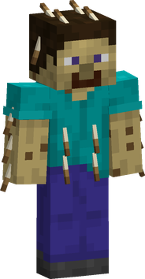
<figcaption>Pufferfish Wotan, size 3.5</figcaption>
</figure>

<figure markdown>
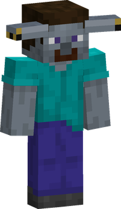
<figcaption>Hammerhead Wotan, size 3.5</figcaption>
</figure>

In 3D: drag to turn, scroll or pinch to zoom. The buttons switch between the seven species.

<!-- /models -->

Since 0.4.0 the Wotan is a race of its own in the character creator, no longer a sub-race of the [giants](giants.md). Of the giants he has everything: the body, the postures, the hands, the couch and the techniques. Of the [fishmen](fishmen.md) he has the breath, the karate and the species. His size is 3.5 times a man's (it was 2.5 as a giant's sub-race): reach, blows, health, strides and techniques all grow with it, through [AkumaLib](../../akumalib/index.md)'s size system.

<figure markdown>

<figcaption>Wotan, in the book</figcaption>
</figure>

<figure markdown>
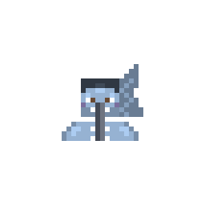
<figcaption>Saw-shark</figcaption>
</figure>

<figure markdown>
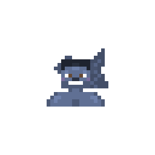
<figcaption>Ray</figcaption>
</figure>

<figure markdown>
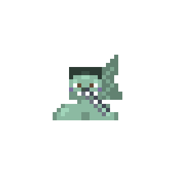
<figcaption>Garfish</figcaption>
</figure>

<figure markdown>
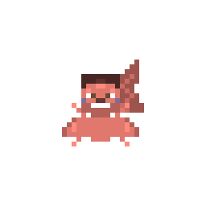
<figcaption>Octopus</figcaption>
</figure>

<figure markdown>
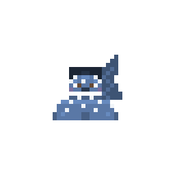
<figcaption>Whale Shark</figcaption>
</figure>

<figure markdown>
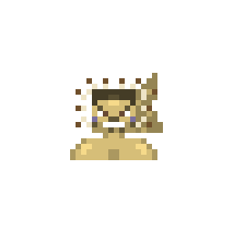
<figcaption>Pufferfish</figcaption>
</figure>

<figure markdown>
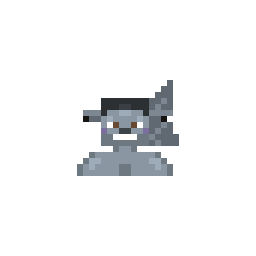
<figcaption>Hammerhead</figcaption>
</figure>

## Seven species { #species }

Each Wotan is of one fish: he wears that fishman's features and skin colour (on a giant's shoulders), and holds [Fishman Body](fishmen.md#fishman-body) and his fish's own passive, the same as the fishman of that species. All seven are at the Wotan's size, 3.5: the Whale Shark Wotan is not bigger than the others, but he has the whale shark's broad chest.

| | Species | His fish's passive |
|---|---|---|
| { .fruit-icon } | **Saw-shark Wotan** | [Saw-shark Body](fishmen.md#saw-shark-body): +3 damage, bare fists may make the target bleed |
| { .fruit-icon } | **Ray Wotan** | [Ray Body](fishmen.md#ray-body): +1 toughness; bare-handed +2 damage, +25 % attack speed |
| { .fruit-icon } | **Garfish Wotan** | [Garfish Body](fishmen.md#garfish-body): swim x4 in all |
| { .fruit-icon } | **Octopus Wotan** | [Octopus Body](fishmen.md#octopus-body): +30 % attack speed, armed or not |
| { .fruit-icon } | **Whale Shark Wotan** | [Whale Shark Body](fishmen.md#whale-shark-body): +2 toughness, +4 health |
| { .fruit-icon } | **Pufferfish Wotan** | [Pufferfish Body](fishmen.md#pufferfish-body): a close attacker takes 2, poisoned one time in four |
| { .fruit-icon } | **Hammerhead Wotan** | [Hammerhead Body](fishmen.md#hammerhead-body): +2 damage, blows push 50 % further |

Each species' page in the book shows the giants' two passives, then Fishman Body, then its fish's own.

## A giant's body { #giant-body }

The Wotan counts as a giant for every rule of [the giants' page](giants.md#a-giant-in-a-human-world): he hunches under low roofs and goes on all fours under lower ones, breaks and places blocks by 3x3x3 (the **G** key for precision), walks through leaves, wades through water that leaves his eyes above it, sleeps on a couch of hay or wool, and reaches chests from outside. He steps a third of his height, about 2.1 blocks.

He holds the giants' passives, [Pride of Elbaf](giants.md#elbaf-pride) and [Shoulder Carry](giants.md#shoulder-carry), and their six techniques, at the same costs and in the same order: [Stomp](giants.md#stomp), [Giant's Grip](giants.md#giants-grip), [Boulder Throw](giants.md#boulder-throw), [Hakoku](giants.md#hakoku), [Elbaf Charge](giants.md#elbaf-charge) and [Roar of Elbaf](giants.md#elbaf-roar). The giants' page gives their figures for a body of size 1: a Wotan's grow with his size. Continent Puller stays the Ancient giants'.

## A fishman's karate { #fishman }

For the base mod the Wotan **counts as a fishman**: the whole Fishman Karate tree is his, as a fishman's. He swims fast and breathes and sees under water through [Fishman Body](fishmen.md#fishman-body), which a Devil Fruit user loses in the water, as a fishman does.

## From 0.3.0 { #from-030 }

- A player who was a Wotan in 0.3.0 (then a giant's sub-race) becomes a **Saw-shark Wotan**, with his techniques, his bar and his size slider.
- **Wotan Body** is gone: Fishman Body takes its place, and a world that held it holds Fishman Body.
- Servers: `giantsSelectable = false` ([configuration](configuration.md)) takes the Wotan out of the character creator with the giants. A player who is already one stays one.
