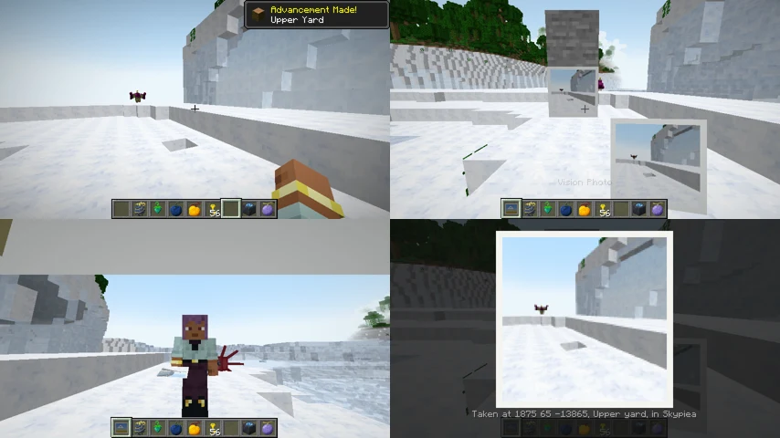

# Dials

Mine Mine no Mi already has eight dials: Axe, Breath, Eisen, Flame, Flash, Impact, Milky and Reject. Sky Island adds **the eight the base mod does not have**, in the base mod's own style — a shell you hold, or a shell you set down.

## What each one does

Five are **used in your hand**: right-click to use one, and it is gone. Sneak and right-click to set it down instead. Three are **set down** and work where they stand; they are never used up.

| Dial | How | What it does |
|---|---|---|
| **Lamp Dial** | set down | Light, as bright as a torch can be (level 15). |
| **Heat Dial** | used | Cooks **the whole stack of raw food in your other hand** at once. In a furnace it is a fuel that burns as long as a bucket of lava. |
| **Jet Dial** | used | **Throws you far along where you look.** Your next landing does you no harm, if it comes within ten seconds. |
| **Ball Dial** | used | **A ball of cloud under your feet**, 3 by 3, for five seconds. It stops a fall, and only fills air where you may build. |
| **Tone Dial** | set down | **An alarm**: it rings when a hostile mob or a player comes within 6 blocks. |
| **Water Dial** | used | **A jet of water**, 6 blocks long: it puts out the fire on you and the fire it meets, and pushes back whoever stands in it. Other players are pushed only where PvP is on. |
| **Flavor Dial** | set down | **Bait**: animals within 16 blocks come to it as they would to their food. Tamed animals are left alone. |
| **Vision Dial** | used | **A photo** of the place: see [the Vision Photo](#the-vision-photo) below. |

A used dial has a short rest (half a second) before the next.

## Where to find them

| Where | Which |
|---|---|
| **[Angel Beach](angel-islands.md#angel-beach)** | Washed up on the shore over time, with the base mod's dials and the conch. Lamp, Heat, Ball, Tone, Water and Flavor are about as common as one another; **Jet and Vision are rare** there. |
| **Skypiean merchants** and **waver dealers** | One or two of Lamp, Heat, Ball, Tone, Water and Flavor, five to ten of a kind, for **0.7 to 2 million extols** each. |
| **[The craftsman of a Birkan town](birka.md#a-town-the-lightning-spared)** | Always sixteen **Jet Dials** (2.5 to 3.5 million) and **Vision Dials** (2 to 3 million), beside his Flame and Impact Dials. |

None of the eight is in a chest. The base mod's dials are in chests all over Skypiea, and in the [Ordeals'](upper-yards.md#the-ordeals-of-gods-priests) rewards.

## The Vision Photo

<figure class="place" markdown>
{ target="_blank" title="Open the picture full size" }
<figcaption>A Vision Photo: in hand, in a frame, and full screen.</figcaption>
</figure>

Use a Vision Dial and you get a **Vision Photo**: **a picture of what you were looking at** — the world, without your hand or your hotbar. The photo also keeps **where it was taken**: its coordinates, its biome and its world, under its name.

- **Hold it** to see the picture in your hand.
- **Put it in an item frame** to hang it on a wall.
- **Right-click it** to see it full screen, the place written under it.

Every player sees the same picture, even after the photo changes hands: the world keeps it, as it keeps its maps (one small file a photo).

!!! note "For big servers"
    `vision_pictures = false` in the [configuration](configuration.md#angel_beach) turns the pictures off: a photo then keeps the place only, and nothing is sent or kept. Photos taken before keep their picture.
