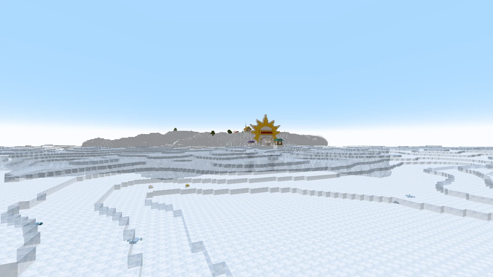
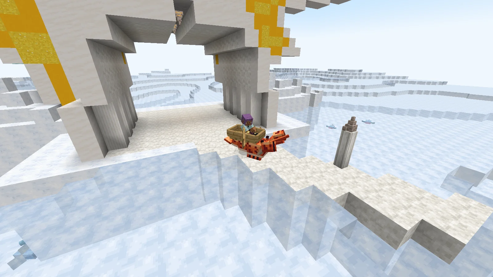
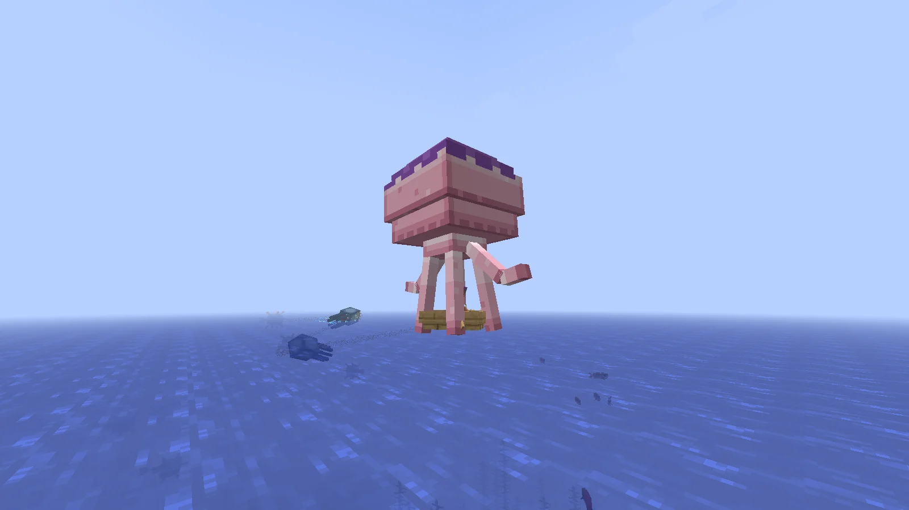

# Getting there and back

## The Knock-Up Stream

A **Knock-Up Stream** is a geyser on the floor of the **deep ocean**. There is one for every island in Skypiea, beside it below: a crater of dark prismarine and tuff round the **Knock-Up Core**.

```
/locate structure inosky:knock_up_stream
```

### An eruption

| Phase | Default | What happens |
|---|---|---|
| Quiet | the rest of the cycle | a bubble column marks the geyser |
| Charge | 30 seconds | bubbles and rumbling: the warning |
| Eruption | 90 seconds | the column rises to the sky |

A cycle lasts **ten minutes** by default, and each geyser is offset in it by its own position: two geysers rarely erupt at the same moment. All three lengths are in the [configuration](configuration.md).

The column lifts **whatever is caught in it**: players, mobs, dropped items, and **boats with everyone aboard**. At the top it sends them on to Skypiea. An eruption always lasts long enough to carry somebody from the sea floor to the top, whatever the configuration says.

### The arrival

<figure class="place" markdown>
[](places/cloud-sea.webp){ target="_blank" title="Open the picture full size" }
<figcaption>The cloud sea, and an island with its Heaven's Gate.</figcaption>
</figure>

You come down on the ground or on the cloud sea, **never inside a block**. On an island with a village, the geyser sets you down in front of its **[Heaven's Gate](angel-islands.md#heavens-gate)**; a boat arrives with its riders still in it.

### The express shrimp

<figure class="place" markdown>
[](places/express-shrimp.webp){ target="_blank" title="Open the picture full size" }
<figcaption>The express shrimp, a boat on its back.</figcaption>
</figure>

**Sail up to Heaven's Gate** in a boat with a player aboard, and **the express shrimp** comes up under it: it takes the boat on its back, carries it through the Gate's tunnel and along the causeway, and **sets it down on the sea by the island's seafront**, crew still aboard. It is free, as the Gate is. A boat still in the air from the geyser is not taken: let it settle on the cloud sea first.

## The way back

Step off an island and sink through the cloud sea. Below the bottom of Skypiea you **come out high above the same place in the overworld** — over the sea, since Skypiea only lies above the deep oceans.

- **Falling on your own**, you get slow falling long enough to land safely.
- **A boat comes back with its crew**, and falls. **Without a balloon octopus the landing is a hard one**: everyone aboard is hurt by how far the boat fell — half a point a block, about ninety points for the whole way home, armour counting — and the boat breaks and gives its item back.

The height of the fall back is `return_y` in the [configuration](configuration.md).

### The balloon octopus

<figure class="place" markdown>
[](places/balloon-octopus.webp){ target="_blank" title="Open the picture full size" }
<figcaption>A boat coming home under its octopus.</figcaption>
</figure>

**Click a boat with a balloon octopus** before you leave the sky: it takes hold of the boat, and when the boat falls it **swells and brings it down slowly** — six blocks a second — all the way to the Blue Sea. Nobody aboard is hurt.

- **One fall only**: the octopus lets go on landing, and is gone. One that never served (its boat lost on the way) gives itself back.
- A short drop — off a quay, off the shrimp's back — does not use it up.
- **Sold by the waver dealer** of an Angel Beach, two to four at a time, for 150,000 to 250,000 extols. It is in no chest.
- A player who leaves the game while the boat comes down, someone else still aboard, is **put back in the boat** on coming back — or let down slowly if the boat has landed meanwhile.

## For operators

| Command | What it does |
|---|---|
| `/geyser` | where the nearest geyser within 64 blocks is, what it is doing and when it erupts |
| `/geyser now` | makes that geyser erupt at once |

Server builders can also place a geyser of their own: the **Knock-Up Stream block**, on the [Configuration](configuration.md#for-server-builders) page.
