# Upper Yards

<figure class="place" markdown>
[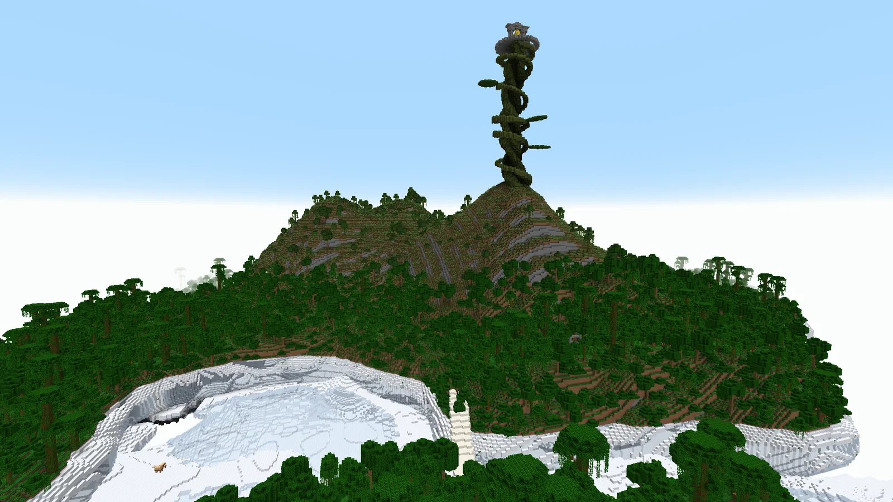](places/upper-yard.webp){ target="_blank" title="Open the picture full size" }
<figcaption>An Upper Yard: jungle, a massif, and the Giant Jack.</figcaption>
</figure>

One island in three is an **Upper Yard**: rarer and far larger than an Angel Island, made of the Blue Sea's earth — the **Vearth** the Skypieans revere. Jungle **plains** around y 100, and **massifs** of rock rising to about 215.

## The Giant Jack

<figure class="place" markdown>
[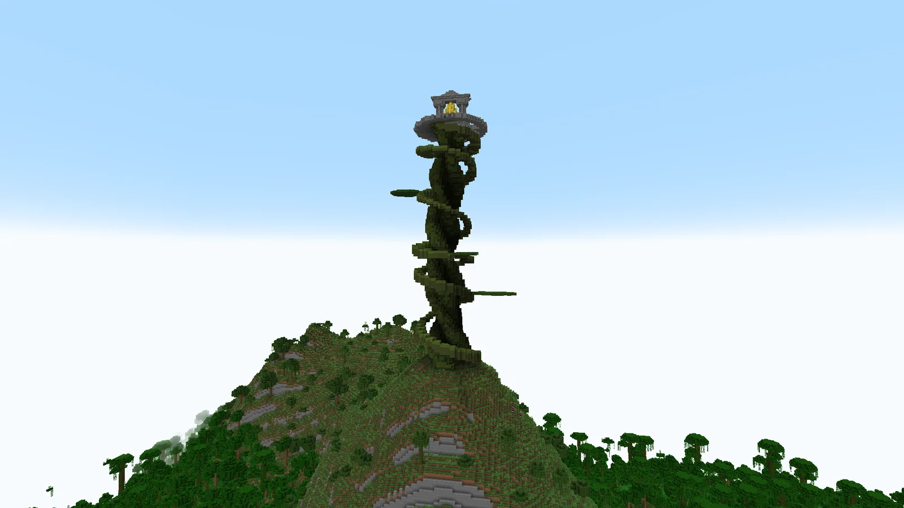](places/giant-jack.webp){ target="_blank" title="Open the picture full size" }
<figcaption>The Giant Jack, and the Golden Bell at its top.</figcaption>
</figure>

One Upper Yard in three has the **Giant Jack**: a beanstalk that towers over the island from its highest massif, **climbable all the way up** by a ramp around it. At the top hangs the **Golden Bell**, with a chest beneath it — **one or two boxes**, a **Golden Box** in about two chests in five.

### Ringing the Golden Bell

**Right-click the bell** to ring it: the whole island hears it. The first time you ring it, **the Shandias of that island make peace with you, for good** — whatever you looted before, and whatever you loot after. They no longer hunt you, but they still defend themselves if you strike them. The peace holds on that island only: every Upper Yard has its own bell.

## Shandora, the City of Gold

<figure class="place" markdown>
[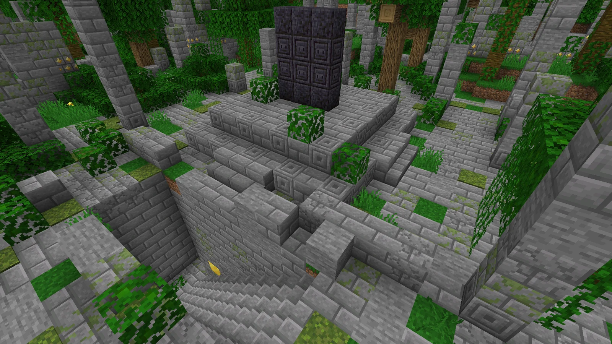](places/shandora.webp){ target="_blank" title="Open the picture full size" }
<figcaption>Shandora's square: the Poneglyph, over the crypt.</figcaption>
</figure>

A little over half of the Upper Yards hold the ruins of **Shandora**, sometimes beside a Giant Jack (never within reach of its stalk): a square, avenues, halls, a broken tower, the stepped temple with its altar, and under the square **the crypt beneath the Poneglyph**.

| Where | What it may hold |
|---|---|
| The halls | gold, common dials, extols; a box in one chest of fifty, never a golden one |
| The temple's altar | gold, diamonds, emeralds, rare dials; a box in one chest of ten |
| **The crypt** | **the treasure**: gold, diamonds, netherite, very rare items, a heavy extol pouch — a box in four chests of ten, golden one time in five |

A whole city gives about one box, and a golden one in about one city of six. The walls are inlaid with **gilded stone bricks**; the gold itself is in the crypt.

**Small ruins of Shandora** lie in the jungle too, one to three per Upper Yard: a forgotten altar, a colonnade, a fallen house, a sacred well. Brush the gravel between their paving stones: it may hide a **pottery sherd** of Shandora, or gold.

### The golden Shandora

<figure class="place" markdown>
[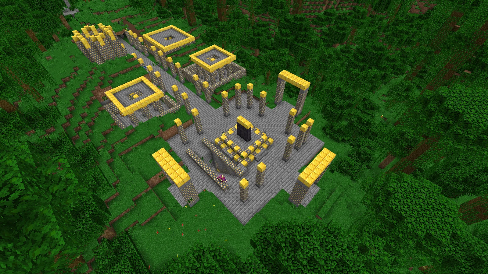](places/golden-shandora.webp){ target="_blank" title="Open the picture full size" }
<figcaption>The golden Shandora's square: its gilded pillars, whole.</figcaption>
</figure>

**One Shandora in twenty stands whole, all in gold**, as it was before it was lost: the same city, but every hall, tower and avenue standing, gilded, with no moss, no crack and no tree inside. It is guarded by more Shandias than the ruins, the square most of all.

Its chests are another matter:

| Where | What it may hold |
|---|---|
| **The golden halls** | gold ingots and blocks, diamonds, emeralds, a dial, a pouch of extol every time; **a box in one chest in two** |
| **The temple's altar** | a box every time — golden in two chests in five — gold, diamonds, netherite scrap, a rare dial or an enchanted golden apple now and then |
| **The crypt** | **two boxes every time**, a golden one in one chest in two; a hoard of gold, diamonds and netherite; always one very rare thing (an enchanted golden apple, a totem, a Flame, Impact or Reject Dial); 2 to 5 million extols |

## The Shandias

The warriors of Shandora, and their chief, guarding their land. **They attack only looters**: leave their chests shut and they leave you alone.

<figure markdown>
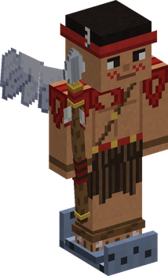
<figcaption>A warrior with his spear (one of six looks)</figcaption>
</figure>

<figure markdown>
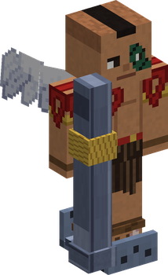
<figcaption>The chief with the burn bazooka</figcaption>
</figure>

In 3D: drag to turn, scroll or pinch to zoom; the buttons change the look. The warrior is shown with the spear, the commonest of his six weapons.

- Their skills, from dials: the burn bazooka, impact, a breath dash, a sky step, and the chief's reject.
- Their arrows and bullets pass through other Shandias: they never hit their own.

A warrior carries **one of six weapons**; the chief keeps the bazooka.

| Weapon | How it fights |
|---|---|
| **Shandia spear** (the commonest) | hand to hand, with an impact dial |
| **Shandia bow** | keeps its distance (16 blocks); flame arrows, volleys |
| **Twin pistols** | keeps its distance (10 blocks), two bullets at a time; sidesteps |
| **Rifle** | from far away (24 blocks): **aims for a second and a half** — you see its line of sight — then fires a precise shot |
| **Shandia shield** and spear | guards its front and walks ahead of the others; bashes with the shield, and can send projectiles back |
| **Burn bazooka** | the burn bazooka's blast |

Warriors never drop their weapons. Four of them are items of this mod: see [their weapons in your hands](#the-shandias-weapons-in-your-hands).
- Few of them at a time: a chief and a warrior on Shandora's square, one in the temple, one in the tower.

## The Shandias' weapons in your hands

The spear, the bazooka and the shield have a 3D model of their own: turn them (drag), zoom (scroll or pinch), and change with the buttons.

| Weapon | In a player's hands | Where it comes from |
|---|---|---|
| 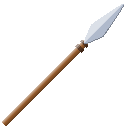{ .item-icon }**Shandia Spear** | A real weapon: it hits like an iron sword (6 attack damage) but a little slower, lasts as long (250 uses), and takes a sword's enchantments. An anvil mends it with iron ingots. | The chests of the [Shandia camps](#shandia-camps): about one chest in three holds one. |
| 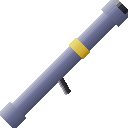{ .item-icon }**Burn Bazooka** | A trophy: the jet of fire is the Shandias' own skill, and the item does nothing when used. Held up in both hands. One per slot. | The same chests, rarely: about one in twelve. |
| 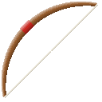{ .item-icon }**Shandia Bow** | A bow like any other: draw it and shoot arrows. 384 uses. | Not found in survival in this version: the creative tab only. The camp chests hold an ordinary bow now and then. |
| { .item-icon }**Shandia Shield** | A round shield in the Shandias' red, gold and black: raise it to block, and an axe disables it, as any shield. 336 uses. | Not found in survival in this version: the creative tab only. |

## Shandia camps

<figure class="place" markdown>
[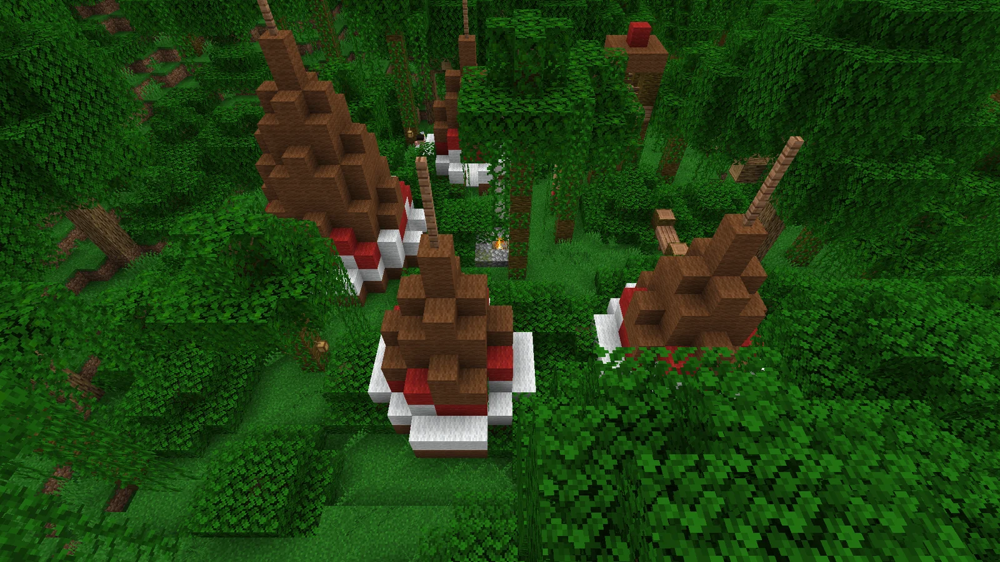](places/shandia-camp.webp){ target="_blank" title="Open the picture full size" }
<figcaption>A war camp: tipis round a fire.</figcaption>
</figure>

**War camps**: two to four per Upper Yard wherever it has the clearings, in clearings of the plains, away from the city, the Giant Jack and the ruins. Four tipis round a fire, a totem, a weapon rack and a lookout, with two warriors.

**The hidden village**: the Shandias' own village, in a **pocket of cloud on the sea at the island's foot**, its only opening facing the sea. Six tipis round a square, the **statue of Kalgara**, totems along the path, and the chief by the fire.

There is **a chest in every tipi**: weapons, war dials, gold and emeralds, an extol pouch, food and arrows — and now and then a Wooden or an Iron Box.

## Sacrificial altars

**Two or three altars** stand in clearings of an Upper Yard's jungle: a small court of stone, a table of offerings between two urns of Vearth, two braziers and a gate. A few gilded slabs leave each altar towards the next: **a trail** that ends at the City of Gold — or at the Giant Jack, or at the great altar, on an island with no city.

The offerings are modest: Vearth, gold nuggets, fruit, now and then a pouch of extol, never a box. They belong to the Shandias: take them with warriors nearby, and they turn on you.

**The great Sacrificial Altar** stands on about one Upper Yard in three, in the middle of **a lake of cloud with no bridge**. Sky sharks guard the lake. A great stair rises to the offerings on top: gold, extol, fruit, and a box in about one chest in two.

## The Sanctuary of God

<figure class="place" markdown>
[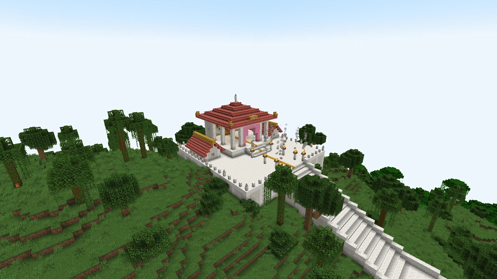](places/sanctuary.webp){ target="_blank" title="Open the picture full size" }
<figcaption>The Sanctuary of God.</figcaption>
</figure>

On the summit of an Upper Yard that has neither a Giant Jack nor the City of Gold — a little over one island in four — stands **Enel's residence**: a great stair of cloud up the flank, an esplanade, the hall with the red roof, the throne and its ring of **Thunder Drums**.

- **Four divine soldiers** keep it, and their commander, the **Divine Soldier Commander**, a mountain of a man with three announced attacks. They fight empty-handed with their dials — the Axe Dial's blade, the Flash Dial that blinds whoever looks at it, the Breath Dial's gust, skates under their feet — and **attack on sight**.
- **The treasure** lies at the foot of the throne, as rich as the chest under the Golden Bell: one or two boxes every time, gold, a heavy pouch of extol, dials.
- Now and then **a patrol** of two or three divine soldiers walks the jungle.

## The Ordeals of God's priests

Four challenges of Mine Mine no Mi's **challenges menu**, under a category of their own, **God's Priests**, each in a Standard and a Hard version. An Ordeal is **learnt in Skypiea only, from its stele**: a paved enclosure of stone on the plains, four pillars that bear the Ordeal's mark, and a great poneglyph at its middle to rub with paper.

**An Upper Yard has the steles of two of the four Ordeals**: the others are on other islands.

<figure class="place" markdown>
[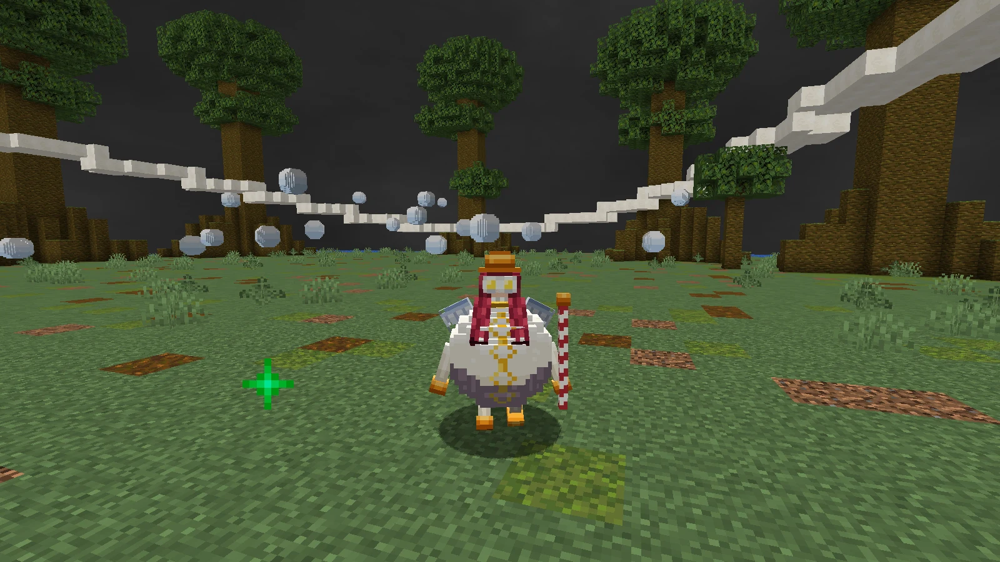](places/ordeal-balls.webp){ target="_blank" title="Open the picture full size" }
<figcaption>Balls: Satori's forest of Surprise Clouds.</figcaption>
</figure>

<figure class="place" markdown>
[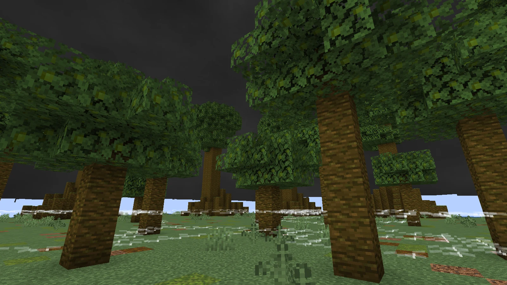](places/ordeal-string.webp){ target="_blank" title="Open the picture full size" }
<figcaption>String: Shura's forest of String Cloud.</figcaption>
</figure>

<figure class="place" markdown>
[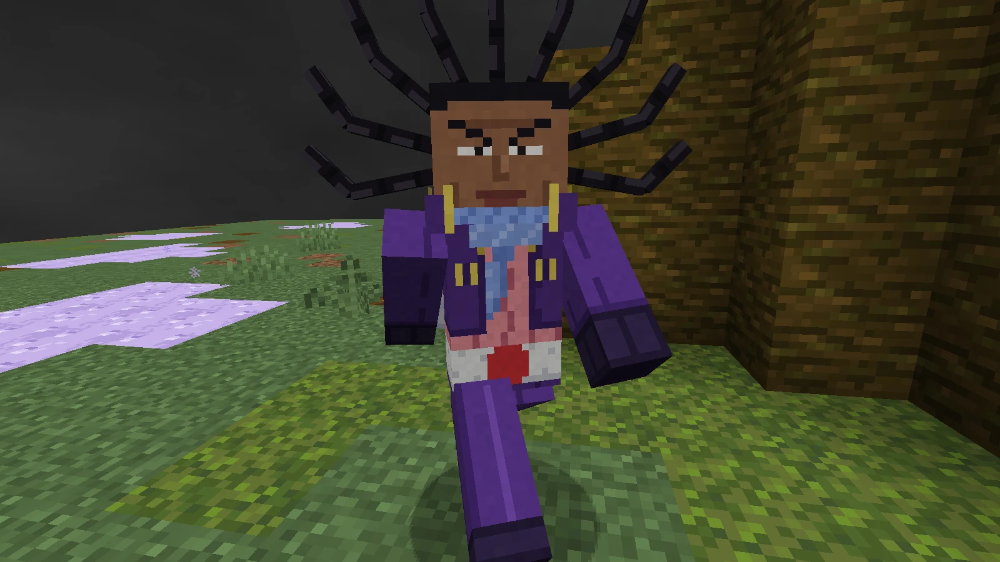](places/ordeal-swamp.webp){ target="_blank" title="Open the picture full size" }
<figcaption>Swamp: Gedatsu's arena of Swamp Cloud.</figcaption>
</figure>

<figure class="place" markdown>
[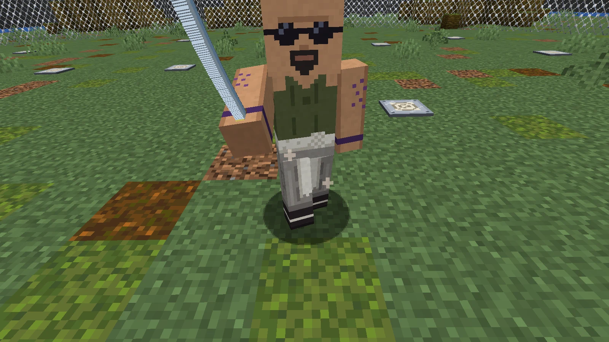](places/ordeal-iron.webp){ target="_blank" title="Open the picture full size" }
<figcaption>Iron: Ohm's Iron Cloud.</figcaption>
</figure>

| Ordeal | Its stele | The fight |
|---|---|---|
| **Balls** — Satori | a ball of cloud on each pillar | a forest of **Surprise Clouds**; Satori keeps away and sends his clouds at you, then calls the **Ball Dragon** |
| **String** — Shura | chains from pillar to pillar | a forest strung with **String Cloud** that slows, then binds; Shura dives on his bird Fuza with his **Heat Javelin** |
| **Swamp** — Gedatsu | puddles of lilac cloud at the pillars' feet | an arena pitted with **Swamp Cloud** you sink in; his **Jet Punch** from afar |
| **Iron** — Ohm | crowns of barbed wire on the pillars | the **Iron Cloud**, and his giant dog **Holy** |

A win pays as the base mod's challenges do, and now and then a dial: Impact, Breath or Flame from Satori, Axe, Breath or Flame from Shura, Milky or Breath from Gedatsu, Eisen or Milky from Ohm — more often in Hard, where an **ancient manual** may come too. The first Standard win opens the Hard version.

The priests' own weapons, Shura's **Heat Javelin** and Ohm's **Eisen Whip**, are never dropped: they are in the creative tab only.

| Weapon | In a player's hands |
|---|---|
| 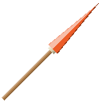{ .item-icon }**Heat Javelin** | A lance that hits harder than an iron sword (7) but slower, and **sets what it strikes on fire** for four seconds. It does not burn. |
| 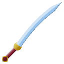{ .item-icon }**Eisen Whip** | A sword like an iron one (6), a little quicker. The blade of Iron Cloud that runs out a dozen blocks is Ohm's own. |

### Enel's Ordeal

<figure class="place" markdown>
[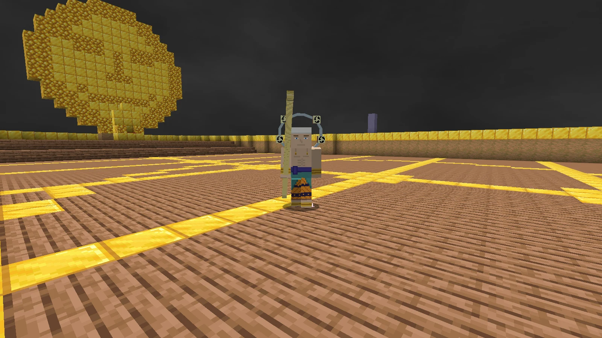](places/ordeal-enel.webp){ target="_blank" title="Open the picture full size" }
<figcaption>Enel, on the deck of the Ark Maxim.</figcaption>
</figure>

**Beat the four priests** — their Standard Ordeals — and **God himself** waits for you: the last Ordeal opens in the challenges menu, with no stele to find. You fight him on **the deck of the Ark Maxim**, his flying ark, among its bars and plates of gold, his golden throne at the bow.

- **His body is lightning: a blow goes through him.** It reaches him only with **Busoshoku Haki** (imbued or hardened), a **seastone** weapon, rubber, or what passes through a Logia — or **when he glows**: after each of his great attacks he is solid for a few seconds, and anything hits.
- **Every attack shows where it will land** before it falls: El Thor's pillar of lightning, Sango's line, the gold he lights under your feet. From two thirds of his health he beats his drums: **Hino**, **Kiten** that hunts you, and **Julungul**.
- **In his last third, Raigo** gathers over the Ark: a countdown, ninety seconds in Standard, sixty in Hard. Beat him before it falls — **it destroys everything on the deck**.
- **In Hard** he is twice as tough and hits harder, and in his last third he takes the form of **Amaru**, the giant.

His first defeat gives you his golden staff, the **Nonosama Bo**, beside a challenge's own payout, four times a priest's.

## The great serpent

<figure class="place" markdown>
[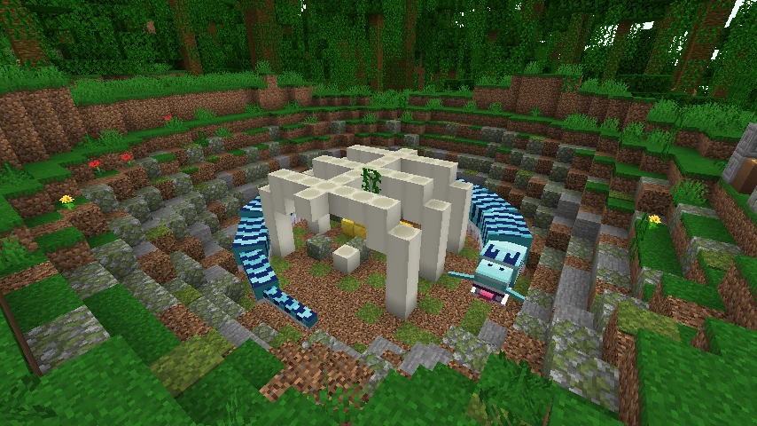](places/serpent-lair.webp){ target="_blank" title="Open the picture full size" }
<figcaption>The great serpent in its lair.</figcaption>
</figure>

About **one Upper Yard in four** hides the lair of **the great serpent**: a stepped pit in the jungle, thirty blocks across, a carcass of one of its kind at the bottom — and the treasure under its ribs. The serpent lies coiled round it, and never strays far.

- **400 health**, armoured, and long: hit any part of its body. Touching its coils crushes and slows you.
- **It swallows you whole.** Inside, you lose health every second; **strike it** — from inside, or have a friend strike it from outside — and it spits you out. It does so on its own after eight seconds, and cannot swallow again for a while.
- **It never comes back**: there is one in each lair, and once killed it is gone. It drops **two Great Serpent Fangs**, a trophy.
- **The lair's chest**: a Golden Box every time and another box, gold, diamonds, netherite scrap, always one very rare thing, 1 to 3 million extols, and a sherd now and then.

## Predators

The Upper Yards are hunting ground for three beasts: the **Cloud Wolf**, the **Sky Shark** and the **Sky Lamprey**. They are on the [Wildlife](wildlife.md#the-predators-of-the-upper-yards) page.
