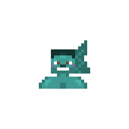
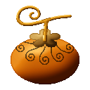
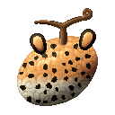
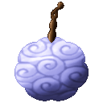
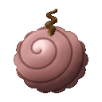
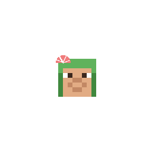

---
tags:
  - new
  - news
  - release
---

# What's new

The pages each release added or changed, newest first. What every release does, in full: the changelog of each mod.

## 2026-11-09: AkumaLib 6.6.0, Awaken Awaken no Mi 3.0.2 { #2026-11-09 }

Awaken Awaken no Mi 3.0.2 needs AkumaLib 6.6.0 and Forge 47.4.2. The network protocol is still 17, as in 6.4.0 and 6.5.0.

### Awaken Awaken no Mi 3.0.2

[Changelog](mods/awaken-awaken-no-mi/changelog.md#v3-0-2)

- **Gear Fifth**: the posed legs and arms stay white during Geppo, and running in the air no longer kicks you from a server where flying is off
- **The awakened human form** is drawn at your own size, with what other mods add to players
- **Starts beside other mods**: Neko Neko no Mi: Leopard Reworked no longer stops the game at start-up
- Fixes for dislocated arms, Flattened, Invisible Touch in singleplayer, and 46 names that showed as raw text

### AkumaLib 6.6.0

[Changelog](akumalib/changelog.md#v6-6-0)

- **Armament Haki on posed limbs** in a form that keeps your own body (Gear Fifth during Geppo, Kamisori, Kamie)
- **`/akumalib faction`** for operators: a player's strikes, highest bounty, prison time and fading bounty
- For addon makers: [first-person gestures](akumalib/animations/first-person-limbs.md#gestures-in-first-person-armgestures), `PoseAnimation`, `ModeTooltips`, [`AkumaMotion.shoveAway`](akumalib/utilities/motion.md#away-from-the-user), `AkumaSize.damageOf` / `hurtOf`

## 2026-11-08: Cruise Cruise no Mi 0.7.0, Sky Island 1.0.2 { #2026-11-08-cruise-sky }

Both need AkumaLib 6.5.0 and Forge 47.4.2. Cruise 0.7.0 has a new network protocol (57): update the server and every player together.

### Cruise Cruise no Mi 0.7.0 (beta)

[Changelog](mods/cruise/changelog.md#v0-7-0)

- **[Villages grow into towns](mods/cruise/villages.md#prosperity-a-village-grows)**: a prosperity in four steps, gifts at the town hall, buildings that rise before your eyes, walls, and a town that falls back
- **[A village defends itself](mods/cruise/villages.md#a-village-defends-itself)**: guards of its own, Marines who land to help, villagers who run
- **[Village killers are hunted](mods/cruise/villages.md#village-killers-are-hunted)**: a bounty that doubles, towns closed for 30 days, bounty hunters or a vice admiral at dusk
- **[A dead village lives again](mods/cruise/villages.md#a-dead-village-lives-again)**: with time, paid for at its board, or with the Carpenter's repopulation plan
- **[The colosseum's six grounds](mods/cruise/towns.md#the-six-grounds)**: sand, ship deck, jungle islet, glacier, volcano, ruins; one full prize a week across towns
- **[20 new traits](mods/cruise/traits.md#traits-of-the-races)**: 15 of the races, 5 of the sky with Sky Island
- **Townsfolk**: six faces for each kind of villager; modified humans turned away ([Villages](mods/cruise/villages.md#the-people))
- **[Commands for operators](mods/cruise/villages.md#commands-for-operators)**: `/cruise village`, `bank`, `prices`, `trade`, `collection`, `clock`, `arena`
- **Trades rebalanced**: talent webs, techniques and recipes on every [trade's page](mods/cruise/trades-and-levels.md); Merchant XP, tournament medals, events told within 1 000 blocks
- **[World settings per world](mods/cruise/configuration.md)**: moved to `serverconfig/inocruise-server.toml`, with the new prosperity, punishment, defence and revival options

### Sky Island 1.0.2

[Changelog](mods/sky-island/changelog.md#v1-0-2)

- **Marines, bounty hunters and revolutionaries fight back** at Skypiea: the [divine soldiers](mods/sky-island/upper-yards.md#the-sanctuary-of-god) are bandits now
- **The item tag `inosky:dials`**: every dial, for other mods ([Compatibility](mods/sky-island/index.md#compatibility))

## 2026-11-08: AkumaLib 6.5.0, Missing Missing no Mi 7.1.0, Race Race no Mi 0.4.0 { #2026-11-08 }

Race Race no Mi 0.4.0 needs AkumaLib 6.5.0. The network protocol is still 17, as in 6.4.0.

### Missing Missing no Mi 7.1.0

[Changelog](mods/missing-missing-no-mi/changelog.md#v7-1-0)

**Six fruits made new**, with their in-game animations:
[Hobi](mods/missing-missing-no-mi/fruits/hobi-hobi-no-mi.md),
[Ton](mods/missing-missing-no-mi/fruits/ton-ton-no-mi.md),
[Ato](mods/missing-missing-no-mi/fruits/ato-ato-no-mi.md),
[Nui](mods/missing-missing-no-mi/fruits/nui-nui-no-mi.md),
[Mushi Mushi, Model: Suzumebachi](mods/missing-missing-no-mi/fruits/mushi-mushi-no-mi-model-suzumebachi.md) and
[Mushi Mushi, Model: Kabutomushi](mods/missing-missing-no-mi/fruits/mushi-mushi-no-mi-model-kabutomushi.md).

**The [Kote Kote no Mi](mods/missing-missing-no-mi/fruits/kote-kote-no-mi.md) rebuilt**: the rule of two hands, [Gauntlet Hammer](mods/missing-missing-no-mi/fruits/kote-kote-no-mi.md#gauntlet-hammer), and three Alt modes (Gauntlet Rush, Gauntlet Boulder, Lightning Catch). Every value on the [All abilities](mods/missing-missing-no-mi/all-abilities.md) table.

### Race Race no Mi 0.4.0 (beta)

[Changelog](mods/race-race-no-mi/changelog.md#v0-4-0)

- { .fruit-icon } **The [Wotan](mods/race-race-no-mi/wotan.md) is a race of its own**: a giant's body, a fishman's karate, seven fish species
- { .fruit-icon } **Four new [fishmen](mods/race-race-no-mi/fishmen.md)**: [Octopus](mods/race-race-no-mi/fishmen.md#octopus-body), [Whale Shark](mods/race-race-no-mi/fishmen.md#whale-shark-body), [Pufferfish](mods/race-race-no-mi/fishmen.md#pufferfish-body), [Hammerhead](mods/race-race-no-mi/fishmen.md#hammerhead-body)
- { .fruit-icon } **Merfolk**: [Merman Combat: Ultramarine](mods/race-race-no-mi/merfolk.md#ultramarine)
- { .fruit-icon } **[Tontatta](mods/race-race-no-mi/tontatta.md#tontatta-strength)**: they fly as high as a man, and jump as high as they hold the key

### AkumaLib 6.5.0

[Changelog](akumalib/changelog.md#v6-5-0) ·
[Lower NPC bounties](akumalib/utilities/base-mod-fixes.md#lower-npc-bounties) (`bountyMultiplierNpc`, 0.1 by default) ·
[Four fishman looks](akumalib/utilities/races.md#fishman-features) ·
[Size defect 82](akumalib/utilities/size-defects.md) (a small body flies as high as a man)

## 2026-11-06: AkumaLib 6.4.0, Missing Missing no Mi 7.0.0, Race Race no Mi 0.3.0 { #2026-11-06 }

AkumaLib 6.4.0 has a new network protocol: update the server and every player together. Forge 47.4.2 or newer.

### Missing Missing no Mi 7.0.0

[Changelog](mods/missing-missing-no-mi/changelog.md#v7-0-0)

**Four new fruits:**

- { .fruit-icon } [Inu Inu no Mi, Model: Okuchi no Makami](mods/missing-missing-no-mi/fruits/inu-inu-no-mi-model-okuchi-no-makami.md), the wolf god of ice
- { .fruit-icon } [Neko Neko no Mi, Model: Cheetah](mods/missing-missing-no-mi/fruits/neko-neko-no-mi-model-cheetah.md), the fastest cat
- { .fruit-icon } [Nemu Nemu no Mi](mods/missing-missing-no-mi/fruits/nemu-nemu-no-mi.md), sleep and memories
- { .fruit-icon } [Shari Shari no Mi](mods/missing-missing-no-mi/fruits/shari-shari-no-mi.md), wheels

**New models, gestures and particles** (see each page's "Animations"):
[Uta](mods/missing-missing-no-mi/fruits/uta-uta-no-mi.md),
[Buku](mods/missing-missing-no-mi/fruits/buku-buku-no-mi.md),
[Wapu](mods/missing-missing-no-mi/fruits/wapu-wapu-no-mi.md),
[Bisu](mods/missing-missing-no-mi/fruits/bisu-bisu-no-mi.md),
[Gasha](mods/missing-missing-no-mi/fruits/gasha-gasha-no-mi.md),
[Moa](mods/missing-missing-no-mi/fruits/moa-moa-no-mi.md),
[Choki](mods/missing-missing-no-mi/fruits/choki-choki-no-mi.md),
[Buki](mods/missing-missing-no-mi/fruits/buki-buki-no-mi.md),
[Giro](mods/missing-missing-no-mi/fruits/giro-giro-no-mi.md),
[Bata](mods/missing-missing-no-mi/fruits/bata-bata-no-mi.md),
[Ami](mods/missing-missing-no-mi/fruits/ami-ami-no-mi.md),
[Kama](mods/missing-missing-no-mi/fruits/kama-kama-no-mi.md),
[Ishi](mods/missing-missing-no-mi/fruits/ishi-ishi-no-mi.md),
[Numa](mods/missing-missing-no-mi/fruits/numa-numa-no-mi.md),
[Inu Inu, Model: Wolf](mods/missing-missing-no-mi/fruits/inu-inu-no-mi-model-wolf.md),
[Tori Tori, Model: Falcon](mods/missing-missing-no-mi/fruits/tori-tori-no-mi-model-falcon.md) and
[Soru's homies](mods/missing-missing-no-mi/fruits/soru-soru-no-mi.md).

**New techniques or fairer numbers** on the same fruits and on [Mochi](mods/missing-missing-no-mi/fruits/mochi-mochi-no-mi.md); every value on the [All abilities](mods/missing-missing-no-mi/all-abilities.md) table.

### Race Race no Mi 0.3.0 (beta)

[Changelog](mods/race-race-no-mi/changelog.md#v0-3-0)

**Three new races:**

- { .fruit-icon } [Buccaneers](mods/race-race-no-mi/buccaneers.md), with three busts
- { .fruit-icon } [Merfolk](mods/race-race-no-mi/merfolk.md), a fish tail in the water
- { .fruit-icon } [Modified Humans](mods/race-race-no-mi/modified-humans.md), with the five Raid Suits of Germa 66

**Two more techniques** for the [Oni](mods/race-race-no-mi/oni.md#demon-sweep), the [Tontatta](mods/race-race-no-mi/tontatta.md#ant-burden) and the [Lunarians](mods/race-race-no-mi/lunarians.md#wing-gust).
**Giants**: [Shoulder Carry and higher steps](mods/race-race-no-mi/giants.md#shoulder-carry), the Ancient Giant's 5x5x5.
**New pages**: [compare the races](mods/race-race-no-mi/index.md#compare) and [every technique in one table](mods/race-race-no-mi/all-techniques.md).

### AkumaLib 6.4.0, for addon makers

[Changelog](akumalib/changelog.md#v6-4-0) ·
[A choice screen: `ChoiceScreens`](akumalib/utilities/screens.md#a-choice-screen-choicescreens) ·
[Merfolk tails](akumalib/utilities/races.md#merfolk-a-tail-in-the-water-legs-on-land) ·
[A chest that flares](akumalib/utilities/races.md#body-shape) ·
[Size defects 77 to 81](akumalib/utilities/size-defects.md)
